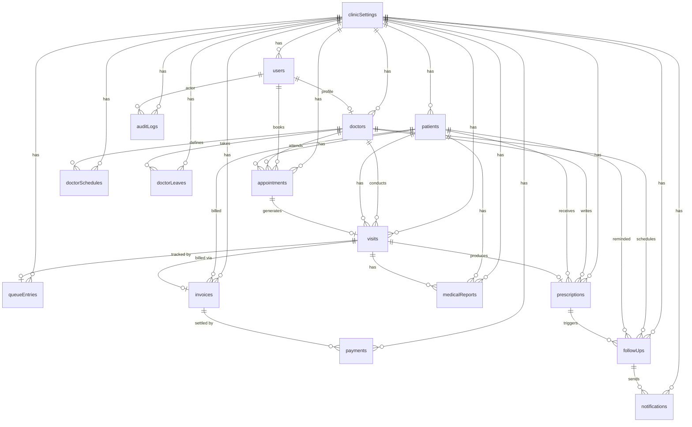

# 02 — Database Architecture
## Smart OPD — MERN-Stack Clinic Management Platform

> **Tech Stack:** MongoDB 7.x · Mongoose 8.x · Node.js 20.x  
> **Multi-Tenancy Model:** Every document carries a `clinicId` field (ObjectId ref → `clinicSettings`) as a logical tenant boundary.  
> **Last Updated:** 2026-11-11  
> **Version:** 1.0.0

---

## Table of Contents

1. [Overview & Design Philosophy](#1-overview--design-philosophy)
2. [Overall ERD Diagram](#2-overall-erd-diagram)
3. [Data Flow Overview](#3-data-flow-overview)
4. [Collection Reference](#4-collection-reference)
   - 4.1 [users](#41-users)
   - 4.2 [clinicSettings](#42-clinicsettings)
   - 4.3 [doctors](#43-doctors)
   - 4.4 [patients](#44-patients)
   - 4.5 [appointments](#45-appointments)
   - 4.6 [doctorSchedules](#46-doctorschedules)
   - 4.7 [doctorLeaves](#47-doctorleaves)
   - 4.8 [visits](#48-visits)
   - 4.9 [queueEntries](#49-queueentries)
   - 4.10 [prescriptions](#410-prescriptions)
   - 4.11 [medicalReports](#411-medicalreports)
   - 4.12 [invoices](#412-invoices)
   - 4.13 [payments](#413-payments)
   - 4.14 [followUps](#414-followups)
   - 4.15 [notifications](#415-notifications)
   - 4.16 [auditLogs](#416-auditlogs)
5. [Indexing Strategy Summary](#5-indexing-strategy-summary)
6. [Transaction Usage Guidelines](#6-transaction-usage-guidelines)
7. [Data Retention & Archiving Policy](#7-data-retention--archiving-policy)
8. [Backup Strategy Recommendations](#8-backup-strategy-recommendations)

---

## 1. Overview & Design Philosophy

### 1.1 Core Principles

| Principle | Implementation |
|-----------|---------------|
| **Multi-tenancy** | Every document has `clinicId` as first field; all queries filter on it |
| **Soft Deletes** | Sensitive records use `isDeleted: boolean` + `deletedAt` instead of hard delete |
| **Audit-first** | Write operations on patient/billing data always emit an `auditLog` entry |
| **Denormalisation** | Frequently-read snapshots (patient name, doctor name) stored inline to avoid expensive joins |
| **Schema versioning** | `__v` Mongoose default retained; `schemaVersion` field added for manual migrations |
| **UTC timestamps** | All dates stored as UTC; time-zone conversion handled at the API layer |

### 1.2 Naming Conventions

- **Collections:** camelCase plural nouns (`queueEntries`, `auditLogs`)
- **Fields:** camelCase; booleans prefixed with `is` / `has` (`isActive`, `hasInsurance`)
- **Foreign keys:** `{entity}Id` → ObjectId (`doctorId`, `patientId`, `clinicId`)
- **Timestamps:** Mongoose `timestamps: true` on all collections (`createdAt`, `updatedAt`)
- **Enums:** UPPER_SNAKE_CASE strings stored as lowercase in DB for portability

### 1.3 Connection & Configuration

```typescript
// mongoose.config.ts
import mongoose from 'mongoose';

const MONGO_OPTIONS: mongoose.ConnectOptions = {
  maxPoolSize: 20,
  minPoolSize: 5,
  serverSelectionTimeoutMS: 5000,
  socketTimeoutMS: 45000,
  family: 4,
};

export const connectDB = async () => {
  await mongoose.connect(process.env.MONGODB_URI!, MONGO_OPTIONS);
};
```

---

## 2. Overall ERD Diagram



---

## 3. Data Flow Overview

### 3.1 Core OPD Workflow

```
[Patient] ──books──► [Appointment]
                           │
                     Check-In (Receptionist)
                           │
                           ▼
                       [Visit]  ◄──────────────────────────────────────────┐
                           │                                               │
              ┌────────────┴────────────┐                                  │
              ▼                         ▼                                  │
        [QueueEntry]            [MedicalReport uploaded]                   │
              │                                                            │
        Doctor calls token                                                 │
              │                                                            │
              ▼                                                            │
     [Consultation begins]                                                 │
              │                                                            │
    ┌─────────┴──────────┐                                                │
    ▼                    ▼                                                 │
[Prescription]      [Visit updated: notes, diagnosis]                      │
    │                                                                      │
    ▼                                                                      │
[FollowUp] ──triggers──► [Notification (email/SMS)]                        │
                                                                           │
[Invoice] ◄──────────── (auto-created from Visit)                         │
    │                                                                      │
    ▼                                                                      │
[Payment] ──────────────── marks Invoice PAID ─────────────────────────── ┘
```

### 3.2 Workflow State Machines

#### Appointment States
```
PENDING ──confirm──► CONFIRMED ──check-in──► CHECKED_IN ──complete──► COMPLETED
   │                     │                                                │
   └──cancel──► CANCELLED └──no-show──► NO_SHOW                RESCHEDULED (new appt)
```

#### Queue States
```
WAITING ──call──► IN_PROGRESS ──complete──► COMPLETED
    │                                           │
    └──skip──► SKIPPED                   (Visit updated)
```

#### Invoice States
```
DRAFT ──finalize──► PENDING ──partial-pay──► PARTIAL ──full-pay──► PAID
                       │                                            │
                       └──void──► VOID                       REFUNDED (partial)
```

### 3.3 Real-Time Queue Events (Socket.IO)

```
Server emits to room `clinic:{clinicId}:queue`:
  - queue:token_called  { visitId, tokenNumber, patientName, doctorId }
  - queue:status_change { queueEntryId, newStatus }
  - queue:new_entry     { queueEntryId, tokenNumber, patientName }
```

---

## 4. Collection Reference

---

### 4.1 `users`

#### Purpose
Central authentication and identity store. Shared across all roles (`admin`, `doctor`, `receptionist`, `patient`). Role-specific profile data lives in separate collections (`doctors`, `patients`). Supports Google OAuth and email/password.

#### Mongoose Schema

```typescript
import { Schema, model, Document, Types } from 'mongoose';
import bcrypt from 'bcryptjs';

interface IUser extends Document {
  clinicId: Types.ObjectId;
  email: string;
  passwordHash: string;
  role: 'admin' | 'doctor' | 'receptionist' | 'patient';
  firstName: string;
  lastName: string;
  phone?: string;
  avatar?: string;
  googleId?: string;
  isActive: boolean;
  isEmailVerified: boolean;
  emailVerificationToken?: string;
  passwordResetToken?: string;
  passwordResetExpires?: Date;
  lastLoginAt?: Date;
  twoFactorEnabled: boolean;
  twoFactorSecret?: string;
  refreshTokens: string[];
  loginAttempts: number;
  lockUntil?: Date;
  schemaVersion: number;
}

const UserSchema = new Schema<IUser>({
  clinicId:               { type: Schema.Types.ObjectId, ref: 'ClinicSettings', required: true, index: true },
  email:                  { type: String, required: true, lowercase: true, trim: true },
  passwordHash:           { type: String, required: true, select: false },
  role:                   { type: String, enum: ['admin','doctor','receptionist','patient'], required: true },
  firstName:              { type: String, required: true, trim: true, maxlength: 60 },
  lastName:               { type: String, required: true, trim: true, maxlength: 60 },
  phone:                  { type: String, match: /^\+?[1-9]\d{7,14}$/ },
  avatar:                 { type: String },                               // Cloudinary URL
  googleId:               { type: String, sparse: true },
  isActive:               { type: Boolean, default: true },
  isEmailVerified:        { type: Boolean, default: false },
  emailVerificationToken: { type: String, select: false },
  passwordResetToken:     { type: String, select: false },
  passwordResetExpires:   { type: Date,   select: false },
  lastLoginAt:            { type: Date },
  twoFactorEnabled:       { type: Boolean, default: false },
  twoFactorSecret:        { type: String, select: false },
  refreshTokens:          { type: [String], default: [], select: false },
  loginAttempts:          { type: Number, default: 0 },
  lockUntil:              { type: Date },
  schemaVersion:          { type: Number, default: 1 },
}, { timestamps: true, collection: 'users' });

UserSchema.index({ clinicId: 1, email: 1 }, { unique: true });
UserSchema.index({ clinicId: 1, role: 1 });
UserSchema.index({ googleId: 1 }, { sparse: true });
```

#### Field Descriptions

| Field | Type | Required | Description |
|-------|------|----------|-------------|
| `clinicId` | ObjectId | ✅ | Tenant boundary — links to `clinicSettings` |
| `email` | String | ✅ | Lowercase, unique per clinic |
| `passwordHash` | String | ✅ | bcrypt hash, `select: false` |
| `role` | Enum | ✅ | One of: `admin`, `doctor`, `receptionist`, `patient` |
| `firstName` / `lastName` | String | ✅ | Display name parts |
| `phone` | String | | E.164 format preferred |
| `googleId` | String | | OAuth2 subject ID; sparse unique |
| `isActive` | Boolean | | Soft-disable without deletion |
| `loginAttempts` | Number | | Brute-force protection counter |
| `lockUntil` | Date | | Account lock expiry |
| `refreshTokens` | [String] | | Rotating refresh token list |

#### Relationships
- **1:1** → `doctors` (when `role === 'doctor'`)
- **1:1** → `patients` (when `role === 'patient'`)
- **1:N** → `appointments` (as booking actor)
- **1:N** → `auditLogs` (as `actorId`)

#### Sample Document

```json
{
  "_id": "64f1a2b3c4d5e6f7a8b9c0d1",
  "clinicId": "64f0a1b2c3d4e5f6a7b8c9d0",
  "email": "dr.sharma@example.com",
  "role": "doctor",
  "firstName": "Rajesh",
  "lastName": "Sharma",
  "phone": "+919876543210",
  "isActive": true,
  "isEmailVerified": true,
  "lastLoginAt": "2026-11-10T08:30:00.000Z",
  "twoFactorEnabled": false,
  "loginAttempts": 0,
  "schemaVersion": 1,
  "createdAt": "2026-01-15T10:00:00.000Z",
  "updatedAt": "2026-11-10T08:30:00.000Z"
}
```

#### Business Rules
- Email must be unique per `clinicId` (compound unique index)
- After 5 failed login attempts, account locks for 30 minutes
- Password must meet: min 8 chars, 1 uppercase, 1 digit, 1 symbol
- `passwordHash` and `refreshTokens` are never returned in API responses

---

### 4.2 `clinicSettings`

#### Purpose
Single configuration document per clinic. Acts as the root of the multi-tenant tree. Stores branding, contact info, billing settings, SMS/email gateway credentials (encrypted), consultation fee defaults, and feature flags.

#### Mongoose Schema

```typescript
interface IClinicSettings extends Document {
  clinicCode: string;
  name: string;
  tagline?: string;
  logoUrl?: string;
  address: {
    line1: string; line2?: string; city: string;
    state: string; country: string; pincode: string;
  };
  contact: { phone: string[]; email: string; website?: string };
  registrationNumber?: string;
  gstNumber?: string;
  currency: string;
  timezone: string;
  defaultConsultationFee: number;
  opdTimings: {
    openTime: string;    // "09:00"
    closeTime: string;   // "20:00"
    slotDurationMins: number;
    bufferMins: number;
  };
  workingDays: number[];  // 0=Sun … 6=Sat
  features: {
    onlineBooking: boolean;
    patientPortal: boolean;
    smsEnabled: boolean;
    emailEnabled: boolean;
    paymentGateway: boolean;
    multiDoctor: boolean;
  };
  smsProvider?: { name: string; apiKeyEncrypted: string; senderId: string };
  emailProvider?: { name: string; apiKeyEncrypted: string; fromEmail: string };
  paymentGateway?: { provider: string; keyEncrypted: string; webhookSecret: string };
  isActive: boolean;
  schemaVersion: number;
}

const ClinicSettingsSchema = new Schema<IClinicSettings>({
  clinicCode:     { type: String, required: true, unique: true, uppercase: true, trim: true },
  name:           { type: String, required: true, trim: true },
  tagline:        { type: String },
  logoUrl:        { type: String },
  address:        {
    line1:   { type: String, required: true },
    line2:   { type: String },
    city:    { type: String, required: true },
    state:   { type: String, required: true },
    country: { type: String, required: true, default: 'India' },
    pincode: { type: String, required: true },
  },
  contact: {
    phone:   { type: [String], required: true },
    email:   { type: String, required: true },
    website: { type: String },
  },
  registrationNumber:      { type: String },
  gstNumber:               { type: String },
  currency:                { type: String, default: 'INR' },
  timezone:                { type: String, default: 'Asia/Kolkata' },
  defaultConsultationFee:  { type: Number, required: true, min: 0 },
  opdTimings: {
    openTime:         { type: String, required: true },
    closeTime:        { type: String, required: true },
    slotDurationMins: { type: Number, required: true, default: 15 },
    bufferMins:       { type: Number, default: 0 },
  },
  workingDays:  { type: [Number], default: [1,2,3,4,5,6] },
  features:     {
    onlineBooking:  { type: Boolean, default: true },
    patientPortal:  { type: Boolean, default: true },
    smsEnabled:     { type: Boolean, default: false },
    emailEnabled:   { type: Boolean, default: true },
    paymentGateway: { type: Boolean, default: false },
    multiDoctor:    { type: Boolean, default: true },
  },
  smsProvider:      { type: Schema.Types.Mixed, select: false },
  emailProvider:    { type: Schema.Types.Mixed, select: false },
  paymentGateway:   { type: Schema.Types.Mixed, select: false },
  isActive:         { type: Boolean, default: true },
  schemaVersion:    { type: Number, default: 1 },
}, { timestamps: true, collection: 'clinicSettings' });
```

#### Business Rules
- One document per clinic; `clinicCode` is globally unique (used in URLs, QR codes)
- API keys stored as AES-256 encrypted blobs; never returned in API responses
- `slotDurationMins` changes are non-destructive — existing appointments retain their original slot

---

### 4.3 `doctors`

#### Purpose
Extended professional profile for users with `role === 'doctor'`. Stores qualifications, specialisations, consultation fees, available languages, and ratings aggregation.

#### Mongoose Schema

```typescript
interface IDoctor extends Document {
  clinicId: Types.ObjectId;
  userId: Types.ObjectId;
  employeeId: string;
  registrationNumber: string;
  specializations: string[];
  qualifications: Array<{ degree: string; institution: string; year: number }>;
  experience: number;        // years
  languages: string[];
  bio?: string;
  consultationFee: number;
  followUpFee: number;
  roomNumber?: string;
  isAvailable: boolean;
  isActive: boolean;
  rating: { average: number; count: number };
  signature?: string;        // Cloudinary URL for prescription PDF
}

const DoctorSchema = new Schema<IDoctor>({
  clinicId:           { type: Schema.Types.ObjectId, ref: 'ClinicSettings', required: true, index: true },
  userId:             { type: Schema.Types.ObjectId, ref: 'User', required: true, unique: true },
  employeeId:         { type: String, required: true },
  registrationNumber: { type: String, required: true },
  specializations:    { type: [String], required: true },
  qualifications:     [{ degree: String, institution: String, year: Number }],
  experience:         { type: Number, min: 0 },
  languages:          { type: [String], default: ['English'] },
  bio:                { type: String, maxlength: 1000 },
  consultationFee:    { type: Number, required: true, min: 0 },
  followUpFee:        { type: Number, required: true, min: 0 },
  roomNumber:         { type: String },
  isAvailable:        { type: Boolean, default: true },
  isActive:           { type: Boolean, default: true },
  rating:             { average: { type: Number, default: 0 }, count: { type: Number, default: 0 } },
  signature:          { type: String },
}, { timestamps: true, collection: 'doctors' });

DoctorSchema.index({ clinicId: 1, isActive: 1 });
DoctorSchema.index({ clinicId: 1, specializations: 1 });
```

#### Relationships
- **N:1** → `users` via `userId`
- **1:N** → `appointments`
- **1:N** → `doctorSchedules`
- **1:N** → `doctorLeaves`
- **1:N** → `visits`

#### Business Rules
- `registrationNumber` must be verified before `isAvailable: true`
- Fee changes apply to future appointments only; historical visits retain captured fee

---

### 4.4 `patients`

#### Purpose
Demographic and medical meta-profile for a patient. Contains allergies, chronic conditions, emergency contacts, and insurance details. Created at first registration (walk-in or online).

#### Mongoose Schema

```typescript
interface IPatient extends Document {
  clinicId: Types.ObjectId;
  userId?: Types.ObjectId;         // only if patient self-registered
  patientCode: string;             // e.g., "PAT-20261101-0042"
  firstName: string;
  lastName: string;
  dateOfBirth: Date;
  gender: 'male' | 'female' | 'other' | 'prefer_not_to_say';
  bloodGroup?: string;
  phone: string;
  email?: string;
  address?: { line1: string; city: string; state: string; pincode: string };
  emergencyContact: { name: string; relation: string; phone: string };
  allergies: string[];
  chronicConditions: string[];
  currentMedications: string[];
  hasInsurance: boolean;
  insurance?: { provider: string; policyNumber: string; expiryDate: Date };
  isActive: boolean;
  registeredBy: Types.ObjectId;    // userId of receptionist or self
  consentGiven: boolean;
  consentDate?: Date;
  profilePhoto?: string;
}

const PatientSchema = new Schema<IPatient>({
  clinicId:          { type: Schema.Types.ObjectId, ref: 'ClinicSettings', required: true, index: true },
  userId:            { type: Schema.Types.ObjectId, ref: 'User', sparse: true },
  patientCode:       { type: String, required: true },
  firstName:         { type: String, required: true, trim: true },
  lastName:          { type: String, required: true, trim: true },
  dateOfBirth:       { type: Date, required: true },
  gender:            { type: String, enum: ['male','female','other','prefer_not_to_say'], required: true },
  bloodGroup:        { type: String, enum: ['A+','A-','B+','B-','AB+','AB-','O+','O-','unknown'] },
  phone:             { type: String, required: true },
  email:             { type: String, lowercase: true },
  address:           { line1: String, city: String, state: String, pincode: String },
  emergencyContact:  { name: { type: String, required: true }, relation: String, phone: { type: String, required: true } },
  allergies:         { type: [String], default: [] },
  chronicConditions: { type: [String], default: [] },
  currentMedications:{ type: [String], default: [] },
  hasInsurance:      { type: Boolean, default: false },
  insurance:         { provider: String, policyNumber: String, expiryDate: Date },
  isActive:          { type: Boolean, default: true },
  registeredBy:      { type: Schema.Types.ObjectId, ref: 'User', required: true },
  consentGiven:      { type: Boolean, default: false },
  consentDate:       { type: Date },
  profilePhoto:      { type: String },
}, { timestamps: true, collection: 'patients' });

PatientSchema.index({ clinicId: 1, patientCode: 1 }, { unique: true });
PatientSchema.index({ clinicId: 1, phone: 1 });
PatientSchema.index({ clinicId: 1, firstName: 'text', lastName: 'text' });
```

#### Business Rules
- `consentGiven` must be `true` before any medical data can be stored
- `patientCode` auto-generated as `PAT-YYYYMMDD-NNNN` (zero-padded sequence per clinic per day)
- If patient registers online, `userId` is set; walk-in patients may have no `userId`

---

### 4.5 `appointments`

#### Purpose
Records a scheduled visit intention — online or walk-in — before the patient physically arrives. Appointment ≠ Visit (visit is created at check-in). Prevents double-booking via atomic slot reservation.

#### Mongoose Schema

```typescript
type AppointmentStatus = 'pending' | 'confirmed' | 'checked_in' | 'completed' | 'cancelled' | 'no_show' | 'rescheduled';
type AppointmentType  = 'regular' | 'follow_up' | 'emergency' | 'walk_in';

interface IAppointment extends Document {
  clinicId: Types.ObjectId;
  patientId: Types.ObjectId;
  doctorId: Types.ObjectId;
  appointmentDate: Date;
  slotStart: string;            // "10:30"
  slotEnd: string;              // "10:45"
  type: AppointmentType;
  status: AppointmentStatus;
  chiefComplaint: string;
  notes?: string;
  referredBy?: string;
  bookedBy: Types.ObjectId;     // userId
  bookedByRole: string;
  cancelledBy?: Types.ObjectId;
  cancellationReason?: string;
  rescheduledFrom?: Types.ObjectId;  // original appointmentId
  visitId?: Types.ObjectId;
  reminderSentAt?: Date[];
  fee: number;
  isWalkIn: boolean;
  priority: 'normal' | 'high' | 'emergency';
}

const AppointmentSchema = new Schema<IAppointment>({
  clinicId:           { type: Schema.Types.ObjectId, ref: 'ClinicSettings', required: true },
  patientId:          { type: Schema.Types.ObjectId, ref: 'Patient', required: true },
  doctorId:           { type: Schema.Types.ObjectId, ref: 'Doctor', required: true },
  appointmentDate:    { type: Date, required: true },
  slotStart:          { type: String, required: true },
  slotEnd:            { type: String, required: true },
  type:               { type: String, enum: ['regular','follow_up','emergency','walk_in'], default: 'regular' },
  status:             { type: String, enum: ['pending','confirmed','checked_in','completed','cancelled','no_show','rescheduled'], default: 'pending' },
  chiefComplaint:     { type: String, required: true, maxlength: 500 },
  notes:              { type: String },
  referredBy:         { type: String },
  bookedBy:           { type: Schema.Types.ObjectId, ref: 'User', required: true },
  bookedByRole:       { type: String, required: true },
  cancelledBy:        { type: Schema.Types.ObjectId, ref: 'User' },
  cancellationReason: { type: String },
  rescheduledFrom:    { type: Schema.Types.ObjectId, ref: 'Appointment' },
  visitId:            { type: Schema.Types.ObjectId, ref: 'Visit' },
  reminderSentAt:     { type: [Date], default: [] },
  fee:                { type: Number, required: true, min: 0 },
  isWalkIn:           { type: Boolean, default: false },
  priority:           { type: String, enum: ['normal','high','emergency'], default: 'normal' },
}, { timestamps: true, collection: 'appointments' });

AppointmentSchema.index({ clinicId: 1, appointmentDate: 1, doctorId: 1 });
AppointmentSchema.index({ clinicId: 1, patientId: 1, appointmentDate: -1 });
AppointmentSchema.index({ clinicId: 1, status: 1, appointmentDate: 1 });
AppointmentSchema.index({ clinicId: 1, doctorId: 1, appointmentDate: 1, slotStart: 1 }, { unique: true, partialFilterExpression: { status: { $nin: ['cancelled','rescheduled'] } } });
```

#### Business Rules
- Partial unique index prevents double-booking on `(clinicId, doctorId, date, slotStart)` for active appointments
- Emergency appointments bypass normal slot blocking but create a `priority: 'emergency'` queue entry
- Reminders sent 24h and 1h before slot; `reminderSentAt` tracks each dispatch

---

### 4.6 `doctorSchedules`

#### Purpose
Weekly recurring availability configuration per doctor. Defines which days and time windows (with optional breaks) a doctor is available. Slot generation queries this collection.

#### Mongoose Schema

```typescript
interface IDoctorSchedule extends Document {
  clinicId: Types.ObjectId;
  doctorId: Types.ObjectId;
  dayOfWeek: number;              // 0=Sun … 6=Sat
  sessions: Array<{
    startTime: string;            // "09:00"
    endTime: string;              // "13:00"
    maxPatients: number;
  }>;
  slotDurationMins: number;
  bufferMins: number;
  isActive: boolean;
  effectiveFrom: Date;
  effectiveTo?: Date;
}

const DoctorScheduleSchema = new Schema<IDoctorSchedule>({
  clinicId:         { type: Schema.Types.ObjectId, ref: 'ClinicSettings', required: true },
  doctorId:         { type: Schema.Types.ObjectId, ref: 'Doctor', required: true },
  dayOfWeek:        { type: Number, min: 0, max: 6, required: true },
  sessions:         [{
    startTime:   { type: String, required: true },
    endTime:     { type: String, required: true },
    maxPatients: { type: Number, required: true, min: 1 },
  }],
  slotDurationMins: { type: Number, required: true, default: 15 },
  bufferMins:       { type: Number, default: 0 },
  isActive:         { type: Boolean, default: true },
  effectiveFrom:    { type: Date, required: true },
  effectiveTo:      { type: Date },
}, { timestamps: true, collection: 'doctorSchedules' });

DoctorScheduleSchema.index({ clinicId: 1, doctorId: 1, dayOfWeek: 1, isActive: 1 });
```

#### Business Rules
- Multiple active schedule rows per `(doctorId, dayOfWeek)` are allowed (e.g., morning + evening session)
- Slot generation algorithm: for each session, divide `(endTime - startTime)` by `(slotDurationMins + bufferMins)`, subtract booked appointments
- `effectiveTo` supports seasonal or temporary schedules

---

### 4.7 `doctorLeaves`

#### Purpose
Records leave/holiday days for a doctor, causing the slot generator to return zero available slots for those dates.

#### Mongoose Schema

```typescript
interface IDoctorLeave extends Document {
  clinicId: Types.ObjectId;
  doctorId: Types.ObjectId;
  leaveDate: Date;
  endDate?: Date;                 // for multi-day leave
  isHalfDay: boolean;
  halfDaySession?: 'morning' | 'evening';
  reason: string;
  leaveType: 'casual' | 'sick' | 'holiday' | 'training' | 'other';
  approvedBy?: Types.ObjectId;
  status: 'pending' | 'approved' | 'rejected';
  affectedAppointmentsHandled: boolean;
}

const DoctorLeaveSchema = new Schema<IDoctorLeave>({
  clinicId:   { type: Schema.Types.ObjectId, ref: 'ClinicSettings', required: true },
  doctorId:   { type: Schema.Types.ObjectId, ref: 'Doctor', required: true },
  leaveDate:  { type: Date, required: true },
  endDate:    { type: Date },
  isHalfDay:  { type: Boolean, default: false },
  halfDaySession: { type: String, enum: ['morning','evening'] },
  reason:     { type: String, required: true },
  leaveType:  { type: String, enum: ['casual','sick','holiday','training','other'], default: 'casual' },
  approvedBy: { type: Schema.Types.ObjectId, ref: 'User' },
  status:     { type: String, enum: ['pending','approved','rejected'], default: 'pending' },
  affectedAppointmentsHandled: { type: Boolean, default: false },
}, { timestamps: true, collection: 'doctorLeaves' });

DoctorLeaveSchema.index({ clinicId: 1, doctorId: 1, leaveDate: 1 });
DoctorLeaveSchema.index({ clinicId: 1, status: 1 });
```

#### Business Rules
- When leave is approved, a background job finds all future appointments in the leave window and sends rescheduling notifications
- `affectedAppointmentsHandled: true` signals the job is complete

---

### 4.8 `visits`

#### Purpose
The authoritative OPD visit record. Created when a receptionist checks in a patient (regardless of whether they had an appointment). Captures consultation notes, diagnosis, vital signs, and links to prescription, invoice, and reports.

#### Mongoose Schema

```typescript
type VisitStatus = 'checked_in' | 'waiting' | 'in_consultation' | 'consultation_done' | 'completed' | 'cancelled';

interface IVisit extends Document {
  clinicId: Types.ObjectId;
  patientId: Types.ObjectId;
  doctorId: Types.ObjectId;
  appointmentId?: Types.ObjectId;
  visitDate: Date;
  tokenNumber: number;
  status: VisitStatus;
  chiefComplaint: string;
  vitals?: {
    weight?: number;         // kg
    height?: number;         // cm
    bmi?: number;
    temperature?: number;    // °C
    bloodPressure?: string;  // "120/80"
    pulseRate?: number;      // bpm
    oxygenSaturation?: number; // %
    respiratoryRate?: number;
    bloodGlucose?: number;   // mg/dL
  };
  consultationNotes?: string;
  diagnosis?: string[];
  icdCodes?: string[];
  treatmentPlan?: string;
  followUpRequired: boolean;
  checkedInAt: Date;
  consultationStartAt?: Date;
  consultationEndAt?: Date;
  checkedInBy: Types.ObjectId;
  consultedBy?: Types.ObjectId;
  prescriptionId?: Types.ObjectId;
  invoiceId?: Types.ObjectId;
  visitType: 'regular' | 'follow_up' | 'emergency' | 'walk_in';
}

const VisitSchema = new Schema<IVisit>({
  clinicId:          { type: Schema.Types.ObjectId, ref: 'ClinicSettings', required: true },
  patientId:         { type: Schema.Types.ObjectId, ref: 'Patient', required: true },
  doctorId:          { type: Schema.Types.ObjectId, ref: 'Doctor', required: true },
  appointmentId:     { type: Schema.Types.ObjectId, ref: 'Appointment' },
  visitDate:         { type: Date, required: true, default: Date.now },
  tokenNumber:       { type: Number, required: true },
  status:            { type: String, enum: ['checked_in','waiting','in_consultation','consultation_done','completed','cancelled'], default: 'checked_in' },
  chiefComplaint:    { type: String, required: true },
  vitals:            { type: Schema.Types.Mixed },
  consultationNotes: { type: String },
  diagnosis:         { type: [String], default: [] },
  icdCodes:          { type: [String], default: [] },
  treatmentPlan:     { type: String },
  followUpRequired:  { type: Boolean, default: false },
  checkedInAt:       { type: Date, required: true, default: Date.now },
  consultationStartAt: { type: Date },
  consultationEndAt:   { type: Date },
  checkedInBy:       { type: Schema.Types.ObjectId, ref: 'User', required: true },
  consultedBy:       { type: Schema.Types.ObjectId, ref: 'User' },
  prescriptionId:    { type: Schema.Types.ObjectId, ref: 'Prescription' },
  invoiceId:         { type: Schema.Types.ObjectId, ref: 'Invoice' },
  visitType:         { type: String, enum: ['regular','follow_up','emergency','walk_in'], default: 'regular' },
}, { timestamps: true, collection: 'visits' });

VisitSchema.index({ clinicId: 1, visitDate: -1 });
VisitSchema.index({ clinicId: 1, patientId: 1, visitDate: -1 });
VisitSchema.index({ clinicId: 1, doctorId: 1, visitDate: -1 });
VisitSchema.index({ clinicId: 1, status: 1 });
VisitSchema.index({ clinicId: 1, tokenNumber: 1, visitDate: 1 }, { unique: true });
```

#### Business Rules
- `tokenNumber` is clinic-scoped, day-scoped, and doctor-scoped; resets to 1 at midnight
- Consultation duration computed from `consultationEndAt - consultationStartAt`

---

### 4.9 `queueEntries`

#### Purpose
Live queue tracking per visit. Provides the real-time position, status, and priority for the Socket.IO queue board. One entry per visit per day.

#### Mongoose Schema

```typescript
interface IQueueEntry extends Document {
  clinicId: Types.ObjectId;
  visitId: Types.ObjectId;
  doctorId: Types.ObjectId;
  patientId: Types.ObjectId;
  tokenNumber: number;
  status: 'waiting' | 'in_progress' | 'completed' | 'skipped';
  priority: 'normal' | 'high' | 'emergency';
  position: number;
  estimatedWaitMins: number;
  calledAt?: Date;
  completedAt?: Date;
  skippedCount: number;
  queueDate: Date;
}

const QueueEntrySchema = new Schema<IQueueEntry>({
  clinicId:          { type: Schema.Types.ObjectId, ref: 'ClinicSettings', required: true },
  visitId:           { type: Schema.Types.ObjectId, ref: 'Visit', required: true, unique: true },
  doctorId:          { type: Schema.Types.ObjectId, ref: 'Doctor', required: true },
  patientId:         { type: Schema.Types.ObjectId, ref: 'Patient', required: true },
  tokenNumber:       { type: Number, required: true },
  status:            { type: String, enum: ['waiting','in_progress','completed','skipped'], default: 'waiting' },
  priority:          { type: String, enum: ['normal','high','emergency'], default: 'normal' },
  position:          { type: Number, required: true },
  estimatedWaitMins: { type: Number, default: 0 },
  calledAt:          { type: Date },
  completedAt:       { type: Date },
  skippedCount:      { type: Number, default: 0 },
  queueDate:         { type: Date, required: true },
}, { timestamps: true, collection: 'queueEntries' });

QueueEntrySchema.index({ clinicId: 1, doctorId: 1, queueDate: 1, status: 1 });
QueueEntrySchema.index({ clinicId: 1, queueDate: 1, priority: 1, position: 1 });
```

#### Business Rules
- Priority ordering: `emergency` > `high` > `normal`; within same priority, ordered by `position`
- When a token is skipped 3 times, status auto-moves to `skipped` and receptionist is notified
- `estimatedWaitMins` recalculated on every status change using average consultation duration from last 10 visits

---

### 4.10 `prescriptions`

#### Purpose
Stores the full digital prescription associated with a visit, including medicines, dosage, duration, and special instructions. Generates a signed PDF stored on Cloudinary.

#### Mongoose Schema

```typescript
interface IMedicine {
  name: string;
  genericName?: string;
  dosage: string;              // "500mg"
  form: string;                // "tablet", "syrup", "injection"
  frequency: string;           // "1-0-1", "twice daily"
  duration: string;            // "5 days"
  instructions?: string;       // "after meals"
  quantity: number;
}

interface IPrescription extends Document {
  clinicId: Types.ObjectId;
  visitId: Types.ObjectId;
  patientId: Types.ObjectId;
  doctorId: Types.ObjectId;
  prescriptionDate: Date;
  medicines: IMedicine[];
  labTests?: string[];
  advice?: string;
  diet?: string;
  restrictions?: string;
  followUpDate?: Date;
  pdfUrl?: string;
  pdfGeneratedAt?: Date;
  isActive: boolean;
  digitalSignature?: string;
}

const PrescriptionSchema = new Schema<IPrescription>({
  clinicId:         { type: Schema.Types.ObjectId, ref: 'ClinicSettings', required: true },
  visitId:          { type: Schema.Types.ObjectId, ref: 'Visit', required: true, unique: true },
  patientId:        { type: Schema.Types.ObjectId, ref: 'Patient', required: true },
  doctorId:         { type: Schema.Types.ObjectId, ref: 'Doctor', required: true },
  prescriptionDate: { type: Date, required: true, default: Date.now },
  medicines:        [{
    name:         { type: String, required: true },
    genericName:  { type: String },
    dosage:       { type: String, required: true },
    form:         { type: String, required: true },
    frequency:    { type: String, required: true },
    duration:     { type: String, required: true },
    instructions: { type: String },
    quantity:     { type: Number, min: 1 },
  }],
  labTests:        { type: [String], default: [] },
  advice:          { type: String },
  diet:            { type: String },
  restrictions:    { type: String },
  followUpDate:    { type: Date },
  pdfUrl:          { type: String },
  pdfGeneratedAt:  { type: Date },
  isActive:        { type: Boolean, default: true },
  digitalSignature:{ type: String },
}, { timestamps: true, collection: 'prescriptions' });

PrescriptionSchema.index({ clinicId: 1, patientId: 1, prescriptionDate: -1 });
PrescriptionSchema.index({ clinicId: 1, doctorId: 1, prescriptionDate: -1 });
```

#### Business Rules
- Only one prescription per visit (enforced by `unique: true` on `visitId`)
- PDF generation is async via a job queue; `pdfUrl` is null until complete
- Prescriptions are immutable after 24 hours from creation; amendments require a new prescription with `remark: "amended"`

---

### 4.11 `medicalReports`

#### Purpose
Stores metadata for uploaded diagnostic reports (X-rays, blood tests, MRI scans, etc.). Actual files are stored on Cloudinary; this collection stores URLs, thumbnails, and access-control metadata.

#### Mongoose Schema

```typescript
interface IMedicalReport extends Document {
  clinicId: Types.ObjectId;
  patientId: Types.ObjectId;
  visitId?: Types.ObjectId;
  uploadedBy: Types.ObjectId;
  reportType: 'lab' | 'radiology' | 'pathology' | 'cardiology' | 'other';
  reportName: string;
  reportDate: Date;
  fileUrl: string;              // Cloudinary secure URL
  filePublicId: string;         // Cloudinary public_id for deletion
  thumbnailUrl?: string;
  fileSizeBytes: number;
  mimeType: string;
  labName?: string;
  referringDoctor?: string;
  findings?: string;
  isSharedWithPatient: boolean;
  isDeleted: boolean;
  deletedAt?: Date;
}

const MedicalReportSchema = new Schema<IMedicalReport>({
  clinicId:   { type: Schema.Types.ObjectId, ref: 'ClinicSettings', required: true },
  patientId:  { type: Schema.Types.ObjectId, ref: 'Patient', required: true },
  visitId:    { type: Schema.Types.ObjectId, ref: 'Visit' },
  uploadedBy: { type: Schema.Types.ObjectId, ref: 'User', required: true },
  reportType: { type: String, enum: ['lab','radiology','pathology','cardiology','other'], required: true },
  reportName: { type: String, required: true },
  reportDate: { type: Date, required: true },
  fileUrl:    { type: String, required: true },
  filePublicId: { type: String, required: true },
  thumbnailUrl: { type: String },
  fileSizeBytes: { type: Number, required: true },
  mimeType:   { type: String, required: true },
  labName:    { type: String },
  referringDoctor: { type: String },
  findings:   { type: String },
  isSharedWithPatient: { type: Boolean, default: false },
  isDeleted:  { type: Boolean, default: false },
  deletedAt:  { type: Date },
}, { timestamps: true, collection: 'medicalReports' });

MedicalReportSchema.index({ clinicId: 1, patientId: 1, reportDate: -1 });
MedicalReportSchema.index({ clinicId: 1, visitId: 1 });
MedicalReportSchema.index({ clinicId: 1, isDeleted: 1 });
```

#### Business Rules
- Max file size: 25 MB per upload; allowed MIME types: `image/*`, `application/pdf`
- Cloudinary deletion must be called before setting `isDeleted: true`
- Patient-portal access controlled by `isSharedWithPatient` flag

---

### 4.12 `invoices`

#### Purpose
Billing record generated per visit. Captures itemized charges (consultation fee, procedures, lab tests, medicines), applicable taxes, discounts, and insurance details.

#### Mongoose Schema

```typescript
type InvoiceStatus = 'draft' | 'pending' | 'partial' | 'paid' | 'void' | 'refunded';

interface IInvoiceItem {
  description: string;
  category: 'consultation' | 'procedure' | 'lab' | 'medicine' | 'other';
  quantity: number;
  unitPrice: number;
  discount: number;         // percentage
  tax: number;              // percentage
  total: number;
}

interface IInvoice extends Document {
  clinicId: Types.ObjectId;
  visitId: Types.ObjectId;
  patientId: Types.ObjectId;
  invoiceNumber: string;
  invoiceDate: Date;
  dueDate: Date;
  status: InvoiceStatus;
  items: IInvoiceItem[];
  subtotal: number;
  discountAmount: number;
  taxAmount: number;
  grandTotal: number;
  paidAmount: number;
  balanceAmount: number;
  currency: string;
  notes?: string;
  pdfUrl?: string;
  voidedBy?: Types.ObjectId;
  voidReason?: string;
  insuranceClaim?: { claimNumber: string; amount: number; status: string };
}

const InvoiceSchema = new Schema<IInvoice>({
  clinicId:       { type: Schema.Types.ObjectId, ref: 'ClinicSettings', required: true },
  visitId:        { type: Schema.Types.ObjectId, ref: 'Visit', required: true, unique: true },
  patientId:      { type: Schema.Types.ObjectId, ref: 'Patient', required: true },
  invoiceNumber:  { type: String, required: true },
  invoiceDate:    { type: Date, required: true, default: Date.now },
  dueDate:        { type: Date, required: true },
  status:         { type: String, enum: ['draft','pending','partial','paid','void','refunded'], default: 'draft' },
  items:          [{ description: String, category: String, quantity: Number, unitPrice: Number, discount: { type: Number, default: 0 }, tax: { type: Number, default: 0 }, total: Number }],
  subtotal:       { type: Number, required: true, min: 0 },
  discountAmount: { type: Number, default: 0 },
  taxAmount:      { type: Number, default: 0 },
  grandTotal:     { type: Number, required: true, min: 0 },
  paidAmount:     { type: Number, default: 0 },
  balanceAmount:  { type: Number, required: true },
  currency:       { type: String, default: 'INR' },
  notes:          { type: String },
  pdfUrl:         { type: String },
  voidedBy:       { type: Schema.Types.ObjectId, ref: 'User' },
  voidReason:     { type: String },
  insuranceClaim: { claimNumber: String, amount: Number, status: String },
}, { timestamps: true, collection: 'invoices' });

InvoiceSchema.index({ clinicId: 1, invoiceNumber: 1 }, { unique: true });
InvoiceSchema.index({ clinicId: 1, patientId: 1, invoiceDate: -1 });
InvoiceSchema.index({ clinicId: 1, status: 1 });
```

#### Business Rules
- `invoiceNumber` auto-generated as `INV-YYYY-NNNNNN`
- `balanceAmount = grandTotal - paidAmount` recalculated on every payment
- Void only allowed within 24 hours of creation by admin role

---

### 4.13 `payments`

#### Purpose
Individual payment transactions against an invoice. An invoice can have multiple payments (partial payments, insurance + self-pay split). Maintains a full ledger trail.

#### Mongoose Schema

```typescript
interface IPayment extends Document {
  clinicId: Types.ObjectId;
  invoiceId: Types.ObjectId;
  patientId: Types.ObjectId;
  transactionId: string;
  amount: number;
  currency: string;
  method: 'cash' | 'card' | 'upi' | 'netbanking' | 'insurance' | 'wallet' | 'cheque';
  status: 'pending' | 'success' | 'failed' | 'refunded';
  gatewayTransactionId?: string;
  gatewayResponse?: object;
  receivedBy: Types.ObjectId;
  paymentDate: Date;
  notes?: string;
  receiptUrl?: string;
  refundedAmount?: number;
  refundedAt?: Date;
  refundReason?: string;
}

const PaymentSchema = new Schema<IPayment>({
  clinicId:    { type: Schema.Types.ObjectId, ref: 'ClinicSettings', required: true },
  invoiceId:   { type: Schema.Types.ObjectId, ref: 'Invoice', required: true },
  patientId:   { type: Schema.Types.ObjectId, ref: 'Patient', required: true },
  transactionId: { type: String, required: true, unique: true },
  amount:      { type: Number, required: true, min: 0.01 },
  currency:    { type: String, default: 'INR' },
  method:      { type: String, enum: ['cash','card','upi','netbanking','insurance','wallet','cheque'], required: true },
  status:      { type: String, enum: ['pending','success','failed','refunded'], default: 'pending' },
  gatewayTransactionId: { type: String },
  gatewayResponse:      { type: Schema.Types.Mixed, select: false },
  receivedBy:  { type: Schema.Types.ObjectId, ref: 'User', required: true },
  paymentDate: { type: Date, required: true, default: Date.now },
  notes:       { type: String },
  receiptUrl:  { type: String },
  refundedAmount: { type: Number },
  refundedAt:     { type: Date },
  refundReason:   { type: String },
}, { timestamps: true, collection: 'payments' });

PaymentSchema.index({ clinicId: 1, invoiceId: 1 });
PaymentSchema.index({ clinicId: 1, patientId: 1, paymentDate: -1 });
PaymentSchema.index({ clinicId: 1, status: 1 });
PaymentSchema.index({ transactionId: 1 }, { unique: true });
```

#### Business Rules
- Payment sum across all `success` payments for an invoice must not exceed `invoice.grandTotal`
- Gateway responses stored encrypted; never logged to `auditLogs` in full
- `transactionId` is UUID v4 generated server-side before gateway call to allow idempotency

---

### 4.14 `followUps`

#### Purpose
Follow-up reminders linked to visits or prescriptions. Tracks scheduling, delivery, and completion of follow-up appointments. Drives the notification engine.

#### Mongoose Schema

```typescript
interface IFollowUp extends Document {
  clinicId: Types.ObjectId;
  patientId: Types.ObjectId;
  doctorId: Types.ObjectId;
  visitId?: Types.ObjectId;
  prescriptionId?: Types.ObjectId;
  followUpDate: Date;
  reason: string;
  instructions?: string;
  status: 'scheduled' | 'reminder_sent' | 'completed' | 'missed' | 'cancelled';
  reminderSentAt?: Date;
  linkedAppointmentId?: Types.ObjectId;
  createdBy: Types.ObjectId;
}

const FollowUpSchema = new Schema<IFollowUp>({
  clinicId:          { type: Schema.Types.ObjectId, ref: 'ClinicSettings', required: true },
  patientId:         { type: Schema.Types.ObjectId, ref: 'Patient', required: true },
  doctorId:          { type: Schema.Types.ObjectId, ref: 'Doctor', required: true },
  visitId:           { type: Schema.Types.ObjectId, ref: 'Visit' },
  prescriptionId:    { type: Schema.Types.ObjectId, ref: 'Prescription' },
  followUpDate:      { type: Date, required: true },
  reason:            { type: String, required: true },
  instructions:      { type: String },
  status:            { type: String, enum: ['scheduled','reminder_sent','completed','missed','cancelled'], default: 'scheduled' },
  reminderSentAt:    { type: Date },
  linkedAppointmentId: { type: Schema.Types.ObjectId, ref: 'Appointment' },
  createdBy:         { type: Schema.Types.ObjectId, ref: 'User', required: true },
}, { timestamps: true, collection: 'followUps' });

FollowUpSchema.index({ clinicId: 1, patientId: 1, followUpDate: 1 });
FollowUpSchema.index({ clinicId: 1, followUpDate: 1, status: 1 });
FollowUpSchema.index({ clinicId: 1, doctorId: 1, followUpDate: 1 });
```

#### Business Rules
- Reminder sent 48 hours before `followUpDate` via SMS/email based on clinic settings
- If patient books an appointment referencing the follow-up, `linkedAppointmentId` is set and status → `completed`

---

### 4.15 `notifications`

#### Purpose
Immutable log of every email/SMS/push notification dispatched. Provides delivery audit trail and powers retry logic.

#### Mongoose Schema

```typescript
interface INotification extends Document {
  clinicId: Types.ObjectId;
  recipientId: Types.ObjectId;
  recipientType: 'patient' | 'doctor' | 'receptionist' | 'admin';
  channel: 'email' | 'sms' | 'push' | 'in_app';
  event: string;               // e.g., "appointment.reminder", "followup.due"
  subject?: string;
  body: string;
  templateId?: string;
  variables: Record<string, string>;
  status: 'queued' | 'sent' | 'delivered' | 'failed' | 'bounced';
  sentAt?: Date;
  deliveredAt?: Date;
  failureReason?: string;
  retryCount: number;
  externalId?: string;         // provider message ID
  referenceId?: Types.ObjectId;
  referenceType?: string;
}

const NotificationSchema = new Schema<INotification>({
  clinicId:      { type: Schema.Types.ObjectId, ref: 'ClinicSettings', required: true },
  recipientId:   { type: Schema.Types.ObjectId, required: true },
  recipientType: { type: String, enum: ['patient','doctor','receptionist','admin'], required: true },
  channel:       { type: String, enum: ['email','sms','push','in_app'], required: true },
  event:         { type: String, required: true },
  subject:       { type: String },
  body:          { type: String, required: true },
  templateId:    { type: String },
  variables:     { type: Schema.Types.Mixed, default: {} },
  status:        { type: String, enum: ['queued','sent','delivered','failed','bounced'], default: 'queued' },
  sentAt:        { type: Date },
  deliveredAt:   { type: Date },
  failureReason: { type: String },
  retryCount:    { type: Number, default: 0 },
  externalId:    { type: String },
  referenceId:   { type: Schema.Types.ObjectId },
  referenceType: { type: String },
}, { timestamps: true, collection: 'notifications' });

NotificationSchema.index({ clinicId: 1, recipientId: 1, createdAt: -1 });
NotificationSchema.index({ clinicId: 1, status: 1, retryCount: 1 });
NotificationSchema.index({ clinicId: 1, event: 1, createdAt: -1 });
```

#### Business Rules
- Max 3 retries; after 3 failures status → `failed` and admin is alerted
- Notification body must not contain sensitive medical information — use patient-safe language

---

### 4.16 `auditLogs`

#### Purpose
Immutable, append-only record of every sensitive action in the system. Used for compliance, security investigation, and change history. Never updated or deleted.

#### Mongoose Schema

```typescript
interface IAuditLog extends Document {
  clinicId: Types.ObjectId;
  actorId: Types.ObjectId;
  actorRole: string;
  actorIp: string;
  actorUserAgent?: string;
  action: string;             // e.g., "PATIENT_RECORD_VIEWED", "PRESCRIPTION_CREATED"
  resourceType: string;       // collection name
  resourceId: Types.ObjectId;
  method: 'CREATE' | 'READ' | 'UPDATE' | 'DELETE';
  before?: object;            // snapshot before change
  after?: object;             // snapshot after change
  diff?: object;              // only changed fields
  outcome: 'success' | 'failure';
  failureReason?: string;
  sessionId?: string;
  requestId?: string;
}

const AuditLogSchema = new Schema<IAuditLog>({
  clinicId:       { type: Schema.Types.ObjectId, ref: 'ClinicSettings', required: true },
  actorId:        { type: Schema.Types.ObjectId, ref: 'User', required: true },
  actorRole:      { type: String, required: true },
  actorIp:        { type: String, required: true },
  actorUserAgent: { type: String },
  action:         { type: String, required: true },
  resourceType:   { type: String, required: true },
  resourceId:     { type: Schema.Types.ObjectId, required: true },
  method:         { type: String, enum: ['CREATE','READ','UPDATE','DELETE'], required: true },
  before:         { type: Schema.Types.Mixed },
  after:          { type: Schema.Types.Mixed },
  diff:           { type: Schema.Types.Mixed },
  outcome:        { type: String, enum: ['success','failure'], required: true },
  failureReason:  { type: String },
  sessionId:      { type: String },
  requestId:      { type: String },
}, { timestamps: true, collection: 'auditLogs' });

// NO update or delete hooks — append-only
AuditLogSchema.index({ clinicId: 1, createdAt: -1 });
AuditLogSchema.index({ clinicId: 1, actorId: 1, createdAt: -1 });
AuditLogSchema.index({ clinicId: 1, resourceType: 1, resourceId: 1 });
AuditLogSchema.index({ clinicId: 1, action: 1 });

// TTL index for auto-archiving after 7 years (HIPAA/DISHA compliance)
AuditLogSchema.index({ createdAt: 1 }, { expireAfterSeconds: 220752000 }); // 7 years
```

#### Business Rules
- Write permissions enforced at the application layer: no `findByIdAndUpdate` / `deleteOne` ever called on this collection
- `before`/`after` snapshots redact `passwordHash`, `refreshTokens`, and `twoFactorSecret`
- Every Express route handling patient data wraps its handler in an `auditMiddleware` that emits the log

---

## 5. Indexing Strategy Summary

| Collection | Key Index | Type | Justification |
|------------|-----------|------|---------------|
| `users` | `{clinicId, email}` | Unique compound | Login lookup; unique per tenant |
| `appointments` | `{clinicId, doctorId, appointmentDate, slotStart}` | Partial unique | Double-booking prevention |
| `appointments` | `{clinicId, patientId, appointmentDate -1}` | Compound | Patient history queries |
| `visits` | `{clinicId, tokenNumber, visitDate}` | Unique compound | Token uniqueness per clinic per day |
| `visits` | `{clinicId, status}` | Compound | Live dashboard queries |
| `queueEntries` | `{clinicId, doctorId, queueDate, status}` | Compound | Real-time queue board |
| `patients` | `{clinicId, firstName text, lastName text}` | Full-text | Patient search by name |
| `prescriptions` | `{clinicId, patientId, prescriptionDate -1}` | Compound | Medical history timeline |
| `invoices` | `{clinicId, status}` | Compound | Accounts receivable dashboards |
| `auditLogs` | `{clinicId, createdAt -1}` | Compound | Security audit queries |
| `auditLogs` | `{createdAt}` | TTL | Auto-expiry after 7 years |

### Index Budget Guidance
- Keep total indexes per collection ≤ 6 to avoid write-amplification
- Always include `clinicId` as the leading field on every compound index
- Use `sparse: true` on optional-field indexes to skip null documents

---

## 6. Transaction Usage Guidelines

MongoDB multi-document transactions (via sessions) are required whenever atomicity spans more than one collection.

### Operations Requiring Sessions

| Operation | Collections Touched | Reason |
|-----------|---------------------|--------|
| **Check-in** | `appointments` + `visits` + `queueEntries` | All three must exist together or not at all |
| **Complete consultation** | `visits` + `prescriptions` + `followUps` | Prescription and follow-up must reflect the same visit state |
| **Finalize invoice** | `visits` + `invoices` | Invoice must reference a completed visit |
| **Record payment** | `payments` + `invoices` | `paidAmount` and `balanceAmount` must stay consistent |
| **Void invoice** | `invoices` + `payments` | Voiding must roll back or flag all associated payments |
| **Cancel appointment** | `appointments` + `notifications` | Notification must only be queued if appointment is successfully cancelled |

### Session Template

```typescript
const session = await mongoose.startSession();
session.startTransaction();
try {
  // ... operations using { session }
  await session.commitTransaction();
} catch (err) {
  await session.abortTransaction();
  throw err;
} finally {
  session.endSession();
}
```

### Non-Transactional Writes
- `auditLogs` inserts (fire-and-forget after main transaction commits)
- `notifications` queue additions (idempotency handled at the job level)
- `queueEntry.estimatedWaitMins` recalculation (non-critical, real-time)

---

## 7. Data Retention & Archiving Policy

| Data Category | Retention | Action at Expiry |
|---------------|-----------|-----------------|
| **Patient medical records** (`visits`, `prescriptions`, `medicalReports`) | 7 years (DISHA 2023) | Archive to cold storage; anonymise on request |
| **Billing records** (`invoices`, `payments`) | 7 years (GST requirement) | Archive; legal hold overrides |
| **Appointments** | 3 years | Archive; anonymised summary retained |
| **Audit logs** | 7 years | TTL index auto-expires; backup retained 10 years |
| **Notifications** | 1 year | Hard delete; `externalId` retained for bounce analysis |
| **Queue entries** | 90 days | Hard delete; aggregated stats retained in `visitAnalytics` |
| **Soft-deleted records** (`isDeleted: true`) | 30 days | Hard delete after 30-day quarantine |

### Archiving Process
1. A nightly cron identifies documents past retention threshold
2. Documents exported to BSON via `mongoexport` → compressed → uploaded to S3 Glacier
3. Source documents marked `archived: true` and pruned in a subsequent job
4. Archival events recorded in `auditLogs` with `action: 'RECORD_ARCHIVED'`

---

## 8. Backup Strategy Recommendations

### 8.1 Backup Tiers

| Tier | Method | Frequency | Retention | Location |
|------|--------|-----------|-----------|----------|
| **Hot** | MongoDB Atlas continuous backup / `mongodump` | Continuous / every 6 h | 7 days | Same-region replica |
| **Warm** | Automated daily snapshot | Daily at 02:00 UTC | 30 days | Cross-region S3 |
| **Cold** | Monthly full dump | 1st of month | 7 years | S3 Glacier / tape |

### 8.2 Recommended Atlas Configuration
```
- Replica set: 3 nodes (1 primary, 2 secondaries) across availability zones
- Continuous cloud backup: enabled (point-in-time restore to any second in last 7 days)
- Backup encryption: AES-256 at rest + TLS in transit
- Oplog window: minimum 24 hours
```

### 8.3 Restore Testing
- Monthly restore drill: restore previous day's backup to a staging cluster
- Verify document counts and referential integrity with automated scripts
- RTO target: **< 4 hours**; RPO target: **< 1 hour**

### 8.4 Security Considerations
- Backup files encrypted with a clinic-specific KMS key
- Access to backup storage restricted to ops team with MFA enforced
- Backup credentials rotated quarterly
- Restore operations logged to `auditLogs` with `action: 'BACKUP_RESTORED'`

---

> **Document end** — Smart OPD Database Architecture v1.0.0  
> Total collections: **16** · Minimum indexes per collection: **3** · Transactions required: **6 workflows**
