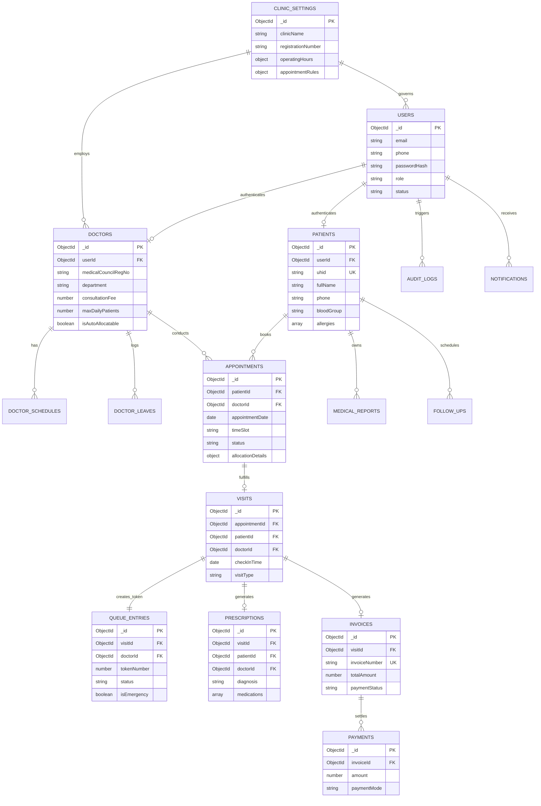

# Smart OPD – MongoDB Database Architecture & Schema Specification
## Single-Clinic Outpatient Department Management System

> **Document ID:** 03-MongoDB-Database-Architecture.md  
> **Version:** 2.0.0 (Master Release)  
> **Status:** Stage A Architectural Baseline – Fully Detailed  
> **Date:** 2026-11-11  
> **Database Engine:** MongoDB 7.0+ (WiredTiger Storage Engine) with Mongoose v8 ODM  
> **Pattern:** Single-Clinic Normalized Domain with `clinicId` Multi-Tenant Boundary  

---

## 1. Architectural Strategy & Design Principles

1. **Configurable Single-Clinic Tenancy (`clinicId`)**: While initial deployment serves one clinic, every collection includes an indexed `clinicId` reference. This provides tenant isolation and ensures frictionless future horizontal scaling to polyclinic branches without database refactoring.
2. **Separation of Reservation and Encounter**: An **Appointment** reserves time; a **Visit** represents actual physical presence and medical delivery. This decoupling ensures accurate no-show tracking and eliminates messy status mutations.
3. **Clinical Immutability**: Historical consultations and prescriptions (`prescriptions` collection) are strictly write-once. Subsequent patient visits create new consultation records linked to the patient's longitudinal `patientId` timeline.
4. **ACID Transactions for Critical Operations**: Multi-document MongoDB sessions are enforced during:
   - Atomic Slot Booking & Smart Doctor Allocation (locking time slot against concurrent races).
   - Patient Check-In (creating `Visit` + allocating sequential daily `QueueEntry` token).
   - Invoice Payment Settlement (recording `Payment` + updating `Invoice` balance).

---

## 2. Master Entity-Relationship Diagram (Mermaid ERD)



---

## 3. Exhaustive Mongoose Schemas & TypeScript Definitions (All 16 Collections)

### 3.1 Collection: `users`
*Shared authentication repository across all roles.*

```typescript
import mongoose, { Schema, Document } from 'mongoose';

export interface IUser extends Document {
  clinicId: mongoose.Types.ObjectId;
  fullName: string;
  email?: string;
  phone: string;
  passwordHash: string;
  role: 'ADMIN' | 'DOCTOR' | 'RECEPTIONIST' | 'PATIENT';
  status: 'ACTIVE' | 'INACTIVE' | 'LOCKED';
  failedLoginAttempts: number;
  lockUntil?: Date;
  lastLoginAt?: Date;
  createdAt: Date;
  updatedAt: Date;
}

const UserSchema = new Schema<IUser>(
  {
    clinicId: { type: Schema.Types.ObjectId, ref: 'ClinicSetting', required: true, index: true },
    fullName: { type: String, required: true, trim: true },
    email: { type: String, lowercase: true, trim: true, sparse: true, index: true },
    phone: { type: String, required: true, trim: true, index: true },
    passwordHash: { type: String, required: true },
    role: { 
      type: String, 
      enum: ['ADMIN', 'DOCTOR', 'RECEPTIONIST', 'PATIENT'], 
      required: true 
    },
    status: { 
      type: String, 
      enum: ['ACTIVE', 'INACTIVE', 'LOCKED'], 
      default: 'ACTIVE' 
    },
    failedLoginAttempts: { type: Number, default: 0 },
    lockUntil: { type: Date },
    lastLoginAt: { type: Date }
  },
  { timestamps: true }
);

// Compound Unique Indexes
UserSchema.index({ clinicId: 1, phone: 1 }, { unique: true });
UserSchema.index({ clinicId: 1, email: 1 }, { unique: true, sparse: true });
```

---

### 3.2 Collection: `clinicSettings`
*Single master configuration document governing all clinic policies.*

```typescript
export interface IClinicSetting extends Document {
  clinicName: string;
  clinicPrefix: string; // e.g., "OPD" for UHID generation
  tagline?: string;
  logoUrl?: string;
  registrationNumber: string; // Clinical Establishments Act
  gstin?: string;
  contact: {
    phone: string;
    emergencyHotline: string;
    email: string;
    address: {
      street: string;
      city: string;
      state: string;
      postalCode: string;
    };
  };
  operatingHours: Array<{
    dayOfWeek: number; // 0 = Sun, 1 = Mon ...
    isOpen: boolean;
    shifts: Array<{ openTime: string; closeTime: string }>;
  }>;
  holidays: Array<{
    date: Date;
    reason: string;
    isRecurringYearly?: boolean;
  }>;
  departments: string[];
  appointmentRules: {
    maxAdvanceBookingDays: number; // default: 14
    cancellationCutoffHours: number; // default: 4
    defaultSlotDurationMinutes: number; // default: 15
    allowWalkIns: boolean;
    allocationMode: 'AUTOMATIC' | 'PATIENT_CHOICE' | 'HYBRID'; // default: 'AUTOMATIC'
    autoAllocationWeights: {
      confirmedWeight: number; // default: 1.0
      queueWeight: number;     // default: 1.25
      activeConsultationWeight: number; // default: 1.5
    };
    allowReceptionistOverride: boolean; // default: true
    overrideRequiresReason: boolean;    // default: true
  };
  billingRules: {
    currency: string; // default: "INR"
    defaultConsultationFee: number;
    followUpFreeDays: number; // default: 7
    taxRatePercentage: number; // default: 0 (exempt)
  };
}
```

---

### 3.3 Collection: `doctors`
*Doctor credentials, departmental affiliation, capacity thresholds, and auto-allocation flags.*

```typescript
export interface IDoctor extends Document {
  clinicId: mongoose.Types.ObjectId;
  userId: mongoose.Types.ObjectId;
  fullName: string;
  medicalCouncilRegNo: string;
  department: string; // e.g. "General Medicine", "Orthopedics"
  specialization: string;
  qualifications: string[]; // e.g. ["MBBS", "MD"]
  roomNumber: string;
  consultationFee: number;
  averageConsultationMinutes: number; // default: 15
  maxDailyPatients: number; // capacity ceiling per shift (default: 25)
  isAutoAllocatable: boolean; // default: true (allows opting out senior visiting consultants)
  status: 'ACTIVE' | 'INACTIVE' | 'ON_LEAVE';
  createdAt: Date;
}

const DoctorSchema = new Schema<IDoctor>(
  {
    clinicId: { type: Schema.Types.ObjectId, ref: 'ClinicSetting', required: true, index: true },
    userId: { type: Schema.Types.ObjectId, ref: 'User', required: true, unique: true },
    fullName: { type: String, required: true, trim: true },
    medicalCouncilRegNo: { type: String, required: true, trim: true },
    department: { type: String, required: true, index: true },
    specialization: { type: String, required: true },
    qualifications: [{ type: String }],
    roomNumber: { type: String, required: true },
    consultationFee: { type: Number, required: true },
    averageConsultationMinutes: { type: Number, default: 15 },
    maxDailyPatients: { type: Number, default: 25 },
    isAutoAllocatable: { type: Boolean, default: true, index: true },
    status: { type: String, enum: ['ACTIVE', 'INACTIVE', 'ON_LEAVE'], default: 'ACTIVE', index: true }
  },
  { timestamps: true }
);

DoctorSchema.index({ clinicId: 1, department: 1, status: 1, isAutoAllocatable: 1 });
```

---

### 3.4 Collection: `patients`
*Patient demographics, medical alerts, allergies, and DPDP digital consent.*

```typescript
export interface IPatient extends Document {
  clinicId: mongoose.Types.ObjectId;
  userId?: mongoose.Types.ObjectId;
  uhid: string; // e.g. "OPD-2611-00042"
  fullName: string;
  dateOfBirth?: Date;
  age?: number;
  gender: 'MALE' | 'FEMALE' | 'OTHER';
  phone: string;
  email?: string;
  bloodGroup?: 'A+' | 'A-' | 'B+' | 'B-' | 'AB+' | 'AB-' | 'O+' | 'O-';
  allergies: string[];
  chronicConditions: string[];
  emergencyContact: {
    name: string;
    relation: string;
    phone: string;
  };
  consentGiven: boolean;
  consentDate?: Date;
  createdAt: Date;
}

const PatientSchema = new Schema<IPatient>(
  {
    clinicId: { type: Schema.Types.ObjectId, ref: 'ClinicSetting', required: true, index: true },
    userId: { type: Schema.Types.ObjectId, ref: 'User', sparse: true },
    uhid: { type: String, required: true, unique: true, index: true },
    fullName: { type: String, required: true, trim: true, index: true },
    dateOfBirth: { type: Date },
    age: { type: Number },
    gender: { type: String, enum: ['MALE', 'FEMALE', 'OTHER'], required: true },
    phone: { type: String, required: true, trim: true, index: true },
    email: { type: String, lowercase: true, trim: true },
    bloodGroup: { 
      type: String, 
      enum: ['A+', 'A-', 'B+', 'B-', 'AB+', 'AB-', 'O+', 'O-'] 
    },
    allergies: [{ type: String, trim: true }],
    chronicConditions: [{ type: String, trim: true }],
    emergencyContact: {
      name: { type: String, required: true },
      relation: { type: String, required: true },
      phone: { type: String, required: true }
    },
    consentGiven: { type: Boolean, default: true },
    consentDate: { type: Date, default: Date.now }
  },
  { timestamps: true }
);

PatientSchema.index({ clinicId: 1, phone: 1 });
PatientSchema.index({ clinicId: 1, fullName: 'text', uhid: 'text' });
```

---

### 3.5 Collection: `appointments`
*Scheduled consultation reservations and smart allocation metadata.*

```typescript
export interface IAppointment extends Document {
  clinicId: mongoose.Types.ObjectId;
  patientId: mongoose.Types.ObjectId;
  doctorId: mongoose.Types.ObjectId;
  appointmentDate: Date; // Normalized to YYYY-MM-DD 00:00:00Z
  timeSlot: string; // e.g. "10:15" (24-hour format)
  slotDurationMinutes: number;
  bookingChannel: 'ONLINE_PATIENT' | 'RECEPTIONIST_WALKIN' | 'RECEPTIONIST_PHONE' | 'DOCTOR_FOLLOWUP';
  status: 'SCHEDULED' | 'CONFIRMED' | 'WAITLISTED' | 'CHECKED_IN' | 'COMPLETED' | 'CANCELLED' | 'NO_SHOW';
  cancellationReason?: string;
  notes?: string;
  allocationDetails?: {
    method: 'AUTOMATIC' | 'PATIENT_CHOICE' | 'RECEPTIONIST_OVERRIDE';
    workloadIndexAtAllocation: number;
    recommendedDoctorId?: mongoose.Types.ObjectId;
    overrideReason?: string;
    overriddenBy?: mongoose.Types.ObjectId;
  };
  createdAt: Date;
}

const AppointmentSchema = new Schema<IAppointment>(
  {
    clinicId: { type: Schema.Types.ObjectId, ref: 'ClinicSetting', required: true },
    patientId: { type: Schema.Types.ObjectId, ref: 'Patient', required: true, index: true },
    doctorId: { type: Schema.Types.ObjectId, ref: 'Doctor', required: true, index: true },
    appointmentDate: { type: Date, required: true, index: true },
    timeSlot: { type: String, required: true },
    slotDurationMinutes: { type: Number, default: 15 },
    bookingChannel: { 
      type: String, 
      enum: ['ONLINE_PATIENT', 'RECEPTIONIST_WALKIN', 'RECEPTIONIST_PHONE', 'DOCTOR_FOLLOWUP'],
      required: true 
    },
    status: { 
      type: String, 
      enum: ['SCHEDULED', 'CONFIRMED', 'WAITLISTED', 'CHECKED_IN', 'COMPLETED', 'CANCELLED', 'NO_SHOW'],
      default: 'CONFIRMED',
      index: true 
    },
    cancellationReason: { type: String },
    notes: { type: String },
    allocationDetails: {
      method: { 
        type: String, 
        enum: ['AUTOMATIC', 'PATIENT_CHOICE', 'RECEPTIONIST_OVERRIDE'], 
        default: 'PATIENT_CHOICE' 
      },
      workloadIndexAtAllocation: { type: Number, default: 0 },
      recommendedDoctorId: { type: Schema.Types.ObjectId, ref: 'Doctor' },
      overrideReason: { type: String },
      overriddenBy: { type: Schema.Types.ObjectId, ref: 'User' }
    }
  },
  { timestamps: true }
);

// CRITICAL UNIQUE CONSTRAINT: Prevents double-booking same doctor at same time
AppointmentSchema.index(
  { doctorId: 1, appointmentDate: 1, timeSlot: 1 },
  { 
    unique: true, 
    partialFilterExpression: { status: { $nin: ['CANCELLED', 'NO_SHOW'] } } 
  }
);
```

---

### 3.6 Collections: `doctorSchedules` & `doctorLeaves`
*Weekly recurring shift blocks and leave overrides.*

```typescript
export interface IDoctorSchedule extends Document {
  clinicId: mongoose.Types.ObjectId;
  doctorId: mongoose.Types.ObjectId;
  dayOfWeek: number; // 0 = Sun, 1 = Mon ...
  shifts: Array<{
    startTime: string; // e.g. "09:00"
    endTime: string;   // e.g. "13:00"
    slotDurationMinutes: number; // default: 15
    maxPatientsPerShift: number; // default: 16
  }>;
  isActive: boolean;
}

export interface IDoctorLeave extends Document {
  clinicId: mongoose.Types.ObjectId;
  doctorId: mongoose.Types.ObjectId;
  startDate: Date;
  endDate: Date;
  allDay: boolean; // default: true
  shiftId?: string; // if leaving specific shift
  reason: string;
  status: 'PENDING' | 'APPROVED' | 'CANCELLED';
  approvedBy?: mongoose.Types.ObjectId;
}
```

---

### 3.7 Collections: `visits` & `queueEntries`
*Physical clinical encounters and real-time live OPD queue.*

```typescript
export interface IVisit extends Document {
  clinicId: mongoose.Types.ObjectId;
  appointmentId?: mongoose.Types.ObjectId;
  patientId: mongoose.Types.ObjectId;
  doctorId: mongoose.Types.ObjectId;
  checkInTime: Date;
  consultationStartTime?: Date;
  consultationEndTime?: Date;
  visitType: 'FIRST_VISIT' | 'FOLLOW_UP' | 'EMERGENCY';
  status: 'CHECKED_IN' | 'WAITING' | 'IN_CONSULTATION' | 'COMPLETED' | 'CANCELLED';
}

export interface IQueueEntry extends Document {
  clinicId: mongoose.Types.ObjectId;
  visitId: mongoose.Types.ObjectId;
  doctorId: mongoose.Types.ObjectId;
  patientId: mongoose.Types.ObjectId;
  tokenNumber: number; // 1, 2, 3... resets daily per doctor
  queueDate: Date; // YYYY-MM-DD
  status: 'WAITING' | 'CALLED' | 'IN_CONSULTATION' | 'COMPLETED' | 'SKIPPED';
  isEmergency: boolean;
  priorityOrder: number; // lower number = higher priority
  calledAt?: Date;
  createdAt: Date;
}

const QueueEntrySchema = new Schema<IQueueEntry>(
  {
    clinicId: { type: Schema.Types.ObjectId, ref: 'ClinicSetting', required: true },
    visitId: { type: Schema.Types.ObjectId, ref: 'Visit', required: true, unique: true },
    doctorId: { type: Schema.Types.ObjectId, ref: 'Doctor', required: true, index: true },
    patientId: { type: Schema.Types.ObjectId, ref: 'Patient', required: true },
    tokenNumber: { type: Number, required: true },
    queueDate: { type: Date, required: true, index: true },
    status: { 
      type: String, 
      enum: ['WAITING', 'CALLED', 'IN_CONSULTATION', 'COMPLETED', 'SKIPPED'],
      default: 'WAITING',
      index: true 
    },
    isEmergency: { type: Boolean, default: false },
    priorityOrder: { type: Number, default: 100 },
    calledAt: { type: Date }
  },
  { timestamps: true }
);

QueueEntrySchema.index({ doctorId: 1, queueDate: 1, status: 1, priorityOrder: 1, tokenNumber: 1 });
```

---

### 3.8 Collection: `prescriptions`
*Immutable clinical encounter findings and prescribed pharmacology.*

```typescript
export interface IPrescription extends Document {
  clinicId: mongoose.Types.ObjectId;
  visitId: mongoose.Types.ObjectId;
  patientId: mongoose.Types.ObjectId;
  doctorId: mongoose.Types.ObjectId;
  vitals: {
    bloodPressureSystolic?: number;
    bloodPressureDiastolic?: number;
    pulseRate?: number;
    temperatureFahrenheit?: number;
    spo2Percentage?: number;
    weightKg?: number;
    bmi?: number;
  };
  chiefComplaints: string[];
  clinicalFindings?: string;
  diagnosis: string;
  icd10Code?: string;
  medications: Array<{
    drugName: string;
    dosageStrength: string; // e.g. "650mg"
    dosageForm: 'TABLET' | 'CAPSULE' | 'SYRUP' | 'INJECTION' | 'DROPS' | 'OINTMENT';
    frequency: string; // e.g. "1-0-1"
    durationDays: number;
    timing: 'BEFORE_FOOD' | 'AFTER_FOOD' | 'WITH_FOOD' | 'BEDTIME' | 'SOS';
    instructions?: string;
  }>;
  generalAdvice?: string;
  followUpDate?: Date;
  pdfUrl?: string;
  verificationToken: string;
  createdAt: Date;
}
```

---

### 3.9 Collection: `medicalReports`
*Diagnostic reports and laboratory attachments stored in Cloudinary.*

```typescript
export interface IMedicalReport extends Document {
  clinicId: mongoose.Types.ObjectId;
  patientId: mongoose.Types.ObjectId;
  visitId?: mongoose.Types.ObjectId;
  uploadedByUserId: mongoose.Types.ObjectId;
  reportTitle: string;
  reportCategory: 'LABORATORY' | 'RADIOLOGY' | 'PATHOLOGY' | 'DISCHARGE_SUMMARY' | 'OTHER';
  fileUrl: string; // Cloudinary secure URL
  cloudinaryPublicId: string;
  fileMimeType: string;
  fileSizeBytes: number;
  uploadedAt: Date;
}
```

---

### 3.10 Collections: `invoices` & `payments`
*Billing records and cash-flow settlements.*

```typescript
export interface IInvoice extends Document {
  clinicId: mongoose.Types.ObjectId;
  visitId: mongoose.Types.ObjectId;
  patientId: mongoose.Types.ObjectId;
  invoiceNumber: string; // INV-YYYY-XXXXX
  lineItems: Array<{
    description: string;
    category: 'CONSULTATION' | 'PROCEDURE' | 'LAB' | 'MEDICINE' | 'DRESSING';
    unitPrice: number;
    quantity: number;
    discountAmount: number;
    taxableAmount: number;
  }>;
  subTotal: number;
  totalDiscount: number;
  discountReason?: string;
  discountAuthorizedBy?: mongoose.Types.ObjectId; // Clinic Admin ID authorization
  taxAmount: number;
  grandTotal: number;
  amountPaid: number;
  balanceDue: number;
  paymentStatus: 'UNPAID' | 'PARTIALLY_PAID' | 'PAID' | 'REFUNDED';
  createdAt: Date;
}

export interface IPayment extends Document {
  clinicId: mongoose.Types.ObjectId;
  invoiceId: mongoose.Types.ObjectId;
  amount: number;
  paymentMode: 'CASH' | 'UPI_QR' | 'CARD' | 'NET_BANKING';
  transactionReference?: string;
  receivedByUserId: mongoose.Types.ObjectId;
  paymentDate: Date;
}
```

---

### 3.11 Collections: `followUps`, `notifications` & `auditLogs`

```typescript
export interface IFollowUp extends Document {
  clinicId: mongoose.Types.ObjectId;
  patientId: mongoose.Types.ObjectId;
  doctorId: mongoose.Types.ObjectId;
  visitId: mongoose.Types.ObjectId;
  recommendedDate: Date;
  status: 'PENDING' | 'BOOKED' | 'EXPIRED' | 'DISMISSED';
  notes?: string;
}

export interface INotification extends Document {
  clinicId: mongoose.Types.ObjectId;
  recipientUserId: mongoose.Types.ObjectId;
  type: 'APPOINTMENT' | 'QUEUE' | 'PRESCRIPTION' | 'BILLING' | 'SYSTEM';
  title: string;
  message: string;
  actionUrl?: string;
  isRead: boolean;
  createdAt: Date;
}

export interface IAuditLog extends Document {
  clinicId: mongoose.Types.ObjectId;
  actorUserId: mongoose.Types.ObjectId;
  actorRole: string;
  action: string; // e.g. "CHECK_IN_PATIENT", "ISSUE_PRESCRIPTION", "DOCTOR_ALLOCATION_OVERRIDDEN"
  targetResource: string; // e.g. "Patient", "Prescription", "Invoice"
  targetResourceId?: string;
  details?: Record<string, any>;
  ipAddress: string;
  userAgent: string;
  timestamp: Date;
}
```

---

## 4. Realistic Concrete Sample Documents

### 4.1 Sample `Doctor` Document
```json
{
  "_id": { "$oid": "6731ecb01234567890doc001" },
  "clinicId": { "$oid": "6731ecb00000000000000001" },
  "userId": { "$oid": "6731ecb01234567890usr001" },
  "fullName": "Dr. Rajesh Sharma",
  "medicalCouncilRegNo": "MCI-2012-45892",
  "department": "General Medicine",
  "specialization": "Internal Medicine",
  "qualifications": ["MBBS", "MD (General Medicine)"],
  "roomNumber": "Room 1",
  "consultationFee": 500,
  "averageConsultationMinutes": 15,
  "maxDailyPatients": 25,
  "isAutoAllocatable": true,
  "status": "ACTIVE",
  "createdAt": { "$date": "2026-11-01T08:00:00.000Z" }
}
```

### 4.2 Sample `Appointment` Document with Auto-Allocation
```json
{
  "_id": { "$oid": "6731ecb0aaaaaaaaaaaa0001" },
  "clinicId": { "$oid": "6731ecb00000000000000001" },
  "patientId": { "$oid": "6731ecb09999999999999001" },
  "doctorId": { "$oid": "6731ecb01234567890doc001" },
  "appointmentDate": { "$date": "2026-11-12T00:00:00.000Z" },
  "timeSlot": "10:15",
  "slotDurationMinutes": 15,
  "bookingChannel": "ONLINE_PATIENT",
  "status": "CONFIRMED",
  "allocationDetails": {
    "method": "AUTOMATIC",
    "workloadIndexAtAllocation": 0.34,
    "recommendedDoctorId": { "$oid": "6731ecb01234567890doc001" }
  },
  "createdAt": { "$date": "2026-11-11T14:30:00.000Z" }
}
```
