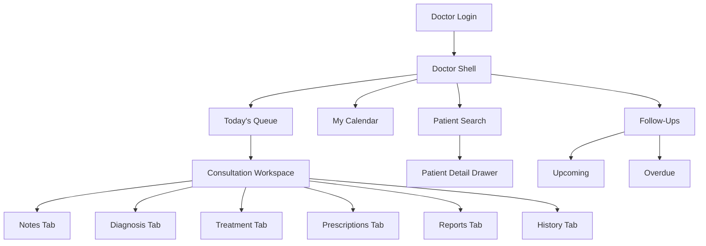
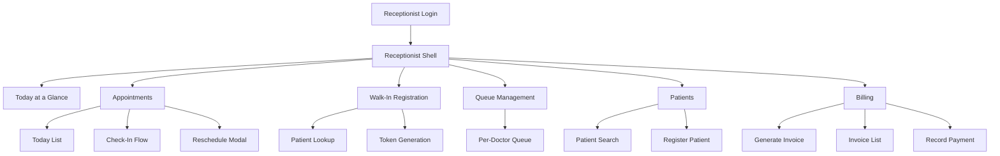
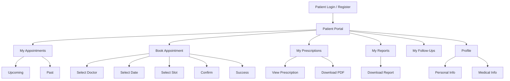

# Smart OPD — UI/UX Specification

> **Version:** 1.0  
> **Status:** Draft  
> **Audience:** Frontend engineers, designers, QA  
> **Stack:** React + Vite + TypeScript + Tailwind CSS + shadcn/ui + Lucide React

---

## Table of Contents

1. [Design Principles](#1-design-principles)
2. [Color System](#2-color-system)
3. [Typography Scale](#3-typography-scale)
4. [Spacing & Layout Grid](#4-spacing--layout-grid)
5. [Component Library](#5-component-library)
6. [Layouts & Pages per Dashboard](#6-layouts--pages-per-dashboard)
7. [Wireframe Descriptions](#7-wireframe-descriptions)
8. [Navigation & Information Architecture](#8-navigation--information-architecture)
9. [Responsive Behavior](#9-responsive-behavior)
10. [Interaction Patterns](#10-interaction-patterns)
11. [Accessibility](#11-accessibility)

---

## 1. Design Principles

These principles govern every design decision in Smart OPD. All components, layouts, and interactions must be evaluated against them before shipping.

### P1 — Clarity over Decoration
Every pixel must carry information. No decorative gradients, glassmorphism, neon glows, or oversized rounded cards. The interface looks like a professional hospital ERP, not a consumer app. When in doubt, ship less.

### P2 — Density without Clutter
Clinical staff process dozens of patients per session. Tables must be compact (`text-sm`, 36 px row height), and dashboards must display actionable numbers above the fold. Whitespace is used for grouping — not for aesthetics.

### P3 — Role-Appropriate Context
Each role (Admin, Doctor, Receptionist, Patient) sees only what is relevant to their workflow. Navigation, data, and actions are scoped per role. No role has to scroll past irrelevant modules.

### P4 — Real-Time Reliability
Queue status and appointment changes are live (Socket.IO). The UI must visually acknowledge incoming updates (subtle row highlight, badge pulse) without disrupting in-progress interactions (typing, dropdowns).

### P5 — Progressive Disclosure
Forms are grouped into sections; advanced options are behind accordions or secondary tabs. Tables show summaries; detail opens in a drawer or modal — never a full-page navigation that breaks table context.

### P6 — Error Prevention First
Blocking validations surface inline, before submission. Date pickers block past dates for new appointments. Double-booking is prevented server-side and reflected immediately in slot availability. Destructive actions (deactivate doctor, void invoice) require a confirmation modal with explicit text match where appropriate.

### P7 — Accessible by Default
Every interactive element has visible focus rings, ARIA labels, and ≥ 4.5:1 contrast ratio. Keyboard navigation follows logical DOM order. Screen reader users can operate all primary workflows.

### P8 — Consistent Feedback Loop
Every user action produces a visible response within 100 ms (optimistic UI or loading state). Toast notifications confirm success or surface errors. Long-running operations show inline spinners.

---

## 2. Color System

### 2.1 Primary Palette

| Token | Hex | Usage |
|---|---|---|
| `color-sidebar` | `#1e2d4a` | Sidebar background, top-level nav items |
| `color-sidebar-hover` | `#263655` | Sidebar item hover state |
| `color-sidebar-active` | `#2f4068` | Sidebar item active/selected state |
| `color-bg-page` | `#f8fafc` | Main content area background |
| `color-bg-card` | `#ffffff` | Card, table, modal backgrounds |
| `color-border` | `#e2e8f0` | Thin borders, dividers, table row separators |
| `color-border-strong` | `#cbd5e1` | Input borders, header separators |

### 2.2 Accent & Semantic Colors

| Token | Hex | Usage |
|---|---|---|
| `color-accent-blue` | `#3b6fce` | Primary buttons, links, active tab indicators, focus rings |
| `color-accent-blue-hover` | `#2d5bb5` | Primary button hover |
| `color-teal` | `#0d9488` | Secondary highlights, success actions, check-in badges |
| `color-teal-light` | `#ccfbf1` | Teal badge backgrounds |
| `color-danger` | `#dc2626` | Destructive buttons, error messages, cancelled badges |
| `color-danger-light` | `#fee2e2` | Danger badge/alert backgrounds |
| `color-success` | `#16a34a` | Completed status, paid badges, success toasts |
| `color-success-light` | `#dcfce7` | Success badge backgrounds |
| `color-warning` | `#d97706` | Pending status, warning alerts, partial payment |
| `color-warning-light` | `#fef3c7` | Warning badge backgrounds |

### 2.3 Text Colors

| Token | Hex | Usage |
|---|---|---|
| `color-text-primary` | `#0f172a` | Main body text, table data, headings |
| `color-text-secondary` | `#475569` | Labels, secondary info, timestamps |
| `color-text-muted` | `#94a3b8` | Placeholder text, disabled states, captions |
| `color-text-on-dark` | `#f1f5f9` | Text on sidebar background |
| `color-text-on-dark-muted` | `#94a3b8` | Secondary sidebar text, section labels |

### 2.4 Status Badge Mapping

| Status | Background | Text | Border |
|---|---|---|---|
| Scheduled | `#dbeafe` | `#1d4ed8` | `#93c5fd` |
| Checked-In | `#ccfbf1` | `#0f766e` | `#5eead4` |
| In-Progress | `#fef9c3` | `#854d0e` | `#fde047` |
| Completed | `#dcfce7` | `#166534` | `#86efac` |
| Cancelled | `#fee2e2` | `#991b1b` | `#fca5a5` |
| No-Show | `#f1f5f9` | `#475569` | `#cbd5e1` |
| Paid | same as Completed | | |
| Partial | same as Warning | | |
| Pending | same as Warning | | |
| Waived | same as Muted | | |

### 2.5 Dark Mode Consideration

Smart OPD ships as **light-mode first**. Dark mode tokens are reserved but not in scope for v1. When implemented, `color-sidebar` becomes the darkest surface (`#0f172a`), card backgrounds shift to `#1e293b`, and all text colors invert on the slate scale.

---

## 3. Typography Scale

**Font family:** `Inter` (loaded via Google Fonts or self-hosted)  
**Base size:** 14 px  
**Line height base:** 1.5

| Role | Size | Weight | Line Height | Tailwind Class |
|---|---|---|---|---|
| Page Title (H1) | 20 px | 600 | 1.3 | `text-xl font-semibold` |
| Section Heading (H2) | 16 px | 600 | 1.4 | `text-base font-semibold` |
| Card / Panel Title (H3) | 14 px | 600 | 1.4 | `text-sm font-semibold` |
| Body (default) | 14 px | 400 | 1.5 | `text-sm font-normal` |
| Body Strong | 14 px | 500 | 1.5 | `text-sm font-medium` |
| Label / Form Label | 13 px | 500 | 1.4 | `text-xs font-medium` |
| Table Header | 12 px | 600 | 1.3 | `text-xs font-semibold uppercase tracking-wide` |
| Table Data | 13 px | 400 | 1.4 | `text-xs font-normal` |
| Caption / Muted | 12 px | 400 | 1.4 | `text-xs text-muted-foreground` |
| Stat Number (KPI) | 24 px | 700 | 1.2 | `text-2xl font-bold` |
| Stat Label | 12 px | 500 | 1.3 | `text-xs font-medium text-muted-foreground` |
| Badge | 11 px | 500 | 1 | `text-[11px] font-medium` |
| Token Number | 48 px | 800 | 1 | `text-5xl font-extrabold` |
| Sidebar Nav Item | 13 px | 500 | 1.4 | `text-[13px] font-medium` |
| Sidebar Section Label | 10 px | 600 | 1 | `text-[10px] font-semibold uppercase tracking-widest` |

---

## 4. Spacing & Layout Grid

- **Base unit:** 4 px (Tailwind spacing scale)
- **Page padding:** `px-6 py-5` (desktop), `px-4 py-4` (tablet), `px-3 py-3` (mobile)
- **Card inner padding:** `p-4` default, `p-3` for compact cards
- **Table row height:** 36 px (`h-9`)
- **Table header height:** 32 px (`h-8`)
- **Sidebar width (expanded):** 240 px
- **Sidebar width (collapsed):** 56 px (icon-only)
- **Top header height:** 56 px
- **Modal widths:** sm = 400 px, md = 560 px, lg = 720 px, xl = 900 px
- **Drawer width:** 480 px (right-anchored)
- **Section gap:** `gap-6` between major sections
- **Form field gap:** `gap-4` between form groups, `gap-1.5` between label and input

---

## 5. Component Library

All components are built on **shadcn/ui** primitives with Tailwind overrides. Icons are exclusively **Lucide React**.

---

### 5.1 Sidebar Navigation

**Structure:**
```
[Logo + Clinic Name]           ← 56px header
─────────────────────
[Section Label: MAIN]
  [Nav Item — active]
  [Nav Item]
  [Nav Item]
─────────────────────
[Section Label: MANAGEMENT]
  [Nav Item]
  ...
─────────────────────
[Bottom: User info + Logout]   ← fixed bottom
```

**Expanded state (240 px):**
- Background: `#1e2d4a`
- Logo area: 56 px tall, logo + "Smart OPD" text in `font-semibold text-white`
- Section labels: `text-[10px] font-semibold uppercase tracking-widest text-slate-400 px-3 py-2`
- Nav item: `flex items-center gap-3 px-3 py-2 rounded-md text-[13px] font-medium text-slate-300`
- Nav item hover: `bg-[#263655] text-white`
- Nav item active: `bg-[#2f4068] text-white` + left accent bar `2px solid #3b6fce`
- Icon: 16 px Lucide icon, `text-slate-400` default, `text-white` on hover/active
- Badge (e.g., unread notifications): `bg-[#3b6fce] text-white text-[10px] rounded-full px-1.5 py-0.5` right-aligned
- Bottom user block: avatar initials circle + name + role label + logout icon

**Collapsed state (56 px):**
- Shows icons only, centered
- Active item: icon in `#3b6fce` color
- Hovering shows tooltip with nav item name (shadcn `Tooltip` component)
- Collapse/expand toggle button at bottom of sidebar

**Collapse trigger:** `ChevronLeft` / `ChevronRight` icon button at sidebar bottom. Transition: `transition-all duration-200`.

---

### 5.2 Top Header Bar

**Height:** 56 px. `bg-white border-b border-[#e2e8f0]`

**Left zone:** Page title (H1) + optional breadcrumb below it  
**Center zone:** Global search input (desktop only) — `w-64`, placeholder "Search patients, appointments…"  
**Right zone (left to right):**
1. `Bell` icon — notification badge with count
2. `HelpCircle` icon  
3. Avatar dropdown — user name, role chip, "Profile", "Logout"

**Search input:** shadcn `Input` with `Search` icon prefix. On focus expands to `w-96`. Triggers debounced search after 300 ms.

---

### 5.3 Stat / KPI Cards

```
┌─────────────────────────────┐
│ [Icon 20px]   [Trend badge] │
│                             │
│  247                        │  ← text-2xl font-bold
│  Appointments Today         │  ← text-xs text-muted
└─────────────────────────────┘
```

- Container: `bg-white border border-[#e2e8f0] rounded-md p-4`
- **No** large rounded corners, **no** gradient backgrounds, **no** shadow-xl
- Shadow: `shadow-sm` only
- Icon background: 32×32 px, `rounded-md bg-[#eff6ff]` for blue, `bg-[#f0fdf4]` for green, etc.
- Icon: 18 px Lucide, colored per semantic meaning
- Trend badge: `+12%` in success green or down in danger red — `text-xs font-medium`
- Grid: 4-column on desktop, 2-column on tablet, 1-column on mobile

**Variants:**
| Variant | Icon | Color Group |
|---|---|---|
| Appointments | `CalendarDays` | Blue |
| Checked-In | `UserCheck` | Teal |
| Completed | `CheckCircle2` | Green |
| Revenue | `IndianRupee` | Amber |
| Pending Queue | `Clock` | Orange |
| Doctors Active | `Stethoscope` | Indigo |

---

### 5.4 Data Tables

Built on shadcn `Table` with custom toolbar.

**Toolbar (above table):**
```
[Search input]  [Filter dropdowns...]  [Date range]    [Export CSV]  [+ Add New]
```

**Column header:** `text-xs font-semibold uppercase tracking-wide text-slate-500`, sortable columns show `ArrowUpDown` icon (16 px).

**Row:** `h-9 border-b border-[#f1f5f9] hover:bg-[#f8fafc]`

**Row actions (rightmost column):**  
Inline icon buttons: `Eye` (view), `Pencil` (edit), `MoreVertical` (kebab menu for additional actions).  
Kebab dropdown: shadcn `DropdownMenu`.

**Selection:** Checkbox column (leftmost), bulk action bar appears above table on selection.

**Pagination:**
```
Showing 1–20 of 247 results    [< Prev]  1  2  3 … 13  [Next >]
                                         Rows per page: [20 ▾]
```

**Empty state:** Centered icon + heading + sub-text + optional CTA button (see §5.11).

**Loading state:** 8 skeleton rows (see §5.10).

**Filter drawer:** Clicking "More Filters" opens right drawer with full filter form.

---

### 5.5 Modal / Drawer Patterns

#### Modal
- shadcn `Dialog`
- Sizes: sm (400), md (560), lg (720), xl (900) — set via `max-w-*`
- Header: title (H2) + optional sub-text + `X` close button (top-right)
- Body: scrollable if content exceeds 60 vh
- Footer: `flex justify-end gap-2` — Cancel (ghost) + Primary action button
- Backdrop: `bg-black/50`
- Destructive confirmation modal: danger-red primary button, warning icon in header

#### Drawer
- Right-anchored, 480 px wide
- Used for: patient detail, appointment detail, filter forms, consultation notes preview
- Header identical to modal
- Body: full-height scrollable
- Footer: sticky at bottom

---

### 5.6 Form Elements

All built on shadcn/ui primitives. Labels use `text-xs font-medium text-slate-700`.

| Element | Component | Notes |
|---|---|---|
| Text input | shadcn `Input` | `h-9`, `rounded-md`, `border-[#cbd5e1]`, focus ring `#3b6fce` |
| Textarea | shadcn `Textarea` | Auto-resize via `resize-y`, min 3 rows |
| Select | shadcn `Select` | Searchable via `Command` inside `Popover` for long lists |
| Multi-select | shadcn `Command` + `Badge` chips | Used for departments, symptoms |
| Date picker | shadcn `Popover` + `Calendar` | Blocks past dates where required; range picker for reports |
| Time picker | shadcn `Select` with 15-min slots | Filtered by doctor availability |
| File upload | Custom dropzone | `Upload` icon, dashed border, accepts PDF/JPEG/PNG, 10 MB max. Shows file name + remove button after selection. |
| Toggle / Switch | shadcn `Switch` | Used for boolean settings |
| Radio group | shadcn `RadioGroup` | Used for gender, payment mode |
| Checkbox | shadcn `Checkbox` | Used for consent, multi-select filter chips |

**Validation states:**
- Error: red border `border-[#dc2626]`, error message below in `text-xs text-[#dc2626]`, `AlertCircle` icon inside input
- Success: green border on blur only (not shown inline to reduce noise)
- Required: `*` after label text in `text-[#dc2626]`

---

### 5.7 Status Badges

shadcn `Badge` variant="outline" with custom color overrides.

```tsx
// Example: Completed
<Badge className="bg-[#dcfce7] text-[#166534] border-[#86efac] text-[11px] font-medium">
  Completed
</Badge>
```

**Appointment statuses:** Scheduled · Checked-In · In-Progress · Completed · Cancelled · No-Show  
**Payment statuses:** Paid · Partial · Pending · Waived  
**Queue statuses:** Waiting · Called · With Doctor · Done · Skipped  
**Doctor statuses:** Available · Busy · On Leave · Inactive

Badges never use colored backgrounds without matching text color (see §2.4 for full mapping).

---

### 5.8 Alert / Toast Notifications

#### Toast (react-hot-toast or shadcn `Sonner`)
- Position: top-right, 16 px from edge
- Width: 360 px max
- Auto-dismiss: 4 s (success), 6 s (error), persistent (critical error requiring action)
- Variants: success (`CheckCircle2`, green), error (`XCircle`, red), warning (`AlertTriangle`, amber), info (`Info`, blue)
- Structure: icon + title + optional description + optional action button

#### Inline Alert (above forms)
- shadcn `Alert` component
- Used for: form submission errors, session expiry warnings, quota notices

---

### 5.9 Loading Skeletons

shadcn `Skeleton` component (`bg-slate-200 animate-pulse rounded`).

| Context | Skeleton pattern |
|---|---|
| Stat card | Rounded rect for icon + two lines for number and label |
| Table | 8 rows × full width, alternating with header skeleton |
| Patient detail drawer | Avatar circle + 4 lines + 2 section blocks |
| Chart | Full chart area placeholder rectangle |
| Queue board | 3 token cards with number and name lines |

Skeletons match the exact shape and dimensions of the real content to prevent layout shift.

---

### 5.10 Empty States

Centered in the content area.

```
       [Lucide icon — 48px, text-slate-300]

       No appointments today
       [sub-text: "Walk-ins will appear here once checked in."]

       [+ Book Appointment]   ← CTA, only where contextually valid
```

- Icon: 48 px, `text-slate-300`
- Heading: `text-sm font-semibold text-slate-600`
- Sub-text: `text-xs text-slate-400`
- CTA: shown only when the user can resolve the empty state

| Screen | Icon | Heading |
|---|---|---|
| Appointments | `CalendarX2` | No appointments found |
| Patients | `Users` | No patients registered |
| Queue | `Clock` | Queue is empty |
| Invoices | `Receipt` | No invoices generated |
| Prescriptions | `Pill` | No prescriptions yet |
| Reports | `FileText` | No reports uploaded |
| Notifications | `Bell` | You're all caught up |

---

### 5.11 Breadcrumbs

shadcn `Breadcrumb` — shown below page title in header.

```
Admin > Patients > Ravi Kumar > Appointments
```

- Separator: `ChevronRight` icon (12 px, `text-slate-400`)
- Current page: `text-slate-700 font-medium` (not a link)
- Parent links: `text-slate-500 hover:text-slate-700`
- Max 4 levels. Beyond that, collapse middle items to `...`

---

### 5.12 Tabs

shadcn `Tabs` — two variants:

**Page-level tabs** (consultation workspace, settings):
- Full-width underline style: `border-b border-[#e2e8f0]`, active tab has `border-b-2 border-[#3b6fce] text-[#3b6fce]`
- Tab height: 40 px

**Card-level tabs** (analytics panels):
- Pill style: `bg-[#f1f5f9] rounded-md p-0.5`, active tab: `bg-white shadow-sm rounded`

---

### 5.13 Medical History Timeline

```
○ 2024-10-14 · Dr. Sharma — Consultation
  Diagnosis: Hypertension (I10)
  Prescribed: Amlodipine 5mg × 30 days
  [View Details →]

○ 2024-09-02 · Dr. Mehta — Follow-up
  ...
```

- Vertical line: `border-l-2 border-[#e2e8f0]` left side
- Circle marker: 10 px, `bg-white border-2 border-[#3b6fce] rounded-full`
- Entry card: `ml-4 mb-4 bg-white border border-[#e2e8f0] rounded-md p-3`
- Date: `text-xs text-slate-400 font-medium`
- Event title: `text-sm font-semibold text-slate-700`
- Details: `text-xs text-slate-500`
- "View Details": opens consultation detail drawer

---

### 5.14 Calendar / Schedule Grid

**Month view:** Standard calendar grid, 7 columns. Appointment dots per day cell (max 3 shown, "+N more" link).

**Week view:** Time slots on Y-axis (08:00–20:00, 30-min rows), days on X-axis. Appointment blocks are colored by doctor for admin, single color for doctor view.

**Day view:** Single column, full time slot list.  
Slot states: Available (white), Booked (blue block), Blocked (grey hatching), Selected (blue ring).

Component: Custom built on `react-calendar` or native grid — matches design system colors.

---

### 5.15 Queue Display (Live Token Board)

```
┌─────────────────────────────────────────────────────┐
│  NOW SERVING          NEXT UP                        │
│                                                      │
│  ┌─────────────┐   ┌──────┐  ┌──────┐  ┌──────┐    │
│  │    T-07     │   │ T-08 │  │ T-09 │  │ T-10 │    │
│  │             │   │      │  │      │  │      │    │
│  │  Ravi Kumar │   │ ...  │  │ ...  │  │ ...  │    │
│  │  Dr. Sharma │   │      │  │      │  │      │    │
│  └─────────────┘   └──────┘  └──────┘  └──────┘    │
│                                                      │
│  [Call Next]  [Skip]  [Mark Done]  [Priority ▾]      │
└─────────────────────────────────────────────────────┘
```

- Current token card: `bg-[#1e2d4a] text-white`, token number in `text-5xl font-extrabold`, patient name in `text-base font-semibold`
- Next-up cards: `bg-white border border-[#e2e8f0]`, token in `text-2xl font-bold text-[#3b6fce]`
- Real-time pulse animation: subtle `ring-2 ring-[#3b6fce] ring-offset-2 animate-pulse` on "Now Serving" card when token changes
- Receptionist view: buttons for Call Next, Skip, Priority Bump, Mark Done
- Doctor view: read-only, refreshes via Socket.IO

---

### 5.16 Prescription Card

```
┌────────────────────────────────────────────────┐
│  Rx   Smart OPD Clinic              2024-10-14 │
│       Dr. Priya Sharma, MBBS, MD               │
│                                                │
│  Patient: Ravi Kumar (M, 42)                   │
│  Diagnosis: Hypertension (I10)                 │
│  ────────────────────────────────────────────  │
│  1. Amlodipine 5mg — 1-0-1 — 30 days          │
│     Take after food                            │
│  2. Atenolol 50mg — 1-0-0 — 30 days           │
│  ────────────────────────────────────────────  │
│  Follow-up: 2024-11-14                         │
│  Notes: Monitor BP daily                       │
│  ────────────────────────────────────────────  │
│  [Download PDF]  [Share]  [Print]              │
└────────────────────────────────────────────────┘
```

- Border: `border border-[#e2e8f0] rounded-md`
- Header: left `Rx` symbol in `text-2xl font-black text-[#3b6fce]`, clinic info right-aligned
- Medicine list: numbered, each row has name + dosage + duration
- Footer actions: `FileDown`, `Share2`, `Printer` Lucide icons

---

### 5.17 Invoice Card

```
┌────────────────────────────────────────────────┐
│  INV-2024-00847          Status: [Paid ✓]      │
│  2024-10-14              Dr. Sharma            │
│  Patient: Ravi Kumar                           │
│  ────────────────────────────────────────────  │
│  Consultation Fee         ₹ 500.00             │
│  Procedure: ECG           ₹ 300.00             │
│  ────────────────────────────────────────────  │
│  Total                    ₹ 800.00             │
│  Paid (Cash)              ₹ 800.00             │
│  Balance                  ₹   0.00             │
│  ────────────────────────────────────────────  │
│  [Download PDF]  [Record Payment]  [Void]      │
└────────────────────────────────────────────────┘
```

- Invoice number: `text-sm font-semibold text-slate-700`
- Status badge: right-aligned
- Line items: table within card, `text-xs`
- Total row: `font-semibold border-t border-[#e2e8f0]`

---

## 6. Layouts & Pages per Dashboard

### 6.1 Shell Layout

All authenticated views share:

```
┌────────────────────────────────────────────────────────┐
│ [Sidebar 240px]  │  [Top Header 56px]                  │
│                  ├─────────────────────────────────────│
│                  │  [Page content area — scrollable]   │
│                  │  bg-[#f8fafc]                        │
│                  │  px-6 py-5                           │
└────────────────────────────────────────────────────────┘
```

---

### 6.2 Admin Dashboard

#### 6.2.1 Overview Page

```
Page Title: "Overview"  |  Date: Today, Wed 11 Nov 2026

[Stat Cards Row — 4 columns]
  Appointments Booked | Checked-In | Completed | Revenue Today

[Row — 2 columns]
  [Queue Overview Panel — 60% width]     [Doctor Status Table — 40% width]

[Recent Appointments Table — full width]
  Columns: Time | Patient | Doctor | Status | Token | Actions
```

**Queue Overview Panel:** Mini token board per active doctor. Collapsible per doctor row.  
**Doctor Status Table:** Name | Department | Current Patient | Queue Length | Status badge  
**Recent Appointments:** last 20, with inline check-in button for "Scheduled" rows.

#### 6.2.2 Doctor Management Page

```
Page Title: "Doctors"
[Toolbar: Search | Department filter | Status filter | + Add Doctor]

[Data Table]
  Columns: Name | Specialty | Department | Schedule | Status | Actions(View, Edit, Deactivate)
```

Add/Edit opens an lg modal with sections: Personal Info, Professional Info, Schedule configuration, Fee settings.  
Deactivate: confirmation modal — "Type the doctor's name to confirm".

#### 6.2.3 Patient Management Page

```
Page Title: "Patients"
[Toolbar: Search (name, phone, ID) | Gender filter | Age range | + Register Patient]

[Data Table]
  Columns: ID | Name | Age/Gender | Phone | Registered | Last Visit | Actions(View, Edit)
```

Row click opens patient detail drawer (see §7.3).

#### 6.2.4 Appointment Calendar Page

**View toggle:** Month | Week | Day (segmented control, top-right)  
Clicking an appointment: opens appointment detail drawer.  
Clicking empty slot: opens "New Appointment" modal pre-filled with that date/time.

#### 6.2.5 Analytics Page

```
Page Title: "Analytics"
[Date range picker — top right]  [Export PDF]

[Tab row: Overview | Appointments | Revenue | Patients | Doctors | Queue]

Under each tab: 2–3 Recharts charts + summary table
```

Charts:
- Appointments Trend: `LineChart` — daily count over period
- Revenue Trend: `AreaChart` — cumulative revenue
- Patient Demographics: `PieChart` — age group distribution, gender split `BarChart`
- Doctor Workload: horizontal `BarChart` — appointments per doctor
- Queue Wait Times: `BarChart` — avg wait per doctor

All charts: `text-xs` axis labels, `color-accent-blue` / `color-teal` / `color-warning` series colors, legend below chart, tooltip on hover.

#### 6.2.6 Billing Page

```
Page Title: "Billing"
[Toolbar: Search | Date range | Payment Status filter | Doctor filter | Export]

[Data Table]
  Columns: Invoice # | Date | Patient | Doctor | Total | Paid | Balance | Status | Actions
```

Row actions: View Invoice (drawer), Record Payment, Download PDF, Void.

#### 6.2.7 Audit Logs Page

```
Page Title: "Audit Logs"
[Toolbar: Date range | Action type filter | Actor filter | Search]

[Data Table — read only, no row actions]
  Columns: Timestamp | Actor | Role | Action | Resource | IP Address | Details
```

Clicking a row expands an inline detail row with full JSON payload. No edit/delete capability.

#### 6.2.8 Settings Page

Tab navigation (left vertical tabs on desktop):

| Tab | Content |
|---|---|
| Clinic Profile | Logo upload, name, address, phone, email, registration number |
| Working Hours | Per-day time range toggles (Mon–Sun), break time |
| Departments | Add/edit/reorder departments list |
| Appointment | Slot duration, booking window, cancellation policy, max per slot |
| Notifications | Email/SMS toggles per event type |
| Billing | Fee categories, GST toggle, payment modes |
| Security | Password policy, session timeout |

Each tab is an independent form with its own Save button (not global save).

---

### 6.3 Doctor Dashboard

#### 6.3.1 Today's Queue

```
Page Title: "Today's Queue"

[NOW SERVING — large token card]    [NEXT UP — 3 smaller cards]

[Action buttons: Call Next | Skip | Mark Done | Priority ▾]

[Patients Remaining List — below]
  Compact table: Token | Name | Age | Appointment Type | Wait Time
```

Socket.IO connection indicator: small green dot (`bg-[#16a34a]`) in top-right of panel. If disconnected: amber dot + "Reconnecting…" text.

#### 6.3.2 Consultation Workspace

```
[Patient Info Panel — left 280px, sticky]          [Tab content — right, scrollable]
  Photo/initials avatar
  Name, Age, Gender, Blood Group
  Vitals quick-entry (BP, Temp, SpO2, Weight)
  Allergies chip list
  [Open Full Profile ↗]

[Tabs: Notes | Diagnosis | Treatment | Prescriptions | Reports | History]

Notes tab:        Rich text area (plain textarea with formatting shortcuts)
Diagnosis tab:    ICD-10 search field + selected diagnoses list
Treatment tab:    Procedure checklist + instructions textarea
Prescriptions tab: Medicine entry form + medicine list
Reports tab:      Uploaded reports table + upload button
History tab:      Medical history timeline (§5.13)
```

Footer (sticky): `[Save Draft]  [Complete Consultation]`  
Completing consultation auto-marks queue entry as Done.

#### 6.3.3 Appointment Calendar

Same calendar component as Admin, filtered to own appointments only.

#### 6.3.4 Patient Search

Full-page search: type name/phone, results appear in table below, clicking opens patient detail drawer.

#### 6.3.5 Follow-Up Manager

```
[Tabs: Upcoming | Overdue | All]

[Data Table]
  Columns: Patient | Due Date | Notes | Appointment | Actions (Book Appointment, Dismiss)
```

---

### 6.4 Receptionist Dashboard

#### 6.4.1 Today at a Glance

```
[3 Stat Cards: Appointments | Checked-In | Pending Queue]

[Today's Appointment List — full width]
  Columns: Time | Token | Patient | Doctor | Type | Status | Actions(Check-In, No-Show, Reschedule)
  Rows sorted by appointment time ascending
  Overdue (past scheduled time, still Scheduled): row highlighted amber `bg-[#fef3c7]`
```

#### 6.4.2 Walk-In Registration & Token Generation

Two-step flow:

**Step 1 — Patient Lookup / Registration:**
Search by phone. If found → show patient card + "Select" button. If not found → "Register as New Patient" reveals inline mini-registration form (name, phone, age, gender).

**Step 2 — OPD Token:**
Select doctor + confirm. System auto-assigns next token number. Display generated token card prominently with print button.

#### 6.4.3 Queue Management

```
[Doctor selector tabs — one per active doctor]

Per doctor panel:
  [Queue list — compact table]
    Columns: Position | Token | Patient | Type | Wait Time | Status | Actions(Call, Skip, Priority)
  [+ Add Walk-In to Queue]
```

Real-time updates via Socket.IO. New entries flash briefly with `bg-[#dbeafe]` for 2 s.

#### 6.4.4 Invoice Generation

```
[Patient search field]
[Visit selector — if patient has multiple active visits today]

[Invoice form]
  Line items: [+ Add Item] rows with description, unit price, qty, amount
  Total auto-calculated
  Payment mode: Cash | Card | UPI | Insurance
  [Generate Invoice]  →  shows invoice preview modal → [Download PDF] [Print] [Close]
```

---

### 6.5 Patient Portal

Separate visual theme: same color tokens, but no sidebar. Top nav bar instead.

**Top Nav:** Logo | My Appointments | Book Appointment | Prescriptions | Reports | Profile | Logout

#### 6.5.1 My Appointments

```
[Tabs: Upcoming | Past]

[Appointment Cards — card list, not table]
  Card: Date+Time | Doctor | Type | Status badge | [View Details] [Cancel] [Reschedule]
```

#### 6.5.2 Book Appointment Flow (Stepper)

```
Step 1: Select Doctor
  [Search or browse doctor cards]
  Doctor card: photo | name | specialty | fee | next available

Step 2: Select Date
  [Calendar — only dates with available slots enabled]

Step 3: Select Slot
  [Time slot buttons grid — available/unavailable states]
  Available: `border border-[#3b6fce] text-[#3b6fce] hover:bg-[#eff6ff]`
  Unavailable: `bg-slate-100 text-slate-300 cursor-not-allowed`

Step 4: Confirm
  Summary card + patient details auto-filled + consent checkbox
  [Confirm Booking]

Step 5: Success
  Booking confirmation card with appointment ID + add-to-calendar link
```

Stepper header: 5 steps with progress dots. `ChevronLeft` back button on steps 2–4.

#### 6.5.3 Prescriptions & Reports

Simple table lists with download buttons. Report access via signed Cloudinary URL (time-limited).

---

## 7. Wireframe Descriptions

### 7.1 Admin Overview Page

**Layout:** 1-column page within the shell. Top row: 4 stat cards spanning full width. Below: 2-panel row (Queue 60% | Doctor Status 40%). Bottom: full-width Recent Appointments table.

**Primary actions:** Click stat card → navigates to respective list page. Check-In button on appointment row.

**Secondary actions:** Refresh button on queue panel. "View All" links on each panel.

**Loading state:** All 4 stat cards show skeletons simultaneously. Table shows 8 skeleton rows.

**Empty state (new clinic, 0 appointments):** Stat cards show "0". Table shows empty state with `CalendarX2` icon and "No appointments scheduled for today" + "+ Book Appointment" CTA.

**Error state:** If API fails, red inline alert above content: "Failed to load dashboard data. Retry?" with `RefreshCw` icon.

---

### 7.2 Consultation Workspace

**Layout:** Split: 280 px left panel (sticky scroll, overflows independently), remaining width right panel with tabs.

**Primary actions:** Save Draft (auto-saves every 60 s with visual indicator), Complete Consultation.

**Secondary actions:** Open Full Profile (new tab), Upload Report, Print Prescription.

**Loading state:** Left panel shows patient info skeleton. Tab content shows skeleton.

**Empty state (new consultation):** Each tab shows appropriate empty state with brief instruction text.

**Error state:** If save fails, inline alert in tab area: "Changes couldn't be saved. Check your connection."

---

### 7.3 Patient Detail Drawer

**Triggered by:** Row click in any patients table, or "Open Full Profile" in consultation.

**Tabs:** Overview | Appointments | Prescriptions | Reports | Invoices | Timeline

**Overview tab:** Demographics card, allergies, blood group, emergency contact, insurance.

**Width:** 480 px. Drawer does not close when clicking backdrop (data-entry risk). Requires explicit close button or `Escape` key.

---

### 7.4 Queue Management (Receptionist)

**Layout:** Doctor tab strip at top (up to 8 doctors, overflow scrollable). Active doctor's queue below.

**Primary actions:** Call Next (green), Mark Done (teal), Skip (amber).

**Secondary actions:** Priority Bump (moves patient to position 2), Add to Queue.

**Real-time behavior:** When a new patient is added (via Socket.IO), the new row slides in from bottom with a 300 ms animation and briefly highlights blue.

**Empty state:** "No patients in queue for Dr. [Name]" + "+ Add Walk-In" button.

---

### 7.5 Book Appointment (Patient)

**Loading state:** Slot grid shows skeleton buttons on date change.

**Error state (slot taken):** If slot is taken between selection and confirmation, error modal: "This slot was just booked. Please select another time." Returns to Step 3.

**Empty state (no slots):** Step 3 shows "No available slots on this date. Please choose another date." Calendar date becomes disabled.

---

## 8. Navigation & Information Architecture

### 8.1 Admin IA

```mermaid
flowchart TD
    A[Admin Login] --> B[Admin Shell]
    B --> C[Overview]
    B --> D[Appointments]
    D --> D1[Calendar View]
    D --> D2[All Appointments List]
    D --> D3[New Appointment]
    B --> E[Doctors]
    E --> E1[Doctors List]
    E --> E2[Add Doctor]
    E --> E3[Doctor Detail / Edit]
    E3 --> E3a[Schedule Config]
    B --> F[Patients]
    F --> F1[Patient List]
    F --> F2[Register Patient]
    F --> F3[Patient Detail]
    F3 --> F3a[Appointment History]
    F3 --> F3b[Medical Timeline]
    B --> G[Queue]
    G --> G1[Live Queue Board]
    B --> H[Billing]
    H --> H1[Invoice List]
    H --> H2[Invoice Detail]
    B --> I[Analytics]
    I --> I1[Overview Charts]
    I --> I2[Appointment Analytics]
    I --> I3[Revenue Analytics]
    I --> I4[Doctor Workload]
    B --> J[Audit Logs]
    B --> K[Settings]
    K --> K1[Clinic Profile]
    K --> K2[Working Hours]
    K --> K3[Departments]
    K --> K4[Appointment Config]
    K --> K5[Notifications]
    K --> K6[Billing Config]
```



### 8.2 Doctor IA



### 8.3 Receptionist IA



### 8.4 Patient Portal IA



---

## 9. Responsive Behavior

### 9.1 Breakpoints

| Breakpoint | Width | Behavior |
|---|---|---|
| Desktop | ≥ 1280 px | Full layout as described; sidebar expanded by default |
| Tablet | 768 px – 1279 px | Sidebar collapses to icon-only; stat cards 2-column; some table columns hidden |
| Mobile | < 768 px | Sidebar hidden, slides in as overlay on hamburger press; tables become card lists; modals become full-screen |

### 9.2 Per-Section Responsive Rules

| Section | Desktop (≥1280) | Tablet (768–1279) | Mobile (<768) |
|---|---|---|---|
| Sidebar | 240 px expanded | 56 px icon-only | Hidden; overlay on `Menu` button press |
| Stat cards | 4 columns | 2 columns | 1 column, horizontal scroll |
| Data tables | All columns visible | Hide: Age, secondary info | Card list; each row becomes a card |
| Consultation workspace | Side-by-side split | Patient panel stacks above tabs | Full screen tabs; patient info in collapsible header |
| Queue board | Horizontal card row | 2 columns | 1 column; "Now Serving" full-width |
| Calendar | Full week/month grid | Week view default | Day view only; month shows dot indicators |
| Analytics charts | Multi-column | 1 column, full-width charts | 1 column, simplified charts, scrollable |
| Modals | Fixed width (560–720 px) | Fixed width (90 vw) | Full screen (100 vw × 100 vh) |
| Drawers | 480 px right | 90 vw right | Full screen bottom sheet |

### 9.3 Mobile Navigation

Bottom navigation bar (mobile only) replaces sidebar for most roles:

- Receptionist: Home | Queue | Patients | Billing
- Doctor: Queue | Calendar | Search | Profile
- Patient: Home | Book | Prescriptions | Profile

---

## 10. Interaction Patterns

### 10.1 Form Submission Feedback

1. User clicks submit → button switches to loading state: spinner + "Saving…" text, button disabled
2. If validation fails (client-side): scroll to first error, focus it, show inline error messages
3. If API succeeds: success toast ("Patient registered successfully") + button returns to default
4. If API fails: error alert above form + button returns to default + form data preserved
5. Avoid full-page navigations after CRUD — stay on page, update data in place or navigate only on explicit "Done"

### 10.2 Optimistic UI

Applies to: check-in, skip queue, mark done, cancel appointment.

1. UI updates instantly (remove/reorder rows, change badge)
2. API call fires in background
3. If API fails: revert UI + show error toast "Action failed. Please try again."
4. If API succeeds: no visual change needed (UI already shows correct state)

### 10.3 Real-Time Queue Updates

Socket.IO events trigger these UI behaviors:

| Event | Animation |
|---|---|
| `queue:new_entry` | New row slides in from bottom, flashes `bg-[#dbeafe]` for 1.5 s |
| `queue:token_called` | "Now Serving" card pulses (`ring-2 ring-[#3b6fce] animate-pulse`) for 2 s |
| `queue:entry_done` | Row fades out (`opacity-0 transition-opacity duration-300`), remaining rows reorder |
| `queue:priority_bump` | Row moves up with smooth `translateY` animation |

Connection status indicator: `●` dot — green (connected), amber (reconnecting), red (disconnected + manual refresh prompt).

### 10.4 Search Debounce

All search inputs debounce API calls:
- **300 ms** for inline table search (client-side filter preferred for < 200 rows)
- **500 ms** for global patient search, ICD-10 diagnosis search, medicine search
- Minimum 2 characters before firing API
- Loading spinner inside search input while request is in-flight
- No results state shown immediately without flicker

### 10.5 Date Picker Behavior

- New appointment date pickers: **block past dates** (grey + `cursor-not-allowed`)
- Doctor leave date range: allow any future date
- Analytics date range: allow past dates only, cannot select future
- Clicking outside calendar closes picker and preserves last valid selection
- Keyboard: arrow keys navigate days, Enter selects, Escape closes

### 10.6 Pagination UX

- Default page size: 20 rows
- Page size options: 10 | 20 | 50 (shadcn `Select`)
- URL reflects current page (`?page=3`) for shareable links and back-button support
- On filter change: reset to page 1 automatically
- "Showing X–Y of Z results" always visible

### 10.7 Confirmation Dialogs

- Simple destructive actions (cancel appointment): standard confirm modal with Cancel + red Confirm button
- High-impact actions (deactivate doctor, void invoice): require typing a specific string to enable the Confirm button
- Never use browser `confirm()` — always use shadcn `AlertDialog`

---

## 11. Accessibility

### 11.1 ARIA Roles & Landmarks

| Element | ARIA role / attribute |
|---|---|
| Sidebar | `role="navigation" aria-label="Main navigation"` |
| Main content | `role="main"` |
| Top header | `role="banner"` |
| Modals | `role="dialog" aria-modal="true" aria-labelledby="<title-id>"` |
| Drawers | `role="complementary"` or `role="dialog"` |
| Data tables | `role="table"`, `<thead>/<tbody>` correct semantics, `scope="col"` on headers |
| Status badges | `aria-label="Status: Completed"` |
| Alert toasts | `role="alert" aria-live="assertive"` for errors; `aria-live="polite"` for success |
| Queue updates | `aria-live="polite"` region wrapping the token board |
| Loading states | `aria-busy="true"` on the container being loaded |

### 11.2 Keyboard Navigation

| Pattern | Keyboard behavior |
|---|---|
| Sidebar navigation | `Tab` moves through items; `Enter`/`Space` activates; `Home`/`End` jump to first/last |
| Data table rows | `Tab` enters table; `↑`/`↓` navigate rows; `Enter` opens row detail |
| Modals | Focus trapped inside; `Escape` closes; first focusable element auto-focused on open |
| Drawers | Same as modals |
| Tabs | `←`/`→` navigate between tabs; `Enter` activates |
| Date picker | `←`/`→`/`↑`/`↓` navigate days; `Enter` selects; `Page Up`/`Page Down` for month |
| Dropdown menus | `↑`/`↓` navigate items; `Enter`/`Space` selects; `Escape` closes |
| Form submission | `Enter` in a single-field form submits; multi-field forms require explicit submit button |

### 11.3 Contrast Ratios

All text must meet WCAG 2.1 AA minimums (4.5:1 for normal text, 3:1 for large text ≥18 px or 14 px bold).

| Combination | Contrast | Pass? |
|---|---|---|
| `#0f172a` on `#ffffff` | 19.1:1 | ✅ AAA |
| `#475569` on `#ffffff` | 6.0:1 | ✅ AA |
| `#94a3b8` on `#ffffff` | 3.3:1 | ✅ AA large only — do not use for body text |
| `#f1f5f9` on `#1e2d4a` | 10.2:1 | ✅ AAA |
| `#3b6fce` on `#ffffff` | 4.6:1 | ✅ AA |
| `#166534` on `#dcfce7` | 7.1:1 | ✅ AAA |
| `#991b1b` on `#fee2e2` | 6.9:1 | ✅ AAA |
| `#854d0e` on `#fef9c3` | 5.1:1 | ✅ AA |
| White on `#3b6fce` (button) | 4.6:1 | ✅ AA |

Muted text (`#94a3b8`) is used **only** for placeholder text, captions, and disabled states — never as the sole conveyor of information.

### 11.4 Focus Management

- All interactive elements have a visible `focus-visible` ring: `outline: 2px solid #3b6fce; outline-offset: 2px`
- Do not suppress focus rings with `outline: none` without a custom replacement
- On modal open: focus moves to the modal title or first focusable element
- On modal close: focus returns to the element that triggered the modal
- On page navigation: focus moves to the `<h1>` page title (`tabIndex={-1}`, programmatic focus)
- Skip-to-content link: visually hidden but focusable, appears on first `Tab` press: "Skip to main content"

### 11.5 Color Independence

Status is never communicated by color alone. Every status badge includes a text label. Error states include both color and an icon (`AlertCircle`). Queue "Now Serving" is distinguishable by size and label, not just color.

### 11.6 Reduced Motion

Respect `prefers-reduced-motion`. When set:
- Queue animations (slide-in, fade-out) become instant
- `animate-pulse` on live token board is disabled
- Page transition animations are skipped

```css
@media (prefers-reduced-motion: reduce) {
  *, *::before, *::after {
    animation-duration: 0.01ms !important;
    transition-duration: 0.01ms !important;
  }
}
```

---

## Appendix A — Component Checklist

| Component | shadcn Base | Lucide Icons Used | Status |
|---|---|---|---|
| Sidebar | Custom | `ChevronLeft`, `ChevronRight`, `LogOut` + nav icons | Spec ✅ |
| Header | Custom | `Bell`, `Search`, `HelpCircle`, `ChevronDown` | Spec ✅ |
| Stat Card | Custom | Per-metric icons | Spec ✅ |
| Data Table | `Table` | `ArrowUpDown`, `Eye`, `Pencil`, `MoreVertical` | Spec ✅ |
| Modal | `Dialog` | `X` | Spec ✅ |
| Drawer | `Sheet` | `X` | Spec ✅ |
| Form Input | `Input` | `AlertCircle`, `Search` | Spec ✅ |
| Select | `Select`, `Command`, `Popover` | `ChevronsUpDown`, `Check` | Spec ✅ |
| Date Picker | `Calendar`, `Popover` | `CalendarDays` | Spec ✅ |
| File Upload | Custom dropzone | `Upload`, `X`, `FileText` | Spec ✅ |
| Status Badge | `Badge` | — | Spec ✅ |
| Toast | `Sonner` | `CheckCircle2`, `XCircle`, `AlertTriangle`, `Info` | Spec ✅ |
| Alert | `Alert` | `AlertTriangle`, `Info` | Spec ✅ |
| Skeleton | `Skeleton` | — | Spec ✅ |
| Breadcrumb | `Breadcrumb` | `ChevronRight` | Spec ✅ |
| Tabs | `Tabs` | — | Spec ✅ |
| Timeline | Custom | `Circle` | Spec ✅ |
| Calendar Grid | Custom | `ChevronLeft`, `ChevronRight` | Spec ✅ |
| Queue Board | Custom | `UserCheck`, `SkipForward`, `Flag` | Spec ✅ |
| Prescription Card | Custom | `FileDown`, `Share2`, `Printer` | Spec ✅ |
| Invoice Card | Custom | `FileDown`, `CreditCard`, `Trash2` | Spec ✅ |
| Confirm Dialog | `AlertDialog` | `AlertTriangle` | Spec ✅ |
| Pagination | Custom | `ChevronLeft`, `ChevronRight` | Spec ✅ |

---

*Document end — Smart OPD UI/UX Specification v1.0*
