# Smart OPD – Clinical Workflows & Activity Diagrams
## Single-Clinic Outpatient Department Management System

> **Document ID:** 05-Workflow-Activity-Diagrams.md  
> **Version:** 2.0.0 (Master Release)  
> **Status:** Stage A Architectural Baseline – Fully Detailed  
> **Date:** 2026-11-11  
> **Modeling Standards:** UML 2.5 via Mermaid (Sequence Diagrams, Activity Flowcharts, State Machines)  

---

## 1. Master Outpatient Lifecycle Architecture

The outpatient care pathway in Smart OPD transitions through five distinct phases:

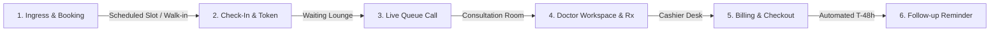

---

## 2. Core Clinical & Administrative Sequence Diagrams

### Workflow 01: Patient Self-Registration & Portal Access
*A new patient creates an account on the patient portal, submits demographics, provides DPDP consent, and receives a unique UHID.*

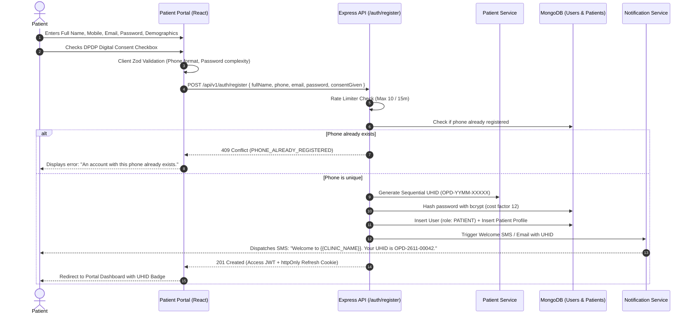

---

### Workflow 02: Online Appointment Booking & Slot Locking
*A patient books a slot via the online portal. The engine verifies doctor availability and commits the slot atomically.*

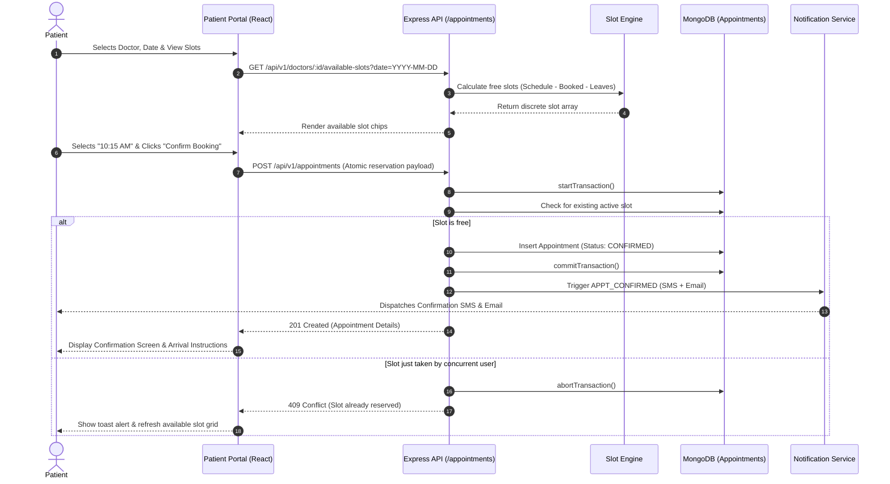

---

### Workflow 03: Smart Specialist Doctor Auto-Allocation & Receptionist Override
*Patient requests a specialty or receptionist books walk-in; the engine scores and assigns the lowest-workload doctor, with authorized override support.*

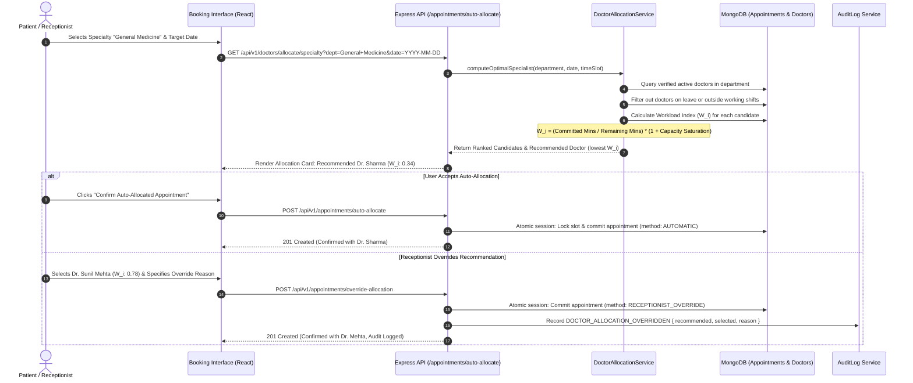

---

### Workflow 04: Receptionist Walk-in & Phone Booking
*Receptionist books an appointment or walk-in patient from the front-desk dashboard.*

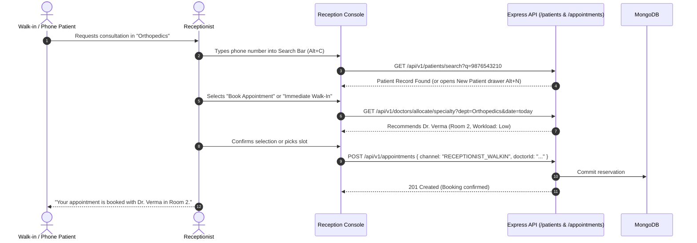

---

### Workflow 05: Physical OPD Check-In & Sequential Token Generation (Path A & Path B)
*Arriving patients receive daily sequential tokens. Supports both pre-booked appointment check-in and direct walk-in tokens.*

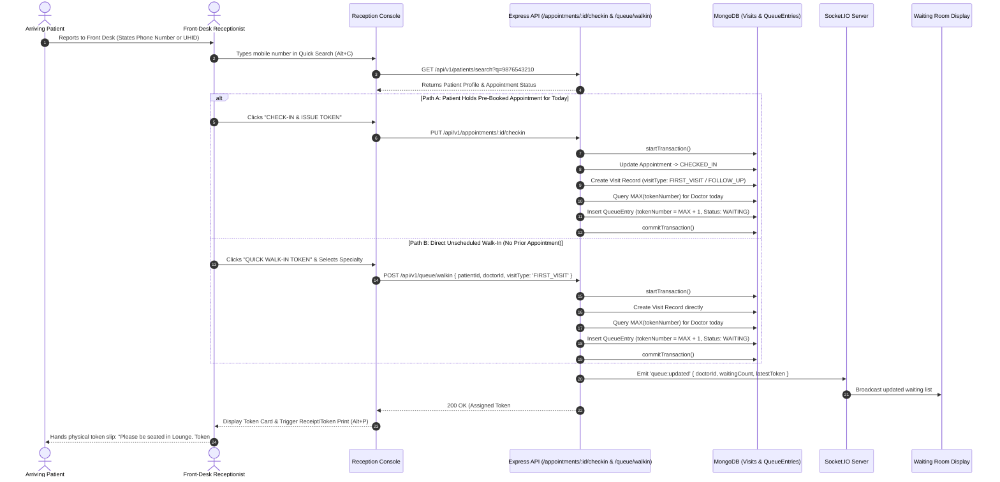

---

### Workflow 06: Live Queue Advance & Waiting Room Call
*Doctor finishes consultation, clicks "Call Next", notifying waiting room screen and patient.*

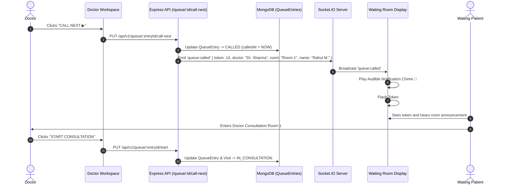

---

### Workflow 07: Clinical Consultation, Prescription & PDFKit Streaming
*Doctor evaluates patient, enters clinical findings, prescribes medications, and finalizes signed PDF.*

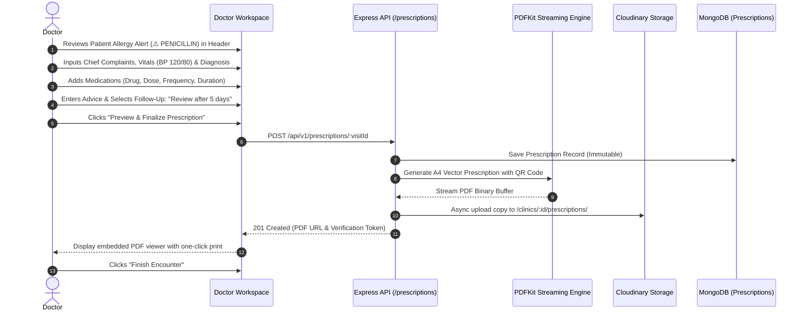

---

### Workflow 08: Diagnostic Lab/Radiology Report Upload & Presigned URL Access
*Front desk or doctor uploads diagnostic report, stored securely in Cloudinary, accessed via signed URL.*

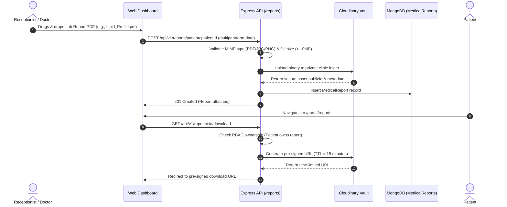

---

### Workflow 09: Emergency Priority Escalation
*A patient presents with acute trauma or chest pain requiring immediate queue override.*

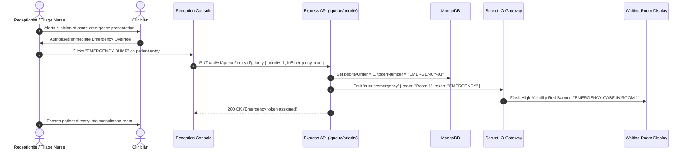

---

### Workflow 10: Doctor Leave Management & Automated Appointment Rescheduling
*Doctor marks unplanned leave; system identifies conflicting appointments and notifies patients.*

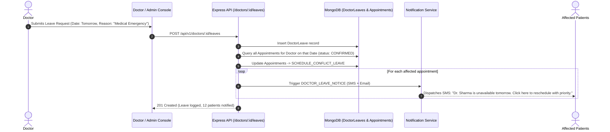

---

## 3. Queue State Machine Diagram

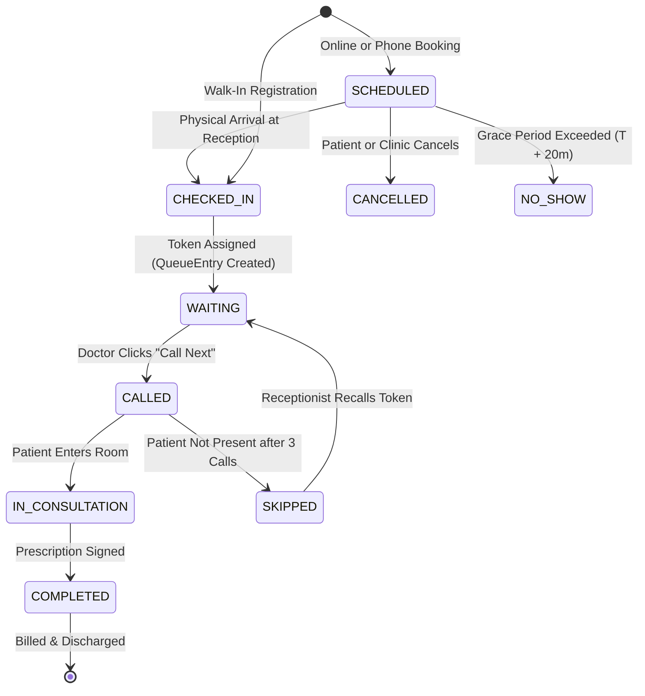

---

## 4. Cashier Billing & Settlement Flowchart

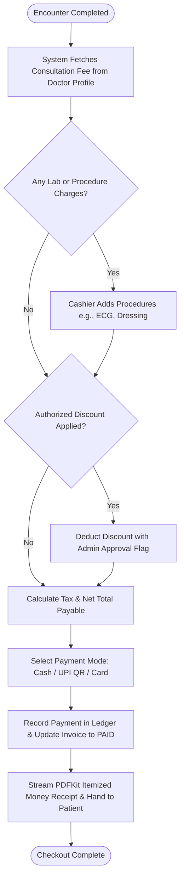
