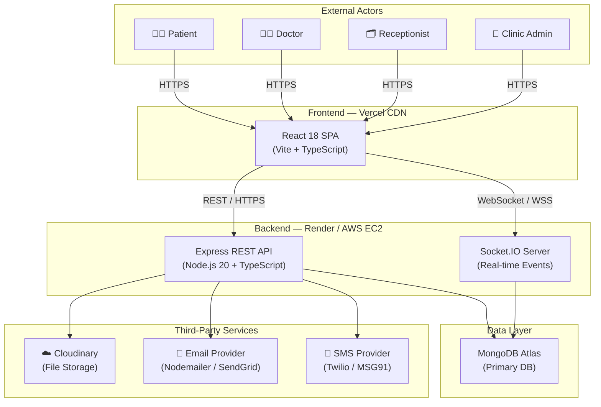
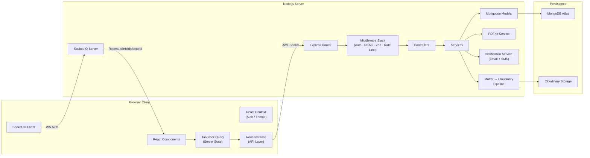
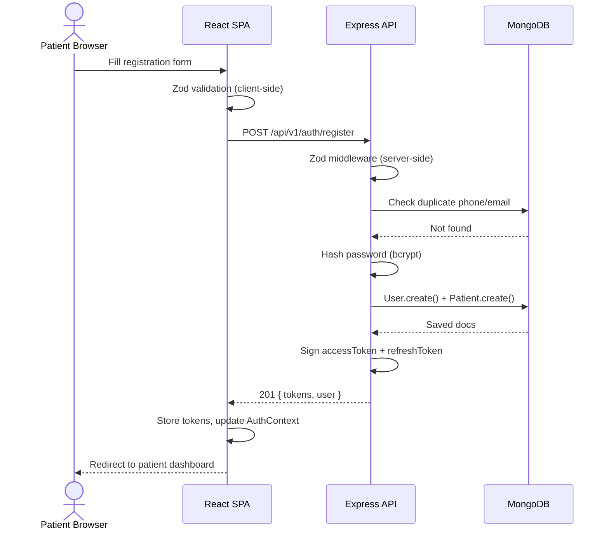
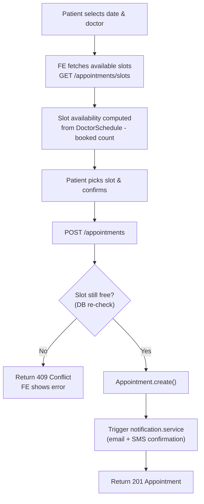
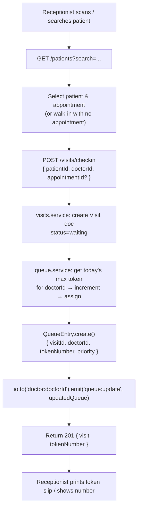
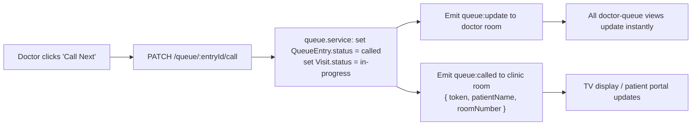
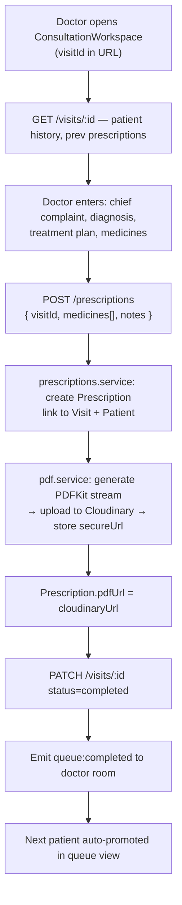
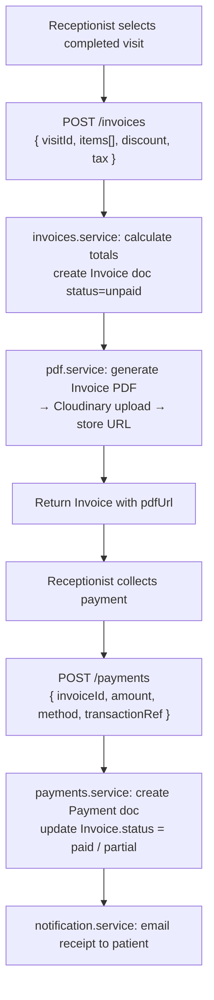
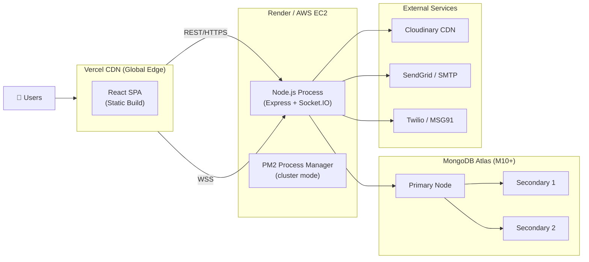

# 06 — System Architecture & Technical Design

**Project:** Smart OPD — Clinic Management Platform  
**Stack:** MERN (MongoDB · Express · React · Node.js) + TypeScript  
**Version:** 1.0.0  
**Last Updated:** 2026-11-11

---

## Table of Contents

1. [Architecture Overview](#1-architecture-overview)
2. [Frontend Architecture](#2-frontend-architecture)
3. [Backend Architecture](#3-backend-architecture)
4. [Real-time Architecture](#4-real-time-architecture)
5. [Data Flow Diagrams](#5-data-flow-diagrams)
6. [Integration Points](#6-integration-points)
7. [Deployment Architecture](#7-deployment-architecture)
8. [Performance Considerations](#8-performance-considerations)
9. [Scalability Notes](#9-scalability-notes)

---

## 1. Architecture Overview

### 1.1 System Context Diagram



### 1.2 Component Interaction Diagram



### 1.3 Key Architectural Decisions

| Decision | Choice | Rationale |
|---|---|---|
| **Full-stack language** | TypeScript everywhere | Shared types between client and server; compile-time safety; better IDE support |
| **Framework** | MERN stack | Uniform JS/TS across layers; large ecosystem; rapid feature delivery |
| **Database** | MongoDB 7 + Mongoose 8 | Flexible schema suits evolving medical records; `clinicId` tenant isolation is natural with documents; Atlas provides managed ops |
| **Real-time queue** | Socket.IO 4 | Bidirectional events; built-in room primitives map 1:1 to doctor queues; auto-reconnect; fallback to polling |
| **File storage** | Cloudinary | Managed CDN; on-the-fly image transformations; signed URLs for HIPAA-aware access control; free tier adequate for MVP |
| **State management** | TanStack Query v5 + Context | Query handles all server state (caching, invalidation, background refresh); Context is limited to auth tokens and UI prefs; avoids Redux overhead |
| **Frontend build** | Vite + React 18 | Fast HMR; native ESM; built-in code splitting; smaller bundle vs CRA |
| **Deployment split** | Vercel (FE) + Render/EC2 (BE) | Static assets on global CDN; backend on persistent server for Socket.IO; allows independent scaling |
| **Auth** | JWT (access + refresh tokens) | Stateless; role encoded in payload; suitable for single-clinic; refresh rotation prevents token theft |
| **PDF** | PDFKit | Node-native; no browser dependency; streaming output; prescriptions + invoices |

---

## 2. Frontend Architecture

### 2.1 Project Structure

```
client/
├── public/
│   └── favicon.ico
├── src/
│   ├── main.tsx                    # React root, providers wrapper
│   ├── App.tsx                     # Router outlet, global providers
│   ├── vite-env.d.ts
│   │
│   ├── api/                        # API layer
│   │   ├── axios.ts                # Configured Axios instance + interceptors
│   │   ├── auth.api.ts
│   │   ├── patients.api.ts
│   │   ├── appointments.api.ts
│   │   ├── queue.api.ts
│   │   ├── prescriptions.api.ts
│   │   ├── invoices.api.ts
│   │   ├── reports.api.ts
│   │   └── admin.api.ts
│   │
│   ├── types/                      # Shared TypeScript types (mirror server DTOs)
│   │   ├── auth.types.ts
│   │   ├── patient.types.ts
│   │   ├── appointment.types.ts
│   │   ├── queue.types.ts
│   │   ├── prescription.types.ts
│   │   ├── invoice.types.ts
│   │   └── common.types.ts         # ApiResponse<T>, PaginatedResponse<T>, etc.
│   │
│   ├── schemas/                    # Zod validation schemas (forms)
│   │   ├── auth.schema.ts
│   │   ├── patient.schema.ts
│   │   ├── appointment.schema.ts
│   │   └── prescription.schema.ts
│   │
│   ├── hooks/                      # Custom React hooks
│   │   ├── useAuth.ts              # Reads AuthContext
│   │   ├── useSocket.ts            # Socket.IO connection + event handlers
│   │   ├── useQueue.ts             # TanStack Query + socket sync for queue
│   │   ├── useToast.ts
│   │   └── usePagination.ts
│   │
│   ├── context/                    # React Context providers
│   │   ├── AuthContext.tsx         # User, tokens, login/logout
│   │   ├── ThemeContext.tsx        # Light/dark mode
│   │   └── SocketContext.tsx       # Shared Socket.IO connection
│   │
│   ├── components/                 # Shared / design-system components
│   │   ├── ui/                     # shadcn/ui re-exports + extensions
│   │   │   ├── Button.tsx
│   │   │   ├── Input.tsx
│   │   │   ├── DataTable.tsx       # Reusable paginated table
│   │   │   ├── Modal.tsx
│   │   │   └── ...
│   │   ├── layout/
│   │   │   ├── RootLayout.tsx      # Shell with sidebar + header
│   │   │   ├── Sidebar.tsx
│   │   │   ├── Header.tsx
│   │   │   └── AuthLayout.tsx      # Centered card for login/register
│   │   ├── guards/
│   │   │   ├── ProtectedRoute.tsx  # Checks auth + role
│   │   │   └── RoleGuard.tsx       # Renders children only for allowed roles
│   │   └── ErrorBoundary.tsx
│   │
│   ├── features/                   # Domain feature modules
│   │   ├── auth/
│   │   │   ├── LoginPage.tsx
│   │   │   └── RegisterPage.tsx
│   │   ├── dashboard/
│   │   │   ├── AdminDashboard.tsx
│   │   │   ├── DoctorDashboard.tsx
│   │   │   └── ReceptionistDashboard.tsx
│   │   ├── patients/
│   │   │   ├── PatientList.tsx
│   │   │   ├── PatientForm.tsx
│   │   │   ├── PatientDetail.tsx
│   │   │   └── MedicalHistory.tsx
│   │   ├── appointments/
│   │   │   ├── AppointmentCalendar.tsx
│   │   │   ├── BookAppointment.tsx
│   │   │   └── AppointmentDetail.tsx
│   │   ├── queue/
│   │   │   ├── QueueBoard.tsx      # Real-time display (Socket.IO)
│   │   │   ├── TokenDisplay.tsx
│   │   │   └── QueueControls.tsx   # Doctor: call next, complete
│   │   ├── consultation/
│   │   │   ├── ConsultationWorkspace.tsx
│   │   │   ├── PrescriptionForm.tsx
│   │   │   └── DiagnosisPanel.tsx
│   │   ├── billing/
│   │   │   ├── InvoiceList.tsx
│   │   │   ├── InvoiceCreate.tsx
│   │   │   └── PaymentRecord.tsx
│   │   ├── reports/
│   │   │   ├── ReportUpload.tsx
│   │   │   └── ReportViewer.tsx
│   │   ├── analytics/
│   │   │   └── AnalyticsDashboard.tsx
│   │   └── settings/
│   │       ├── ClinicSettings.tsx
│   │       └── UserManagement.tsx
│   │
│   ├── routes/
│   │   └── index.tsx               # Centralised route definitions
│   │
│   └── utils/
│       ├── formatters.ts           # Date, currency, name formatters
│       ├── constants.ts
│       └── errorHandler.ts
│
├── index.html
├── vite.config.ts
├── tailwind.config.ts
├── tsconfig.json
└── package.json
```

### 2.2 Routing Strategy

React Router v6 with nested routes and role-based protection:

```tsx
// routes/index.tsx (abbreviated)
<Routes>
  {/* Public */}
  <Route path="/login"    element={<LoginPage />} />
  <Route path="/register" element={<RegisterPage />} />

  {/* Protected shell */}
  <Route element={<ProtectedRoute />}>
    <Route element={<RootLayout />}>

      {/* Admin-only */}
      <Route element={<RoleGuard roles={["admin"]} />}>
        <Route path="/admin/settings"  element={<ClinicSettings />} />
        <Route path="/admin/users"     element={<UserManagement />} />
        <Route path="/admin/analytics" element={<AnalyticsDashboard />} />
        <Route path="/admin/audit"     element={<AuditLogs />} />
      </Route>

      {/* Doctor */}
      <Route element={<RoleGuard roles={["doctor", "admin"]} />}>
        <Route path="/doctor/queue"         element={<QueueBoard />} />
        <Route path="/doctor/consultation/:visitId" element={<ConsultationWorkspace />} />
      </Route>

      {/* Receptionist */}
      <Route element={<RoleGuard roles={["receptionist", "admin"]} />}>
        <Route path="/reception/checkin"    element={<CheckIn />} />
        <Route path="/reception/queue"      element={<QueueBoard />} />
      </Route>

      {/* Shared */}
      <Route path="/patients"            element={<PatientList />} />
      <Route path="/patients/:id"        element={<PatientDetail />} />
      <Route path="/appointments"        element={<AppointmentCalendar />} />
      <Route path="/billing"             element={<InvoiceList />} />
    </Route>
  </Route>

  <Route path="*" element={<NotFound />} />
</Routes>
```

`ProtectedRoute` checks the JWT in `AuthContext`; `RoleGuard` checks `user.role` and renders a `403` page if unauthorised.

### 2.3 State Management Strategy

| State Category | Tool | Examples |
|---|---|---|
| **Server state** | TanStack Query v5 | Patient list, appointments, queue, invoices |
| **Auth state** | React Context + localStorage | `accessToken`, `refreshToken`, `user` object |
| **UI / theme** | React Context | `darkMode`, sidebar open/closed |
| **Form state** | React Hook Form | Controlled fields, errors, touched state |
| **Ephemeral UI** | `useState` / `useReducer` | Modal open, selected row, search term |
| **Real-time** | Socket.IO → Query `setQueryData` | Live queue entries injected into query cache |

### 2.4 API Client Pattern

```ts
// api/axios.ts
import axios from "axios";

export const apiClient = axios.create({
  baseURL: import.meta.env.VITE_API_BASE_URL,
  headers: { "Content-Type": "application/json" },
});

// Request interceptor — attach Bearer token
apiClient.interceptors.request.use((config) => {
  const token = localStorage.getItem("accessToken");
  if (token) config.headers.Authorization = `Bearer ${token}`;
  return config;
});

// Response interceptor — handle 401 / token refresh
apiClient.interceptors.response.use(
  (res) => res,
  async (error) => {
    if (error.response?.status === 401) {
      // attempt refresh; on failure, logout
    }
    return Promise.reject(error);
  }
);
```

All API modules export typed functions returning `Promise<ApiResponse<T>>`.

### 2.5 Form Handling Pattern

```ts
// schemas/patient.schema.ts
import { z } from "zod";

export const patientSchema = z.object({
  name:        z.string().min(2).max(100),
  phone:       z.string().regex(/^\+?[0-9]{10,14}$/),
  dob:         z.string().datetime(),
  gender:      z.enum(["male", "female", "other"]),
  bloodGroup:  z.enum(["A+","A-","B+","B-","AB+","AB-","O+","O-"]).optional(),
  address:     z.string().optional(),
});

export type PatientFormData = z.infer<typeof patientSchema>;

// In component:
const { register, handleSubmit, formState: { errors } } =
  useForm<PatientFormData>({ resolver: zodResolver(patientSchema) });
```

### 2.6 Real-time Updates via Socket.IO Client

```ts
// context/SocketContext.tsx
export const SocketProvider: FC<PropsWithChildren> = ({ children }) => {
  const { user, accessToken } = useAuth();
  const socket = useMemo(() =>
    io(import.meta.env.VITE_WS_URL, {
      auth: { token: accessToken },
      transports: ["websocket", "polling"],  // websocket first, polling fallback
      autoConnect: false,
    }), [accessToken]);

  useEffect(() => {
    if (user) { socket.connect(); }
    return () => { socket.disconnect(); };
  }, [user]);

  return <SocketContext.Provider value={socket}>{children}</SocketContext.Provider>;
};

// hooks/useQueue.ts
const socket = useSocket();
const qc = useQueryClient();

useEffect(() => {
  socket.on("queue:update", (payload: QueueUpdatePayload) => {
    qc.setQueryData(["queue", payload.doctorId], payload.queue);
  });
  return () => { socket.off("queue:update"); };
}, [socket, qc]);
```

### 2.7 Error Boundaries & Fallbacks

- A top-level `<ErrorBoundary>` wraps `<App>` to catch render errors.
- Each major feature route uses a Suspense boundary with a skeleton fallback.
- TanStack Query `onError` callbacks display toast notifications.

### 2.8 Code Splitting & Lazy Loading

All page-level feature components are lazy-loaded:

```ts
const ConsultationWorkspace = lazy(() => import("./features/consultation/ConsultationWorkspace"));
```

Vite automatically splits vendor chunks (react, react-dom, tanstack, socket.io-client) from application code.

### 2.9 TypeScript Conventions

```ts
// Shared response wrapper
interface ApiResponse<T> {
  success: boolean;
  data: T;
  message?: string;
  errors?: Record<string, string[]>;
}

// Paginated
interface PaginatedResponse<T> extends ApiResponse<T[]> {
  pagination: { page: number; limit: number; total: number; pages: number };
}

// Role enum
enum UserRole { Admin = "admin", Doctor = "doctor", Receptionist = "receptionist", Patient = "patient" }
```

---

## 3. Backend Architecture

### 3.1 Project Structure

```
server/
├── src/
│   ├── index.ts                    # HTTP + Socket.IO server bootstrap
│   ├── app.ts                      # Express app factory, middleware registration
│   │
│   ├── config/
│   │   ├── db.ts                   # Mongoose connection with retry
│   │   ├── env.ts                  # Zod-parsed environment variables
│   │   ├── cloudinary.ts           # Cloudinary SDK init
│   │   └── nodemailer.ts           # Nodemailer transporter
│   │
│   ├── routes/
│   │   ├── index.ts                # Mount all routers under /api/v1
│   │   ├── auth.routes.ts
│   │   ├── patients.routes.ts
│   │   ├── appointments.routes.ts
│   │   ├── queue.routes.ts
│   │   ├── visits.routes.ts
│   │   ├── prescriptions.routes.ts
│   │   ├── reports.routes.ts
│   │   ├── invoices.routes.ts
│   │   ├── payments.routes.ts
│   │   ├── followups.routes.ts
│   │   ├── notifications.routes.ts
│   │   ├── analytics.routes.ts
│   │   ├── auditlogs.routes.ts
│   │   └── settings.routes.ts
│   │
│   ├── controllers/
│   │   ├── auth.controller.ts
│   │   ├── patients.controller.ts
│   │   ├── appointments.controller.ts
│   │   ├── queue.controller.ts
│   │   ├── visits.controller.ts
│   │   ├── prescriptions.controller.ts
│   │   ├── reports.controller.ts
│   │   ├── invoices.controller.ts
│   │   └── analytics.controller.ts
│   │
│   ├── services/
│   │   ├── auth.service.ts         # Token creation/validation, refresh rotation
│   │   ├── patients.service.ts
│   │   ├── appointments.service.ts # Slot conflict detection, waitlist logic
│   │   ├── queue.service.ts        # Token numbering, priority queue
│   │   ├── visits.service.ts
│   │   ├── prescriptions.service.ts
│   │   ├── pdf.service.ts          # PDFKit – prescription, invoice, report PDFs
│   │   ├── cloudinary.service.ts   # Upload, delete, signed URL
│   │   ├── email.service.ts        # Template rendering + Nodemailer dispatch
│   │   ├── sms.service.ts          # Twilio / MSG91 adapter
│   │   └── notification.service.ts # Orchestrates email + SMS
│   │
│   ├── models/
│   │   ├── User.model.ts
│   │   ├── ClinicSettings.model.ts
│   │   ├── Doctor.model.ts
│   │   ├── Patient.model.ts
│   │   ├── Appointment.model.ts
│   │   ├── DoctorSchedule.model.ts
│   │   ├── DoctorLeave.model.ts
│   │   ├── Visit.model.ts
│   │   ├── QueueEntry.model.ts
│   │   ├── Prescription.model.ts
│   │   ├── MedicalReport.model.ts
│   │   ├── Invoice.model.ts
│   │   ├── Payment.model.ts
│   │   ├── FollowUp.model.ts
│   │   ├── Notification.model.ts
│   │   └── AuditLog.model.ts
│   │
│   ├── middleware/
│   │   ├── authenticate.ts         # Verifies JWT, attaches req.user
│   │   ├── authorize.ts            # RBAC factory: authorize("admin","doctor")
│   │   ├── validate.ts             # Zod schema middleware factory
│   │   ├── auditLogger.ts          # Writes AuditLog post-request
│   │   ├── rateLimiter.ts          # express-rate-limit configs
│   │   ├── upload.ts               # Multer disk/memory storage config
│   │   └── errorHandler.ts         # Global Express error handler
│   │
│   ├── errors/
│   │   └── AppError.ts             # Custom error class
│   │
│   ├── sockets/
│   │   ├── socket.server.ts        # Socket.IO init, namespace/room setup
│   │   ├── socket.auth.ts          # WS JWT verification middleware
│   │   └── queue.socket.ts         # Queue event emitters / handlers
│   │
│   ├── jobs/
│   │   ├── reminderJob.ts          # node-cron: appointment reminders
│   │   └── cleanupJob.ts           # node-cron: soft-delete old notifications
│   │
│   ├── utils/
│   │   ├── asyncHandler.ts         # Wraps async controllers
│   │   ├── generateToken.ts        # JWT sign helper
│   │   ├── paginate.ts             # Mongoose cursor pagination helper
│   │   └── slugify.ts
│   │
│   └── types/
│       ├── express.d.ts            # Augment req.user, req.clinicId
│       └── shared.types.ts         # ApiResponse<T>, Role enum
│
├── tsconfig.json
├── package.json
└── .env.example
```

### 3.2 Layered Architecture

```
HTTP Request
     │
     ▼
[ Express Router ]   – URL matching, method dispatch
     │
     ▼
[ Middleware Stack ]  – authenticate → authorize → validate → rateLimiter
     │
     ▼
[ Controller ]       – Extract params/body, call service, format response
     │
     ▼
[ Service ]          – Business logic, cross-collection operations, side effects
     │
     ▼
[ Mongoose Model ]   – Schema enforcement, DB queries, virtuals, hooks
     │
     ▼
[ MongoDB Atlas ]
```

### 3.3 Middleware Stack

```ts
// app.ts
app.use(helmet());
app.use(cors({ origin: process.env.CORS_ORIGIN, credentials: true }));
app.use(express.json({ limit: "10mb" }));
app.use(cookieParser());
app.use("/api/v1", generalRateLimiter);    // 100 req/15 min per IP
app.use("/api/v1/auth", authRateLimiter);  // 10 req/15 min on login
app.use("/api/v1", router);
app.use(errorHandler);                     // must be last
```

**Per-route middleware order:**

```
authenticate → authorize("doctor","receptionist") → validate(schema) → asyncHandler(controller)
```

### 3.4 Error Handling Strategy

```ts
// errors/AppError.ts
export class AppError extends Error {
  constructor(
    public message: string,
    public statusCode: number,
    public code?: string,
    public details?: unknown,
  ) {
    super(message);
    this.name = "AppError";
  }
}

// middleware/errorHandler.ts
export const errorHandler: ErrorRequestHandler = (err, _req, res, _next) => {
  if (err instanceof AppError) {
    return res.status(err.statusCode).json({ success: false, message: err.message, code: err.code });
  }
  if (err.name === "ValidationError") {         // Mongoose
    return res.status(400).json({ ... });
  }
  if (err.name === "CastError") {               // Invalid ObjectId
    return res.status(400).json({ ... });
  }
  // Unhandled — log and return 500
  logger.error(err);
  res.status(500).json({ success: false, message: "Internal server error" });
};
```

### 3.5 Async Error Wrapper

```ts
// utils/asyncHandler.ts
import { Request, Response, NextFunction, RequestHandler } from "express";

type AsyncFn = (req: Request, res: Response, next: NextFunction) => Promise<unknown>;

export const asyncHandler = (fn: AsyncFn): RequestHandler =>
  (req, res, next) => Promise.resolve(fn(req, res, next)).catch(next);
```

All controllers are wrapped: `router.get("/", asyncHandler(controller.list))`.

### 3.6 Request Validation (Zod Middleware)

```ts
// middleware/validate.ts
import { AnyZodObject, ZodError } from "zod";

export const validate = (schema: AnyZodObject) =>
  (req: Request, _res: Response, next: NextFunction) => {
    try {
      schema.parse({ body: req.body, query: req.query, params: req.params });
      next();
    } catch (err) {
      if (err instanceof ZodError) {
        next(new AppError("Validation failed", 400, "VALIDATION_ERROR", err.flatten()));
      } else next(err);
    }
  };
```

### 3.7 File Upload Pipeline

```
Client (multipart/form-data)
       │
       ▼
  Multer (memory storage, 10 MB limit, MIME whitelist)
       │
       ▼
  cloudinary.service.ts → cloudinary.uploader.upload_stream()
       │
       ▼
  Returns: { publicId, secureUrl, format, bytes }
       │
       ▼
  Stored in MedicalReport / User.avatar document field
```

Signed URL generation for private assets:

```ts
cloudinary.utils.private_download_url(publicId, format, { expires_at: Date.now()/1000 + 3600 });
```

### 3.8 PDF Generation Pipeline

```ts
// services/pdf.service.ts
import PDFDocument from "pdfkit";
import { Response } from "express";

export const streamPrescriptionPDF = (data: PrescriptionData, res: Response) => {
  const doc = new PDFDocument({ margin: 50 });
  res.setHeader("Content-Type", "application/pdf");
  res.setHeader("Content-Disposition", `inline; filename="prescription-${data.id}.pdf"`);
  doc.pipe(res);

  // Header: clinic logo, name, address
  // Patient section
  // Medicines table
  // Doctor signature
  doc.end();
};
```

Three PDF types: **Prescription**, **Invoice**, **Medical Report summary**.

### 3.9 Notification Service

Notifications are dispatched inline after the triggering service action (MVP). A thin adapter pattern allows swapping provider without changing callers:

```ts
// services/notification.service.ts
export const sendAppointmentConfirmation = async (appointment: IAppointment) => {
  const [emailResult, smsResult] = await Promise.allSettled([
    emailService.send({ to: appointment.patient.email, template: "appointment_confirmed", data: { ... } }),
    smsService.send({ to: appointment.patient.phone, body: `Your appointment is confirmed...` }),
  ]);
  await Notification.create({ ... log both results ... });
};
```

**SMS adapter** wraps Twilio or MSG91 behind a common `ISmsProvider` interface, switchable via `SMS_PROVIDER` env var.

### 3.10 Background Jobs (node-cron)

| Job | Schedule | Purpose |
|---|---|---|
| `reminderJob` | Every 30 min | Send email/SMS for appointments in next 24 h |
| `cleanupJob` | Daily 02:00 | Mark sent notifications older than 90 days as archived |

---

## 4. Real-time Architecture

### 4.1 Namespace & Room Design

```
Socket.IO Server
└── Namespace: /opd  (default namespace used for simplicity)
    ├── Room: clinic:<clinicId>          → clinic-wide broadcasts (admin alerts)
    ├── Room: doctor:<doctorId>          → doctor's queue events
    └── Room: patient:<patientId>        → patient-specific notifications
```

Clients join rooms after authentication:

```ts
// sockets/queue.socket.ts
socket.on("join:doctor", (doctorId: string) => {
  socket.join(`doctor:${doctorId}`);
});
socket.on("join:clinic", (clinicId: string) => {
  socket.join(`clinic:${clinicId}`);
});
```

### 4.2 Event Catalogue

| Event Name | Direction | Payload | Triggered By |
|---|---|---|---|
| `queue:update` | Server → Client | `{ doctorId, queue: QueueEntry[] }` | Check-in, next-called, completed |
| `queue:called` | Server → Client | `{ token, patientName, roomNumber }` | Doctor calls next patient |
| `queue:completed` | Server → Client | `{ visitId, doctorId }` | Consultation marked complete |
| `appointment:updated` | Server → Client | `{ appointmentId, status }` | Reschedule / cancel |
| `notification:new` | Server → Client | `{ title, body, type }` | Any backend notification trigger |
| `join:doctor` | Client → Server | `doctorId` | On doctor dashboard mount |
| `join:clinic` | Client → Server | `clinicId` | On admin dashboard mount |

### 4.3 WebSocket Authentication

JWT is verified in the Socket.IO middleware before connection is accepted:

```ts
// sockets/socket.auth.ts
io.use(async (socket, next) => {
  const token = socket.handshake.auth?.token;
  if (!token) return next(new Error("Authentication required"));
  try {
    const decoded = verifyJWT(token);
    socket.data.user = decoded;
    next();
  } catch {
    next(new Error("Invalid token"));
  }
});
```

### 4.4 Reconnection & Fallback Strategy

- Socket.IO is configured `transports: ["websocket", "polling"]` — WebSocket is attempted first; long-polling is used as fallback automatically.
- Client `reconnectionAttempts: 5`, `reconnectionDelay: 1000ms` (exponential backoff built in).
- On reconnect, client re-emits `join:doctor` / `join:clinic` to re-subscribe to rooms.
- TanStack Query `refetchOnWindowFocus: true` acts as a data-consistency safety net if events are missed.

---

## 5. Data Flow Diagrams

### 5.1 Patient Self-Registration



### 5.2 Appointment Booking



### 5.3 OPD Check-in & Token Generation



### 5.4 Doctor Calls Next Patient



### 5.5 Consultation & Prescription Creation



### 5.6 Invoice Generation & Payment Recording



---

## 6. Integration Points

### 6.1 Cloudinary

| Operation | Method | Notes |
|---|---|---|
| Upload file | `cloudinary.uploader.upload_stream()` | Streams from Multer buffer; avoids temp disk write |
| Delete file | `cloudinary.uploader.destroy(publicId)` | Called on report deletion |
| Signed URL | `cloudinary.utils.private_download_url()` | Expires in 1 h; prevents public hotlinking of medical files |
| Transformations | URL parameters (`w_800,q_auto,f_auto`) | Applied at delivery time for image reports |

**Folder structure in Cloudinary:**
```
smart-opd/
├── clinics/<clinicId>/reports/<patientId>/
├── clinics/<clinicId>/prescriptions/
├── clinics/<clinicId>/invoices/
└── clinics/<clinicId>/avatars/
```

### 6.2 Email Notifications

Templates are compiled with **Handlebars** (or inline string interpolation for MVP) and sent via Nodemailer:

| Trigger | Template | Recipients |
|---|---|---|
| Patient registration | `welcome.hbs` | Patient |
| Appointment confirmed | `appointment_confirmed.hbs` | Patient |
| Appointment reminder | `appointment_reminder.hbs` | Patient (24 h before) |
| Appointment cancelled | `appointment_cancelled.hbs` | Patient |
| Token called | `token_called.hbs` | Patient (optional push) |
| Invoice ready | `invoice_ready.hbs` | Patient (with PDF attachment) |
| Prescription ready | `prescription_ready.hbs` | Patient |

### 6.3 SMS Notifications

Sent for critical events only (high open rate). Provider selected via `SMS_PROVIDER` env var:

| Trigger | Message (abbreviated) |
|---|---|
| Appointment confirmed | "Appt confirmed for [date] with Dr [name]" |
| Appointment reminder | "Reminder: appt tomorrow at [time]" |
| Token called | "Your token #[N] is now being called. Please proceed." |
| Appointment cancelled | "Your appt on [date] has been cancelled." |

### 6.4 PDF Generation

| PDF Type | Key Sections | Delivery |
|---|---|---|
| **Prescription** | Clinic header, patient info, Rx items, dosage, doctor signature | Stream to browser + upload to Cloudinary |
| **Invoice** | Clinic header, patient info, line items, taxes, total, QR | Stream to browser + Cloudinary URL in Invoice doc |
| **Report summary** | Clinic header, report metadata, Cloudinary image embed | Stream to browser |

---

## 7. Deployment Architecture

### 7.1 Production Infrastructure



### 7.2 Environment Variables

> **Note:** Values are never committed to source control. Use provider secrets management (Render dashboard, AWS Secrets Manager, Vercel env UI).

#### Backend `.env`

| Variable | Description |
|---|---|
| `NODE_ENV` | `production` / `development` / `test` |
| `PORT` | HTTP server port (default 5000) |
| `CORS_ORIGIN` | Allowed frontend origin(s), comma-separated |
| `MONGODB_URI` | Full MongoDB Atlas connection string |
| `JWT_ACCESS_SECRET` | Secret for signing access tokens |
| `JWT_REFRESH_SECRET` | Secret for signing refresh tokens |
| `JWT_ACCESS_EXPIRES_IN` | Access token TTL (e.g. `15m`) |
| `JWT_REFRESH_EXPIRES_IN` | Refresh token TTL (e.g. `7d`) |
| `CLOUDINARY_CLOUD_NAME` | Cloudinary account cloud name |
| `CLOUDINARY_API_KEY` | Cloudinary API key |
| `CLOUDINARY_API_SECRET` | Cloudinary API secret |
| `EMAIL_HOST` | SMTP host |
| `EMAIL_PORT` | SMTP port (587 / 465) |
| `EMAIL_USER` | SMTP username / SendGrid API key |
| `EMAIL_PASS` | SMTP password |
| `EMAIL_FROM` | Sender address |
| `SMS_PROVIDER` | `twilio` or `msg91` |
| `TWILIO_ACCOUNT_SID` | Twilio account SID |
| `TWILIO_AUTH_TOKEN` | Twilio auth token |
| `TWILIO_PHONE_NUMBER` | Twilio sender number |
| `MSG91_AUTH_KEY` | MSG91 API auth key |
| `MSG91_SENDER_ID` | MSG91 sender ID |
| `BCRYPT_SALT_ROUNDS` | bcrypt cost factor (default 12) |
| `RATE_LIMIT_WINDOW_MS` | Rate limit window in ms |
| `RATE_LIMIT_MAX` | Max requests per window |

#### Frontend `.env`

| Variable | Description |
|---|---|
| `VITE_API_BASE_URL` | Backend REST API base URL |
| `VITE_WS_URL` | WebSocket server URL |
| `VITE_APP_NAME` | App display name |

### 7.3 CI/CD Pipeline (GitHub Actions)

```yaml
# .github/workflows/ci.yml  (abbreviated)
name: CI/CD

on:
  push:
    branches: [main, develop]
  pull_request:
    branches: [main]

jobs:
  lint-and-test:
    runs-on: ubuntu-latest
    steps:
      - uses: actions/checkout@v4
      - uses: actions/setup-node@v4
        with: { node-version: "20" }
      - run: npm ci
      - run: npm run lint
      - run: npm run typecheck
      - run: npm run test

  deploy-frontend:
    needs: lint-and-test
    if: github.ref == 'refs/heads/main'
    runs-on: ubuntu-latest
    steps:
      - uses: actions/checkout@v4
      - run: cd client && npm ci && npm run build
      - uses: amondnet/vercel-action@v25
        with:
          vercel-token: ${{ secrets.VERCEL_TOKEN }}
          vercel-org-id: ${{ secrets.VERCEL_ORG_ID }}
          vercel-project-id: ${{ secrets.VERCEL_PROJECT_ID }}
          working-directory: ./client

  deploy-backend:
    needs: lint-and-test
    if: github.ref == 'refs/heads/main'
    runs-on: ubuntu-latest
    steps:
      - uses: actions/checkout@v4
      - run: |
          curl -X POST "${{ secrets.RENDER_DEPLOY_HOOK_URL }}"
```

### 7.4 Vercel Configuration

```json
// client/vercel.json
{
  "rewrites": [{ "source": "/(.*)", "destination": "/index.html" }],
  "headers": [
    {
      "source": "/assets/(.*)",
      "headers": [{ "key": "Cache-Control", "value": "public, max-age=31536000, immutable" }]
    }
  ]
}
```

### 7.5 Render / AWS EC2 Backend Configuration

**Render:**
- Build command: `npm ci && npm run build`
- Start command: `npm start` → runs `node dist/index.js` via PM2 (or `node dist/index.js` directly on Render)
- Health check path: `GET /api/v1/health`
- Auto-deploy on GitHub `main` branch push

**AWS EC2:**
- Use PM2 cluster mode: `pm2 start dist/index.js -i max`
- Nginx reverse proxy on port 80/443 → `localhost:5000`
- SSL via Certbot (Let's Encrypt)

### 7.6 MongoDB Atlas Configuration

| Setting | Recommendation |
|---|---|
| **Cluster tier** | M10 (production), M0 (development) |
| **Backups** | Continuous cloud backups + daily snapshots (7-day retention) |
| **Network access** | IP whitelist — Render/EC2 static IPs only |
| **Database user** | Principle of least privilege — `readWrite` on `smart-opd` DB only |
| **Connection string** | Use SRV format with `retryWrites=true&w=majority` |
| **Indexes** | See Section 8 |

### 7.7 SSL/TLS & DNS

- **Frontend:** Vercel provides automatic TLS for custom domains via Let's Encrypt.
- **Backend (Render):** Render provides automatic TLS on `*.onrender.com`; custom domain uses Render-managed cert.
- **Backend (AWS EC2):** Nginx + Certbot. Renew cron: `0 0 */60 * * certbot renew --quiet`.
- **DNS records:** `A` record for backend, `CNAME` for `www` frontend to Vercel. Use Cloudflare as DNS with Proxy enabled for DDoS protection.
- **WebSocket (AWS):** Ensure Nginx `proxy_http_version 1.1;`, `proxy_set_header Upgrade $http_upgrade;`, `proxy_set_header Connection "upgrade";`.

---

## 8. Performance Considerations

### 8.1 MongoDB Query Optimization

**Critical indexes:**

```js
// Compound indexes for most frequent queries
db.appointments.createIndex({ clinicId: 1, doctorId: 1, date: 1 });
db.appointments.createIndex({ clinicId: 1, patientId: 1, status: 1 });
db.queueEntries.createIndex({ clinicId: 1, doctorId: 1, date: 1, status: 1 });
db.visits.createIndex({ clinicId: 1, patientId: 1, createdAt: -1 });
db.patients.createIndex({ clinicId: 1, phone: 1 }, { unique: true });
db.patients.createIndex({ clinicId: 1, name: "text", phone: 1 });  // text search
db.auditLogs.createIndex({ clinicId: 1, createdAt: -1 });
db.notifications.createIndex({ clinicId: 1, userId: 1, read: 1 });
```

**Pagination:** All list endpoints use cursor-based or offset pagination with `limit` capped at 100. Always project only required fields.

```ts
// Efficient query pattern
const patients = await Patient
  .find({ clinicId, ...filter }, "name phone dob gender _id")  // projection
  .sort({ createdAt: -1 })
  .skip((page - 1) * limit)
  .limit(limit)
  .lean();  // returns plain JS objects — no Mongoose document overhead
```

### 8.2 TanStack Query Caching Strategy

| Data Type | `staleTime` | `gcTime` | Rationale |
|---|---|---|---|
| Patient list | 2 min | 10 min | Changes infrequently during a session |
| Appointment slots | 30 s | 5 min | Slots can fill quickly — stay fresh |
| Active queue | 0 | 1 min | Always fresh — real-time via Socket.IO |
| Prescriptions | 5 min | 30 min | Historical; rarely changes |
| Clinic settings | 10 min | 1 h | Very rarely changes |
| Analytics | 5 min | 15 min | Approximate data acceptable |

Queue data uses `staleTime: 0` but is primarily updated via `setQueryData` from Socket.IO events, making background re-fetches infrequent.

### 8.3 Image Optimization

Cloudinary URL transformations are appended at fetch time:

```
https://res.cloudinary.com/<cloud>/image/upload/w_800,q_auto,f_auto/smart-opd/...
```

- `q_auto` — Cloudinary selects optimal quality per image
- `f_auto` — serves WebP/AVIF for supporting browsers
- `w_800` — cap width for report thumbnails

### 8.4 API Response Time Targets

| Endpoint Category | P50 Target | P99 Target |
|---|---|---|
| Auth (login/register) | < 200 ms | < 800 ms |
| List endpoints (paginated) | < 150 ms | < 500 ms |
| Single record fetch | < 80 ms | < 300 ms |
| Appointment booking | < 200 ms | < 600 ms |
| PDF generation | < 1 s | < 3 s |
| File upload (Cloudinary) | < 2 s | < 5 s |

### 8.5 Connection Pooling

Mongoose maintains a connection pool internally. Configure pool size to match the deployment tier:

```ts
// config/db.ts
mongoose.connect(process.env.MONGODB_URI, {
  maxPoolSize: 10,          // 10 concurrent connections
  serverSelectionTimeoutMS: 5000,
  socketTimeoutMS: 45000,
});
```

On EC2 with PM2 cluster mode (N workers), set `maxPoolSize` to `Math.ceil(100 / N)` to stay within Atlas M10 connection limits (500 total).

---

## 9. Scalability Notes

### 9.1 `clinicId` Tenant Isolation

Every MongoDB document except `users` contains a `clinicId` field. All service methods accept and filter by `clinicId`:

```ts
// Enforced at service level — never bypassed
const appointments = await Appointment.find({ clinicId: req.user.clinicId, ... });
```

This design is **multi-tenancy-ready**: adding a second clinic requires zero schema migrations — simply onboard a new `clinicId`. When expanding to SaaS, the top-level route guard ensures a JWT's `clinicId` matches the requested resource's `clinicId`.

### 9.2 Horizontal Scaling Considerations

| Component | Scaling Approach |
|---|---|
| **Express API** | Stateless — scale horizontally with PM2 cluster or multiple EC2 instances behind a load balancer |
| **Socket.IO** | Requires sticky sessions (Nginx `ip_hash`) OR the **Redis adapter** (`@socket.io/redis-adapter`) so events broadcast correctly across processes |
| **Background jobs** | Only one instance should run cron jobs — use a leader-election lock in Redis or a dedicated worker process |
| **MongoDB** | Atlas horizontal sharding on `clinicId` when multi-clinic load demands it |

**Redis adapter for Socket.IO (when scaling):**

```ts
import { createAdapter } from "@socket.io/redis-adapter";
import { createClient } from "redis";

const pubClient = createClient({ url: process.env.REDIS_URL });
const subClient = pubClient.duplicate();
io.adapter(createAdapter(pubClient, subClient));
```

### 9.3 Database Sharding Readiness

MongoDB Atlas supports sharding. When the single-clinic deployment grows to multi-clinic SaaS:

- **Shard key:** `{ clinicId: 1 }` — ensures all data for a clinic resides on one shard for query locality.
- **Pre-condition:** All indexes already include `clinicId` as the leading field (Section 8.1).
- **Migration path:** Enable Atlas sharding on the existing cluster → define shard key → Atlas handles chunk balancing automatically.

> [!NOTE]
> For a single-clinic deployment, sharding is unnecessary. The architecture is designed to allow it without schema changes when demand grows.

---

*Document generated for the Smart OPD project. All configuration values are placeholders — refer to the `.env.example` file and your secrets manager for actual values.*
