# Smart OPD — Workflow & Business Process Documentation

**Document ID:** WF-DOC-01  
**Version:** 1.0  
**Status:** Draft  
**Audience:** Business Analysts, Developers, QA Engineers, Clinic Administrators  
**Last Updated:** 2026-11-11

---

## Table of Contents

| ID | Workflow | Category |
|----|----------|----------|
| [WF-01](#wf-01-patient-self-registration) | Patient Self-Registration | Onboarding |
| [WF-02](#wf-02-receptionist-patient-registration) | Receptionist Patient Registration | Onboarding |
| [WF-03](#wf-03-appointment-booking-patient-self-service) | Appointment Booking (Patient Self-Service) | Scheduling |
| [WF-04](#wf-04-appointment-booking-receptionist-assisted) | Appointment Booking (Receptionist-Assisted) | Scheduling |
| [WF-05](#wf-05-doctor-schedule-configuration) | Doctor Schedule Configuration | Availability |
| [WF-06](#wf-06-doctor-leave-management) | Doctor Leave Management | Availability |
| [WF-07](#wf-07-opd-check-in--token-generation) | OPD Check-In & Token Generation | Queue |
| [WF-08](#wf-08-live-queue-management) | Live Queue Management | Queue |
| [WF-09](#wf-09-doctor-consultation) | Doctor Consultation | Clinical |
| [WF-10](#wf-10-prescription-generation) | Prescription Generation | Clinical |
| [WF-11](#wf-11-medical-report-upload--access) | Medical Report Upload & Access | Clinical |
| [WF-12](#wf-12-follow-up-scheduling) | Follow-up Scheduling | Clinical |
| [WF-13](#wf-13-invoice-generation) | Invoice Generation | Billing |
| [WF-14](#wf-14-payment-recording) | Payment Recording | Billing |
| [WF-15](#wf-15-appointment-cancellation-patient) | Appointment Cancellation (Patient) | Scheduling |
| [WF-16](#wf-16-appointment-cancellation-staff) | Appointment Cancellation (Staff) | Scheduling |
| [WF-17](#wf-17-no-show-handling) | No-Show Handling | Queue |
| [WF-18](#wf-18-emergency--priority-queue) | Emergency / Priority Queue | Queue |
| [WF-19](#wf-19-analytics-report-generation) | Analytics Report Generation | Reporting |
| [WF-20](#wf-20-audit-log-review) | Audit Log Review | Compliance |
| [WF-21](#wf-21-notification-sending) | Notification Sending | Communication |
| [WF-22](#wf-22-clinic-settings-update) | Clinic Settings Update | Administration |

---

## Notation Guide

- **Actor labels:** `Patient`, `Receptionist`, `Doctor`, `Admin`, `System`
- **Field names** are written in `camelCase` (e.g., `appointmentStatus`, `tokenNumber`)
- **Status values** are written in `UPPER_SNAKE_CASE` (e.g., `CONFIRMED`, `CHECKED_IN`)
- **Events** (Socket.IO) are written in `kebab-case` (e.g., `queue:next-called`)
- **Collections** are written in **bold** (e.g., **appointments**, **visits**)

---

## WF-01: Patient Self-Registration

### Overview

| Attribute | Value |
|-----------|-------|
| **Purpose** | Allow a new patient to independently create an account on the patient portal |
| **Actors** | Patient (primary), System |
| **Trigger** | Patient navigates to `/register` on the patient portal |
| **Outcome** | New **users** + **patients** records created; patient can log in and book appointments |

### Preconditions

- The patient portal is accessible.
- The patient does not have an existing account with the same email or phone number.
- The clinic has enabled patient self-registration (`clinicSettings.allowSelfRegistration = true`).

### Step-by-Step Flow

| Step | Actor | Action | System Response |
|------|-------|--------|-----------------|
| 1 | Patient | Opens patient portal URL and clicks **Register** | System renders the multi-step registration form |
| 2 | Patient | Enters `firstName`, `lastName`, `email`, `phone`, `dateOfBirth`, `gender`, `address` | Real-time Zod validation; duplicate-email/phone check on blur |
| 3 | System | Checks **users** collection for existing `email` or `phone` | If duplicate found → returns error `EMAIL_ALREADY_EXISTS` / `PHONE_ALREADY_EXISTS` |
| 4 | Patient | Enters `emergencyContact.name`, `emergencyContact.phone`, `emergencyContact.relation` | Form validates non-empty |
| 5 | Patient | Reads and accepts the consent checkbox (`consentGiven = true`) | Submit button becomes active |
| 6 | Patient | Clicks **Create Account** | System hashes password via bcrypt, creates **users** doc (`role: "patient"`, `isActive: true`) + **patients** doc with `mrn` (auto-generated Medical Record Number), `createdAt` |
| 7 | System | Sends verification email to `email` with a token link | Notification logged in **notifications** (`type: "EMAIL_VERIFY"`) |
| 8 | Patient | Clicks verification link in email | System sets `users.emailVerified = true` |
| 9 | System | Redirects patient to login page with success toast | — |

### Alternate Flows

| Scenario | Handling |
|----------|----------|
| Email already exists | Step 3: return 409 conflict; prompt patient to log in or use "Forgot Password" |
| Phone already registered | Step 3: return 409; show inline error |
| Patient skips email verification | Account created but `emailVerified = false`; booking allowed but reminder shown to verify |
| Self-registration disabled | Portal shows informational page: "Please visit the clinic to register" |
| Network error during submission | Frontend retries up to 2 times; shows toast on persistent failure |

### Postconditions

- **users** record exists with `role: "patient"`, `isActive: true`.
- **patients** record exists with unique `mrn`, linked `userId`.
- Verification email dispatched and logged.
- Patient can authenticate and access the portal.

### Sequence Diagram

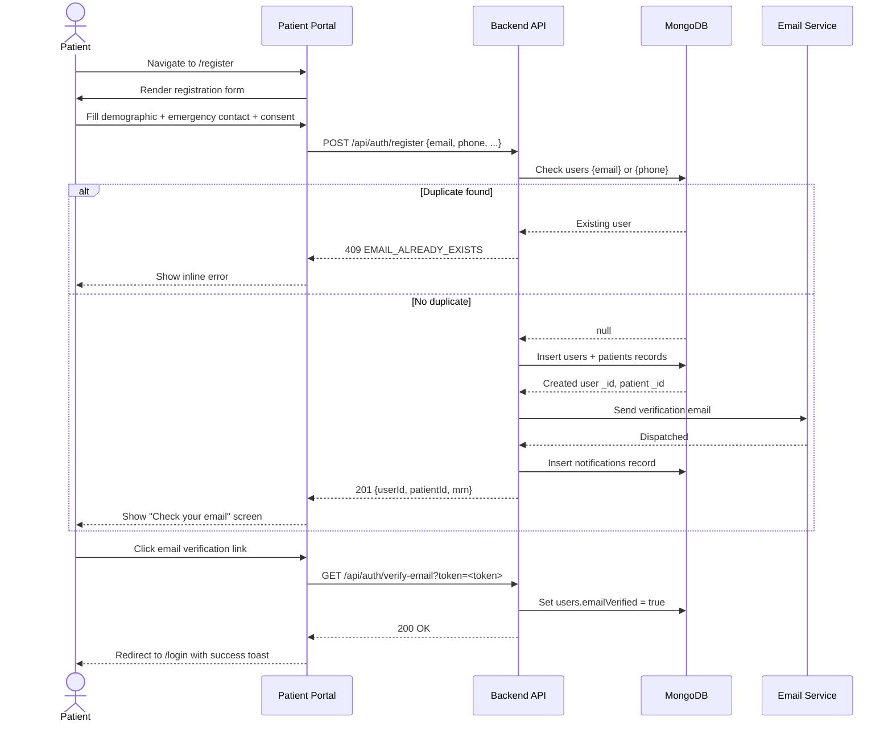

---

## WF-02: Receptionist Patient Registration

### Overview

| Attribute | Value |
|-----------|-------|
| **Purpose** | Register a walk-in or phone patient at the front desk, with duplicate prevention |
| **Actors** | Receptionist (primary), System |
| **Trigger** | Patient arrives at clinic or calls; Receptionist opens **Patient Registration** screen |
| **Outcome** | Patient record created or existing record retrieved; patient is ready for appointment/check-in |

### Preconditions

- Receptionist is authenticated with `role: "receptionist"`.
- Reception terminal has access to the system.

### Step-by-Step Flow

| Step | Actor | Action | System Response |
|------|-------|--------|-----------------|
| 1 | Receptionist | Opens **Register Patient** screen | Blank registration form with search bar |
| 2 | Receptionist | Searches by `phone` or `name` | System queries **patients** (fuzzy match); returns list |
| 3 | Receptionist | Reviews search results | If match found → opens existing record; if no match → proceeds to new registration |
| 4 | Receptionist | Enters `firstName`, `lastName`, `phone`, `email` (optional), `dateOfBirth`, `gender`, `address`, `bloodGroup`, `allergies[]`, `chronicConditions[]` | Zod validation; phone format check |
| 5 | Receptionist | Enters `emergencyContact` | Optional but recommended |
| 6 | Receptionist | Sets `consentGiven = true` on behalf of patient (physical form signed) | — |
| 7 | Receptionist | Clicks **Save Patient** | System creates **users** (role: `"patient"`, temporary password or no-login account) + **patients** record with `mrn`, `registeredBy: receptionistId`, `registrationSource: "WALK_IN"` |
| 8 | System | Writes audit log: `action: "PATIENT_REGISTERED"`, `actorId`, `patientId` | — |
| 9 | Receptionist | Optionally proceeds to book appointment for the patient | Navigates to Appointment Booking (WF-04) |

### Alternate Flows

| Scenario | Handling |
|----------|----------|
| Partial duplicate (same name, different phone) | System shows warning; receptionist confirms intent to create new record |
| Patient refuses to provide phone | Phone stored as `null`; `mrn` becomes primary identifier |
| Merge needed (two records for same patient) | Admin-only merge operation; deferred to admin role |
| Registration fails (DB error) | Error toast shown; form data preserved for retry |

### Postconditions

- **patients** record exists with `registrationSource: "WALK_IN"` or `"PHONE"`.
- Audit log entry created.
- Patient is ready for appointment booking or direct check-in.

---

## WF-03: Appointment Booking (Patient Self-Service)

### Overview

| Attribute | Value |
|-----------|-------|
| **Purpose** | Let an authenticated patient book an appointment from the portal |
| **Actors** | Patient (primary), System |
| **Trigger** | Patient clicks **Book Appointment** in the portal |
| **Outcome** | **appointments** record created with `status: "CONFIRMED"`; confirmation notification sent |

### Preconditions

- Patient is authenticated (`emailVerified = true` preferred).
- At least one active doctor has a configured schedule.
- The selected date is not a clinic holiday.

### Step-by-Step Flow

| Step | Actor | Action | System Response |
|------|-------|--------|-----------------|
| 1 | Patient | Navigates to **Book Appointment** | Portal fetches active doctors list |
| 2 | Patient | Selects doctor from dropdown (`doctorId`) | System fetches `doctorSchedules` and `doctorLeaves` for the next 30 days |
| 3 | Patient | Picks a date from the calendar | System computes available time slots: schedule blocks minus existing bookings minus leaves; returns `availableSlots[]` |
| 4 | Patient | Selects a time slot (`slotTime`) | Slot held in memory; not locked in DB yet |
| 5 | Patient | Optionally enters `chiefComplaintPreview` (reason for visit) | — |
| 6 | Patient | Clicks **Confirm Booking** | System performs atomic slot availability check (see race condition note below) |
| 7 | System | If slot available → creates **appointments** doc: `patientId`, `doctorId`, `clinicId`, `slotDate`, `slotTime`, `duration`, `type: "ONLINE_BOOKING"`, `status: "CONFIRMED"`, `appointmentNumber` (sequential per day) | Returns `appointmentId` |
| 8 | System | Triggers `APPOINTMENT_CONFIRMED` notification (email) to patient | Notification logged in **notifications** |
| 9 | Patient | Sees confirmation screen with `appointmentNumber` and date/time | — |

### Race Condition Handling

The booking endpoint uses a **MongoDB findOneAndUpdate with upsert-style atomic check**: it queries `appointments` for the same `{doctorId, slotDate, slotTime, status: {$in: ["CONFIRMED","PENDING"]}}` atomically. If a conflicting record exists, the booking fails with `SLOT_UNAVAILABLE`.

### Alternate Flows

| Scenario | Handling |
|----------|----------|
| Slot taken between viewing and submitting | Step 6: return 409 `SLOT_UNAVAILABLE`; portal refreshes available slots and prompts re-selection |
| Doctor on leave on selected date | Step 3: system excludes leave dates; calendar days disabled |
| All slots for the day are booked | Day marked as "Full" on calendar |
| Patient already has a future appointment with same doctor | System warns (`DUPLICATE_BOOKING_WARNING`) but allows override |
| Clinic is closed on selected date | Day blocked in calendar based on `clinicSettings.workingDays` |

### Postconditions

- **appointments** record with `status: "CONFIRMED"` stored.
- Slot is now unavailable for other bookings.
- Notification dispatched and logged.

### Sequence Diagram

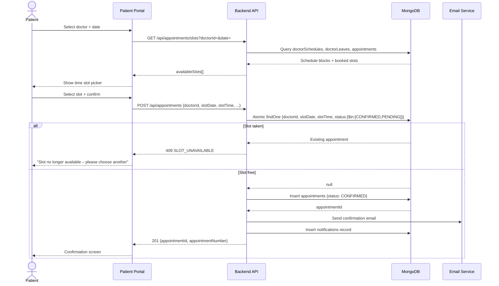

---

## WF-04: Appointment Booking (Receptionist-Assisted)

### Overview

| Attribute | Value |
|-----------|-------|
| **Purpose** | Receptionist books an appointment on behalf of a patient (walk-in / phone call) |
| **Actors** | Receptionist (primary), Patient (data provider), System |
| **Trigger** | Patient walks in or calls to request an appointment |
| **Outcome** | **appointments** record created; patient receives confirmation (if contact available) |

### Preconditions

- Receptionist is authenticated.
- Patient record exists or is created on the spot (WF-02).

### Step-by-Step Flow

| Step | Actor | Action | System Response |
|------|-------|--------|-----------------|
| 1 | Receptionist | Searches patient by `phone` / `name` / `mrn` | System returns matched **patients** record |
| 2 | Receptionist | Selects doctor from list | System fetches available slots (same logic as WF-03) |
| 3 | Receptionist | Selects date and slot | Slot availability verified |
| 4 | Receptionist | Enters `chiefComplaintPreview`, `appointmentType` (`WALK_IN` or `PHONE`) | — |
| 5 | Receptionist | Clicks **Book** | Atomic slot check; creates **appointments** with `bookedBy: receptionistId`, `type: "RECEPTIONIST_BOOKING"` |
| 6 | System | Sends `APPOINTMENT_CONFIRMED` notification if patient has valid email/phone | Logged in **notifications** |
| 7 | Receptionist | Sees confirmation with appointment card; can print or share verbally | — |

### Alternate Flows

Same as WF-03 slot conflict handling. Additionally:
- If patient has no email/phone, skip notification; receptionist communicates verbally.
- Receptionist can book same-day slots that are within clinic hours regardless of advance booking policy (staff bypass).

### Postconditions

- Same as WF-03 plus `bookedBy` field populated with receptionist's `userId`.

---

## WF-05: Doctor Schedule Configuration

### Overview

| Attribute | Value |
|-----------|-------|
| **Purpose** | Define a doctor's weekly recurring availability and consultation duration |
| **Actors** | Admin or Doctor (primary), System |
| **Trigger** | Admin opens **Schedule Management** or Doctor opens **My Schedule** |
| **Outcome** | **doctorSchedules** records created/updated; slot generation engine uses these for future availability |

### Preconditions

- Actor is authenticated as `admin` or `doctor`.
- Doctor profile exists in **doctors** collection.

### Step-by-Step Flow

| Step | Actor | Action | System Response |
|------|-------|--------|-----------------|
| 1 | Admin/Doctor | Opens **Schedule** screen for a doctor | Current schedule loaded from **doctorSchedules** |
| 2 | Admin/Doctor | For each working day (`dayOfWeek`: 0–6), defines: `startTime`, `endTime`, `consultationDuration` (minutes), `breakSlots[]` (optional break windows) | Form shows visual timeline |
| 3 | Admin/Doctor | Sets `effectiveFrom` date (defaults to next Monday) | — |
| 4 | Admin/Doctor | Clicks **Save Schedule** | System upserts **doctorSchedules** per day; calculates total slot count |
| 5 | System | Invalidates any cached slot calculations for future dates | Re-computes on next slot request |
| 6 | System | Writes audit log: `action: "SCHEDULE_UPDATED"`, `doctorId`, `changedBy` | — |

### Alternate Flows

| Scenario | Handling |
|----------|----------|
| New schedule overlaps existing appointments | System warns: "X appointments exist in the modified time range"; existing appointments preserved, new slots reflect updated schedule |
| `consultationDuration` changed | Existing booked slots keep old duration; new bookings use updated duration |
| Doctor removes a day from schedule | Day marked as unavailable; existing appointments on that day surfaced for review |

### Postconditions

- **doctorSchedules** records up-to-date.
- Slot generator uses new schedule for all requests beyond `effectiveFrom`.
- Audit logged.

### Flowchart

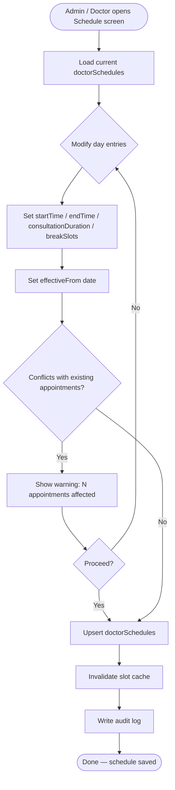

---

## WF-06: Doctor Leave Management

### Overview

| Attribute | Value |
|-----------|-------|
| **Purpose** | Record planned absence for a doctor; protect existing appointments by triggering reschedule notifications |
| **Actors** | Doctor or Admin (primary), System, Patient (notification recipient) |
| **Trigger** | Doctor or Admin opens **Leave Management** and submits a leave request |
| **Outcome** | **doctorLeaves** record created; affected appointments notified; slots blocked |

### Preconditions

- Doctor profile exists.
- Actor is authenticated as `doctor` (own leave) or `admin` (any doctor).

### Step-by-Step Flow

| Step | Actor | Action | System Response |
|------|-------|--------|-----------------|
| 1 | Doctor/Admin | Opens **Leave Management** | Calendar with existing leaves shown |
| 2 | Doctor/Admin | Selects `leaveDate` (or date range: `leaveFrom`–`leaveTo`) and `leaveType` (`FULL_DAY`, `HALF_DAY_AM`, `HALF_DAY_PM`) | — |
| 3 | Doctor/Admin | Optionally enters `reason` | — |
| 4 | Doctor/Admin | Clicks **Mark Leave** | System creates **doctorLeaves** record; `status: "APPROVED"` (doctor self-marks) or `"PENDING"` (if approval flow configured) |
| 5 | System | Queries **appointments** for `{doctorId, slotDate: {$in: leaveDates}, status: "CONFIRMED"}` | Builds list of affected appointments |
| 6 | System | For each affected appointment: sets `status: "CANCELLED_DOCTOR_LEAVE"`, logs `cancellationReason`, triggers `APPOINTMENT_CANCELLED_DOCTOR_LEAVE` notification to patient | Notifications batched and dispatched |
| 7 | System | Writes audit log: `action: "LEAVE_MARKED"`, `doctorId`, `actorId`, `dates` | — |
| 8 | Receptionist (optional) | Reviews cancelled appointment list; manually reschedules on patient request | Standard appointment booking flow |

### Alternate Flows

| Scenario | Handling |
|----------|----------|
| Leave overlaps already-approved leave | System detects overlap and returns `LEAVE_OVERLAP_CONFLICT`; admin resolves |
| No existing appointments on leave dates | No notifications sent; leave silently blocks slots |
| Doctor cancels a leave | **doctorLeaves** `status` set to `"REVOKED"`; slot becomes available again; no automatic re-booking |

### Postconditions

- **doctorLeaves** record exists and blocks slots for covered dates.
- Affected **appointments** updated with cancellation status.
- Patients notified.
- Audit log written.

### Sequence Diagram

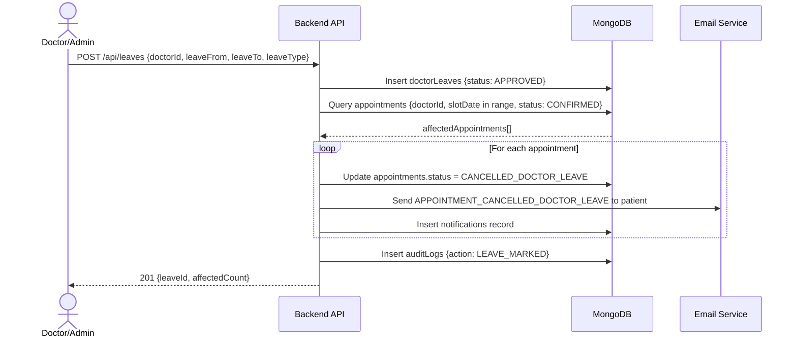

---

## WF-07: OPD Check-In & Token Generation

### Overview

| Attribute | Value |
|-----------|-------|
| **Purpose** | Convert an arriving patient's appointment (or walk-in) into a Visit record and queue token |
| **Actors** | Receptionist (primary), System |
| **Trigger** | Patient arrives at the clinic and presents at reception |
| **Outcome** | **visits** record created with `status: "CHECKED_IN"`; **queueEntries** record with `tokenNumber` assigned; patient joins live queue |

### Preconditions

- Reception screen is open and receptionist is authenticated.
- For appointment-based check-in: **appointments** record with `status: "CONFIRMED"` exists.
- For walk-in check-in: patient record exists (or created on the spot).

### Step-by-Step Flow

| Step | Actor | Action | System Response |
|------|-------|--------|-----------------|
| 1 | Receptionist | Searches patient: `name`, `phone`, or `mrn` in search bar | System returns patient + today's appointments |
| 2 | Receptionist | Selects the matching appointment or selects **Walk-In** | — |
| 3 | Receptionist | Confirms `doctorId` and `visitDate` (today) | — |
| 4 | Receptionist | Clicks **Check In** | System validates: appointment not already checked in; doctor is working today |
| 5 | System | Creates **visits** record: `{patientId, doctorId, clinicId, appointmentId (if any), visitDate, status: "CHECKED_IN", checkedInAt: now, checkedInBy: receptionistId}` | Returns `visitId` |
| 6 | System | Atomically assigns `tokenNumber`: queries max `tokenNumber` for `{doctorId, visitDate}` in **queueEntries**; increments by 1. Walk-in: appended at current end | Returns `tokenNumber` |
| 7 | System | Creates **queueEntries** record: `{visitId, patientId, doctorId, clinicId, tokenNumber, status: "WAITING", isEmergency: false, priority: "NORMAL", queuePosition: tokenNumber}` | — |
| 8 | System | Updates **appointments** `status: "CHECKED_IN"` (if appointment-based) | — |
| 9 | System | Emits Socket.IO event `queue:patient-added` with new queue state to all connected clients | Doctor's screen and display boards update instantly |
| 10 | System | Triggers `CHECK_IN_CONFIRMED` notification to patient (if phone/email available) | — |
| 11 | Receptionist | Displays token slip / tells patient their token number | — |

### Alternate Flows

| Scenario | Handling |
|----------|----------|
| Patient has no appointment (walk-in) | Receptionist selects **Walk-In**; `appointmentId = null`; token placed at end of queue or by policy |
| Patient already checked in (duplicate scan) | System returns `ALREADY_CHECKED_IN` warning; no duplicate visit created |
| Doctor not scheduled today | System warns; receptionist can override with confirmation (creates ad-hoc visit) |
| Queue is empty (first check-in of day) | `tokenNumber = 1` |

### Postconditions

- **visits** record with `status: "CHECKED_IN"`.
- **queueEntries** record with `tokenNumber` and `status: "WAITING"`.
- Real-time queue broadcast sent.
- Appointment (if any) marked `CHECKED_IN`.

### Sequence Diagram

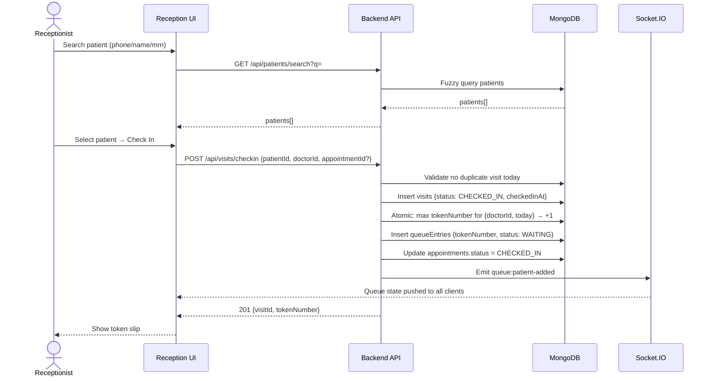

---

## WF-08: Live Queue Management

### Overview

| Attribute | Value |
|-----------|-------|
| **Purpose** | Real-time management of the OPD queue — calling patients, skipping, reordering, and handling emergencies |
| **Actors** | Doctor (primary — calls next), Receptionist (reorder/skip/priority), System (broadcast) |
| **Trigger** | Doctor clicks **Call Next Patient** or Receptionist modifies queue order |
| **Outcome** | Queue state updated in DB; all connected clients receive real-time update via Socket.IO |

### Preconditions

- At least one **queueEntries** record with `status: "WAITING"` exists for the doctor.
- Doctor and Receptionist are authenticated and viewing the queue screen.

### Step-by-Step Flow — Normal Flow (Doctor Calls Next)

| Step | Actor | Action | System Response |
|------|-------|--------|-----------------|
| 1 | Doctor | Views queue dashboard; sees list of waiting patients with tokens | Live data from **queueEntries** |
| 2 | Doctor | Clicks **Call Next** | API finds next `queueEntries` with `status: "WAITING"` for `{doctorId, today}` ordered by `queuePosition` ASC |
| 3 | System | Updates that **queueEntries** to `status: "CALLED"`; updates linked **visits** to `status: "IN_CONSULTATION"` | — |
| 4 | System | Emits `queue:next-called` event with `{tokenNumber, patientName, doctorId}` via Socket.IO | All subscribed clients (reception display, doctor UI, patient display board) update instantly |
| 5 | Doctor | Patient enters; consultation begins (see WF-09) | — |
| 6 | Doctor | After consultation, clicks **Mark Done** | **queueEntries** → `status: "COMPLETED"`; **visits** → `status: "CONSULTATION_DONE"` |
| 7 | System | Emits `queue:patient-completed` event | Display boards update |

### Receptionist Queue Operations

| Operation | Action | System Response |
|-----------|--------|-----------------|
| **Skip patient** | Receptionist clicks Skip on a `CALLED` or `WAITING` entry | `status: "SKIPPED"`; next patient in queue notified |
| **Re-queue skipped** | Receptionist clicks Re-queue | `status: "WAITING"`; `queuePosition` set to current last |
| **Mark priority** | Receptionist sets `priority: "HIGH"` | Queue re-sorted: priority patients before normal in next call |
| **Mark emergency** | Receptionist/Doctor flags emergency | See WF-18 |

### Postconditions

- **queueEntries** `status` reflects current state.
- All connected clients have consistent, up-to-date queue view.
- **visits** status tracks clinical progress.

### Sequence Diagram

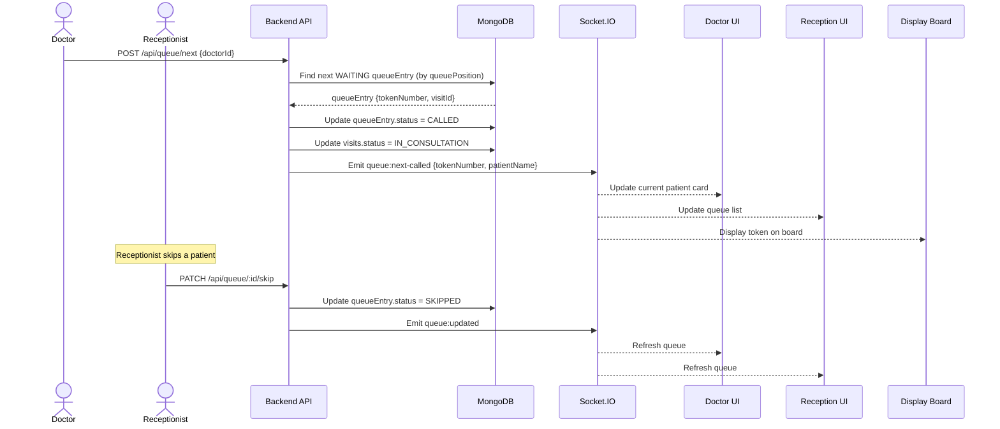

---

## WF-09: Doctor Consultation

### Overview

| Attribute | Value |
|-----------|-------|
| **Purpose** | Doctor records the clinical encounter: complaints, findings, diagnosis, treatment plan |
| **Actors** | Doctor (primary), System |
| **Trigger** | Doctor clicks **Call Next** and patient enters consultation room |
| **Outcome** | **visits** record updated with consultation data; medical history timeline updated |

### Preconditions

- **queueEntries** `status: "CALLED"` for this patient.
- **visits** `status: "IN_CONSULTATION"`.
- Doctor is authenticated and owns the queue for today.

### Step-by-Step Flow

| Step | Actor | Action | System Response |
|------|-------|--------|-----------------|
| 1 | Doctor | Opens patient card from queue dashboard | System fetches: **patients** profile, full visit history, latest **prescriptions**, **medicalReports** |
| 2 | Doctor | Reviews medical history timeline in side panel | Timeline renders all past visits, diagnoses, prescriptions in chronological order |
| 3 | Doctor | Enters `chiefComplaint` (free text) | Auto-saved on blur |
| 4 | Doctor | Enters `examinationFindings` (vitals: `weight`, `height`, `bloodPressure`, `temperature`, `pulseRate`, `spO2`; and clinical notes) | — |
| 5 | Doctor | Enters `diagnosis`: `diagnosisText` (free text) + optional `icdCode` (ICD-10 lookup dropdown) | System fetches ICD suggestions on typing |
| 6 | Doctor | Enters `treatmentPlan` (free text) | — |
| 7 | Doctor | Enters `doctorNotes` (internal notes, not visible to patient) | — |
| 8 | Doctor | Clicks **Save Consultation** | System updates **visits**: `{chiefComplaint, examinationFindings, diagnosis, treatmentPlan, doctorNotes, consultationEndAt: now, status: "CONSULTATION_DONE"}` |
| 9 | System | Emits `queue:patient-completed` via Socket.IO | — |
| 10 | Doctor | Optionally proceeds to: Prescription (WF-10), Report Upload (WF-11), Follow-up (WF-12) | — |

### Alternate Flows

| Scenario | Handling |
|----------|----------|
| Doctor exits without saving | Auto-draft saved every 30 seconds in `visits.consultationDraft` |
| ICD code lookup fails | Doctor can type free-text diagnosis without ICD code |
| Medical history fetch times out | Side panel shows "History unavailable" with retry button; main consultation unblocked |

### Postconditions

- **visits** `status: "CONSULTATION_DONE"` with all clinical fields populated.
- Medical history timeline updated for future consultations.
- Queue entry marked `COMPLETED`.

---

## WF-10: Prescription Generation

### Overview

| Attribute | Value |
|-----------|-------|
| **Purpose** | Doctor creates a digital prescription with medicines and advice; system generates a downloadable PDF |
| **Actors** | Doctor (primary), System, Patient (recipient) |
| **Trigger** | Doctor clicks **Write Prescription** within or after consultation |
| **Outcome** | **prescriptions** record created; PDF generated and stored; patient can view on portal |

### Preconditions

- **visits** record exists and is in `IN_CONSULTATION` or `CONSULTATION_DONE` state.
- Doctor is authenticated.

### Step-by-Step Flow

| Step | Actor | Action | System Response |
|------|-------|--------|-----------------|
| 1 | Doctor | Opens **Prescription** tab on patient card | Pre-filled with `patientName`, `age`, `visitDate`, `diagnosis` from current visit |
| 2 | Doctor | Adds medicine rows: `medicineName`, `dosage` (e.g., "500mg"), `frequency` (e.g., "1-0-1"), `duration` (e.g., "5 days"), `route` (oral/topical), `instructions` (e.g., "after meals") | Dynamic row addition; validation on each field |
| 3 | Doctor | Enters `adviceText` (lifestyle advice, precautions) | — |
| 4 | Doctor | Enters `followUpDate` (optional; prefills WF-12) | — |
| 5 | Doctor | Clicks **Sign & Save** | System creates **prescriptions** record: `{visitId, patientId, doctorId, clinicId, medicines[], adviceText, followUpDate, signedAt: now, status: "SIGNED"}` |
| 6 | System | Generates prescription PDF using server-side template (clinic letterhead, doctor signature block) | PDF stored to Cloudinary or local temp storage |
| 7 | System | Updates **prescriptions** with `pdfUrl` | — |
| 8 | System | Triggers `PRESCRIPTION_READY` notification to patient | Logged in **notifications** |
| 9 | Patient | Opens portal → **My Prescriptions** | Sees latest prescription; clicks **Download PDF** |

### Alternate Flows

| Scenario | Handling |
|----------|----------|
| PDF generation fails | Prescription record saved; PDF queued for retry; doctor notified |
| Doctor edits after signing | Creates new `version: 2` prescription; original preserved (`status: "SUPERSEDED"`) |
| No medicines added (advice only) | Allowed; `medicines[]` empty; `adviceText` required |

### Postconditions

- **prescriptions** record with `status: "SIGNED"` and `pdfUrl`.
- Patient portal shows downloadable prescription.
- Notification dispatched.

### Sequence Diagram

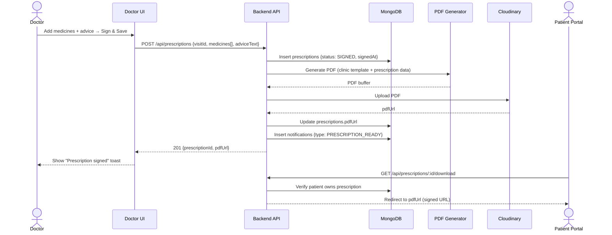

---

## WF-11: Medical Report Upload & Access

### Overview

| Attribute | Value |
|-----------|-------|
| **Purpose** | Upload a diagnostic report (PDF/image) and control patient access to it |
| **Actors** | Doctor or Admin (uploader), System, Patient (viewer) |
| **Trigger** | Doctor clicks **Upload Report** on patient profile or visit screen |
| **Outcome** | **medicalReports** record created with Cloudinary URL; patient sees report if authorized |

### Preconditions

- Uploader is authenticated as `doctor` or `admin`.
- **patients** record exists for the target patient.
- File size ≤ 10 MB; type is `PDF`, `JPEG`, or `PNG`.

### Step-by-Step Flow

| Step | Actor | Action | System Response |
|------|-------|--------|-----------------|
| 1 | Doctor | Opens **Reports** tab on patient profile | Existing reports listed |
| 2 | Doctor | Clicks **Upload Report**, selects file, enters `reportName`, `reportType` (e.g., "X-Ray", "Blood Test"), `reportDate`, optional `visitId` | — |
| 3 | Doctor | Sets `patientVisible: true/false` | Controls patient portal visibility |
| 4 | Doctor | Clicks **Upload** | Frontend sends multipart form to backend |
| 5 | System | Validates file type and size | Returns 400 if invalid |
| 6 | System | Uploads file to Cloudinary under `clinic/{clinicId}/reports/{patientId}/` folder | Returns `cloudinaryPublicId`, `secureUrl` |
| 7 | System | Creates **medicalReports** record: `{patientId, clinicId, visitId, doctorId, reportName, reportType, reportDate, cloudinaryPublicId, patientVisible, uploadedAt}` | — |
| 8 | System | Writes audit log: `action: "REPORT_UPLOADED"` | — |
| 9 | Patient | Opens portal → **My Reports** | Sees only reports where `patientVisible: true` |
| 10 | Patient | Clicks **View Report** | Backend generates a time-limited signed Cloudinary URL (validity: 30 min); redirects patient |

### Alternate Flows

| Scenario | Handling |
|----------|----------|
| Cloudinary upload fails | Show error; file not saved; no DB record created |
| Patient tries to access `patientVisible: false` report | API returns 403 `REPORT_ACCESS_DENIED` |
| Doctor revokes patient access | Updates `medicalReports.patientVisible = false`; existing signed URLs expire naturally |

### Postconditions

- **medicalReports** record with Cloudinary references stored.
- Patient access controlled by `patientVisible` flag.
- Signed URL generated on-demand; never stored permanently.

---

## WF-12: Follow-up Scheduling

### Overview

| Attribute | Value |
|-----------|-------|
| **Purpose** | Doctor schedules a future follow-up visit; system sends a reminder before the date |
| **Actors** | Doctor (primary), System, Patient (notification recipient) |
| **Trigger** | Doctor clicks **Schedule Follow-up** at end of consultation |
| **Outcome** | **followUps** record created; reminder notification scheduled |

### Preconditions

- Current **visits** `status: "CONSULTATION_DONE"` or `IN_CONSULTATION`.
- Doctor is authenticated.

### Step-by-Step Flow

| Step | Actor | Action | System Response |
|------|-------|--------|-----------------|
| 1 | Doctor | Clicks **Schedule Follow-up** | Modal opens pre-filled with `patientId`, `doctorId` |
| 2 | Doctor | Enters `followUpDate`, `followUpReason` (e.g., "Review blood report"), `reminderDaysBefore` (default: 1) | — |
| 3 | Doctor | Clicks **Save** | System creates **followUps** record: `{patientId, doctorId, clinicId, visitId, followUpDate, followUpReason, reminderDaysBefore, status: "SCHEDULED", createdAt}` |
| 4 | System | Schedules reminder job: fires at `followUpDate - reminderDaysBefore` days | Cron/job queue entry created |
| 5 | System (on reminder day) | Sends `FOLLOW_UP_REMINDER` notification to patient (email/SMS) | Notification logged in **notifications** |
| 6 | Patient | On follow-up day, checks in (WF-07) | **followUps** `status` updated to `"COMPLETED"` on check-in |

### Alternate Flows

| Scenario | Handling |
|----------|----------|
| Patient misses follow-up | On day+1, job marks `followUps.status = "MISSED"` |
| Doctor cancels follow-up | `status: "CANCELLED"`; cancellation notification sent to patient |
| Follow-up date changes | Old reminder job cancelled; new one created |

### Postconditions

- **followUps** record with `status: "SCHEDULED"`.
- Reminder job queued.
- Patient receives reminder on the configured day.

---

## WF-13: Invoice Generation

### Overview

| Attribute | Value |
|-----------|-------|
| **Purpose** | Generate an itemized invoice for a patient visit |
| **Actors** | Receptionist or System (primary), Admin (fee schedule config) |
| **Trigger** | Consultation marked done; Receptionist clicks **Generate Invoice**, or system auto-generates based on clinic setting |
| **Outcome** | **invoices** record created with `status: "UNPAID"`; PDF available for printing |

### Preconditions

- **visits** `status: "CONSULTATION_DONE"`.
- Fee schedule configured in `clinicSettings.feeSchedule[]`.

### Step-by-Step Flow

| Step | Actor | Action | System Response |
|------|-------|--------|-----------------|
| 1 | Receptionist | Opens billing screen for patient's visit | System pre-populates line items from `clinicSettings.feeSchedule` based on `visitType` and doctor |
| 2 | Receptionist | Reviews line items: `consultationFee`, `procedureFees[]`, `additionalCharges[]` | Each item: `{description, quantity, unitPrice, total}` |
| 3 | Receptionist | Adds/removes line items as needed; applies discount if authorized (`discountAmount`, `discountReason`) | Total recalculated |
| 4 | Receptionist | Clicks **Generate Invoice** | System creates **invoices** record: `{visitId, patientId, clinicId, lineItems[], subtotal, discountAmount, taxAmount, totalAmount, status: "UNPAID", generatedBy, generatedAt}` |
| 5 | System | Generates invoice PDF (clinic header, patient details, itemized table, totals) | PDF stored; `pdfUrl` saved to **invoices** |
| 6 | Receptionist | Prints or shares invoice with patient | — |

### Alternate Flows

| Scenario | Handling |
|----------|----------|
| Fee schedule not configured | Receptionist manually enters all line items |
| Invoice already exists for visit | System shows existing invoice; option to void and re-generate (admin only) |
| Tax not applicable | `taxAmount = 0`; `taxRate` from `clinicSettings.taxConfig` |

### Postconditions

- **invoices** record with `status: "UNPAID"` and `pdfUrl`.
- Receptionist can proceed to WF-14 for payment collection.

### Flowchart

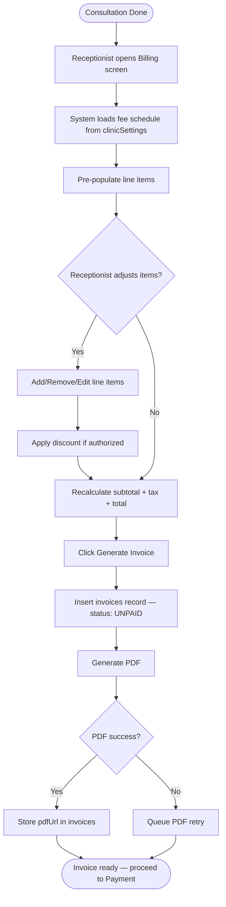

---

## WF-14: Payment Recording

### Overview

| Attribute | Value |
|-----------|-------|
| **Purpose** | Record the patient's payment against an invoice |
| **Actors** | Receptionist (primary), System |
| **Trigger** | Patient makes payment at the counter; Receptionist opens **Record Payment** |
| **Outcome** | **payments** record created; **invoices** `status` updated to `"PAID"` or `"PARTIAL"` |

### Preconditions

- **invoices** record with `status: "UNPAID"` or `"PARTIAL"` exists.
- Receptionist is authenticated.

### Step-by-Step Flow

| Step | Actor | Action | System Response |
|------|-------|--------|-----------------|
| 1 | Receptionist | Opens **Record Payment** for the invoice | Shows `totalAmount`, `amountPaid` (previous partial if any), `amountDue` |
| 2 | Receptionist | Enters `amountPaid`, `paymentMethod` (`CASH` / `CARD` / `UPI`), `paymentReference` (card last-4 or UPI ref), `paymentDate` (default: today) | — |
| 3 | Receptionist | Clicks **Record Payment** | System creates **payments** record: `{invoiceId, patientId, clinicId, amountPaid, paymentMethod, paymentReference, paymentDate, recordedBy}` |
| 4 | System | Recalculates: `invoice.amountPaid += payment.amountPaid`; if `amountPaid >= totalAmount` → `invoice.status = "PAID"` else → `"PARTIAL"` | Updates **invoices** |
| 5 | System | Writes audit log: `action: "PAYMENT_RECORDED"` | — |
| 6 | Receptionist | Prints receipt | — |

### Alternate Flows

| Scenario | Handling |
|----------|----------|
| Overpayment (`amountPaid > totalAmount`) | System flags overpayment; records as `PAID`; excess shown as `creditBalance` |
| Payment reversed/refunded | Receptionist creates refund record; `invoice.status` reverted to `UNPAID` or `PARTIAL` (admin only) |
| Multiple payment installments | Each creates a separate **payments** entry; `invoice.status` tracks cumulatively |

### Postconditions

- **payments** record created.
- **invoices** `status` updated (`PAID` / `PARTIAL`).
- Audit log written.

---

## WF-15: Appointment Cancellation (Patient)

### Overview

| Attribute | Value |
|-----------|-------|
| **Purpose** | Allow a patient to cancel an upcoming appointment from the portal, with policy enforcement |
| **Actors** | Patient (primary), System |
| **Trigger** | Patient clicks **Cancel** on an upcoming appointment in the portal |
| **Outcome** | **appointments** `status: "CANCELLED_PATIENT"`; slot freed; doctor notified |

### Preconditions

- **appointments** `status: "CONFIRMED"`.
- Appointment `slotDate` is in the future.
- Patient is authenticated and owns the appointment.

### Step-by-Step Flow

| Step | Actor | Action | System Response |
|------|-------|--------|-----------------|
| 1 | Patient | Navigates to **My Appointments**; clicks **Cancel** on a specific appointment | Confirmation modal with cancellation policy |
| 2 | System | Displays `clinicSettings.cancellationPolicy`: e.g., "Cancellations within 24 hours are non-refundable" | — |
| 3 | Patient | Enters `cancellationReason` (optional); confirms cancellation | — |
| 4 | System | Checks: `hoursUntilAppointment = slotDate+slotTime - now` | — |
| 5 | System | Updates **appointments**: `status: "CANCELLED_PATIENT"`, `cancellledAt: now`, `cancellationReason`, `refundEligible: (hoursUntilAppointment >= clinicSettings.refundWindowHours)` | — |
| 6 | System | Triggers `APPOINTMENT_CANCELLED` notification to doctor (and patient confirmation) | — |
| 7 | System | Writes audit log: `action: "APPOINTMENT_CANCELLED_PATIENT"` | — |
| 8 | Patient | Sees cancellation confirmation; refund eligibility displayed | — |

### Alternate Flows

| Scenario | Handling |
|----------|----------|
| Cancellation within policy window | `refundEligible: false`; note shown to patient |
| No payment was made | `refundEligible` irrelevant; cancellation proceeds normally |
| Patient cancels same-day appointment | Allowed; `refundEligible: false` |

### Postconditions

- **appointments** `status: "CANCELLED_PATIENT"`.
- Slot available for new bookings.
- Doctor and patient notified.

### Sequence Diagram

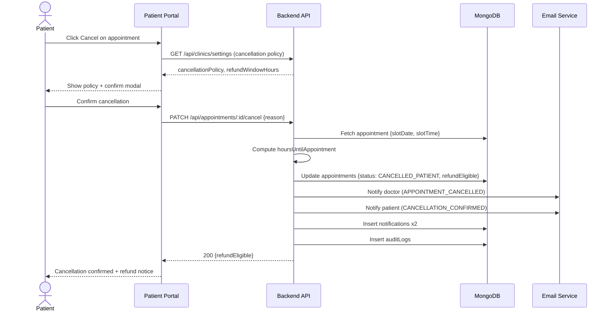

---

## WF-16: Appointment Cancellation (Staff)

### Overview

| Attribute | Value |
|-----------|-------|
| **Purpose** | Admin or Receptionist cancels an appointment, with optional patient notification |
| **Actors** | Admin or Receptionist (primary), System, Patient (notification recipient) |
| **Trigger** | Staff member selects an appointment and clicks **Cancel** in the admin/reception dashboard |
| **Outcome** | **appointments** `status: "CANCELLED_STAFF"`; patient notified (if configured) |

### Preconditions

- Actor is authenticated as `admin` or `receptionist`.
- **appointments** `status: "CONFIRMED"`.

### Step-by-Step Flow

| Step | Actor | Action | System Response |
|------|-------|--------|-----------------|
| 1 | Staff | Searches appointment by patient name / date / doctor | Appointment list shown |
| 2 | Staff | Selects appointment; clicks **Cancel** | Modal: `cancellationReason` (required), `notifyPatient` toggle (default: on) |
| 3 | Staff | Fills reason; confirms | — |
| 4 | System | Updates **appointments**: `status: "CANCELLED_STAFF"`, `cancelledAt`, `cancelledBy: staffId`, `cancellationReason` | — |
| 5 | System | If `notifyPatient: true` → sends `APPOINTMENT_CANCELLED_STAFF` notification to patient | — |
| 6 | System | Writes audit log | — |

### Bulk Cancellation (Doctor Full-Day Leave)

When triggered by WF-06 (doctor leave), the system batch-cancels all appointments for the leave period using the same status `CANCELLED_DOCTOR_LEAVE` and sends notifications asynchronously.

### Postconditions

- **appointments** cancelled with staff reference.
- Slot freed.
- Patient optionally notified.
- Audit logged.

---

## WF-17: No-Show Handling

### Overview

| Attribute | Value |
|-----------|-------|
| **Purpose** | Record that a patient with a confirmed appointment did not arrive within the grace period |
| **Actors** | Receptionist (primary), System |
| **Trigger** | Receptionist marks a patient as no-show after `clinicSettings.noShowGracePeriodMinutes` has elapsed past appointment time |
| **Outcome** | **appointments** `status: "NO_SHOW"`; no **visits** record created; slot not automatically released |

### Preconditions

- **appointments** `status: "CONFIRMED"`.
- Current time > `slotTime + noShowGracePeriodMinutes`.
- No check-in exists for this appointment.

### Step-by-Step Flow

| Step | Actor | Action | System Response |
|------|-------|--------|-----------------|
| 1 | Receptionist | Views today's appointments; identifies patient who hasn't arrived | Appointment list shows time elapsed |
| 2 | Receptionist | Clicks **Mark No-Show** | Confirmation dialog |
| 3 | Receptionist | Confirms | System updates **appointments**: `status: "NO_SHOW"`, `noShowMarkedAt: now`, `noShowMarkedBy: receptionistId` |
| 4 | System | Writes audit log: `action: "NO_SHOW_MARKED"` | — |
| 5 | System | Optionally sends `NO_SHOW_NOTIFICATION` to patient (configurable) | — |

### Alternate Flows

| Scenario | Handling |
|----------|----------|
| Patient arrives after no-show marked | Receptionist reverses: `status: "CONFIRMED"`; proceeds with check-in (WF-07) |
| Auto no-show (system-triggered) | If `clinicSettings.autoNoShow: true`, system cron marks no-show automatically at `slotTime + gracePeriod` |

### Postconditions

- **appointments** `status: "NO_SHOW"`.
- No **visits** or **queueEntries** created.
- Slot remains blocked for the period (not reused automatically).

---

## WF-18: Emergency / Priority Queue

### Overview

| Attribute | Value |
|-----------|-------|
| **Purpose** | Insert an emergency patient at the top of the live queue, displacing normal-priority patients |
| **Actors** | Receptionist or Doctor (initiator), System |
| **Trigger** | Clinician identifies an emergency case at reception or in queue |
| **Outcome** | **queueEntries** record with `isEmergency: true` placed at `queuePosition: 0`; all other entries shift; real-time broadcast |

### Preconditions

- Reception or consultation screen is active.
- Doctor is working today.

### Step-by-Step Flow

| Step | Actor | Action | System Response |
|------|-------|--------|-----------------|
| 1 | Receptionist | Identifies emergency patient (walk-in or already checked in) | — |
| 2 | Receptionist | Checks in patient (if not already) using WF-07, selecting **Emergency** flag | `queueEntries.isEmergency = true` on creation |
| 3 | System | Assigns `tokenNumber` as next sequential number; sets `queuePosition = 0` (front of queue) | Shifts all existing `WAITING` entries: `queuePosition += 1` |
| 4 | System | Emits `queue:emergency-added` via Socket.IO | All clients show emergency alert banner; doctor notified audibly (if audio enabled) |
| 5 | Doctor | Sees emergency patient at top of queue | Calls immediately |
| 6 | Doctor | Marks done after consultation | Standard queue completion (WF-08 step 6) |

### Alternate Flows

| Scenario | Handling |
|----------|----------|
| Multiple emergencies | Each gets `queuePosition = 0`; subsequent emergencies placed before previous emergency (`queuePosition` subsorting by `createdAt`) |
| Existing `CALLED` patient mid-consultation | Current patient is not interrupted; emergency patient waits at position 0 for next call |

### Postconditions

- Emergency **queueEntries** at front of queue.
- All clients notified via Socket.IO event `queue:emergency-added`.
- Normal queue resumes after emergency seen.

### Sequence Diagram

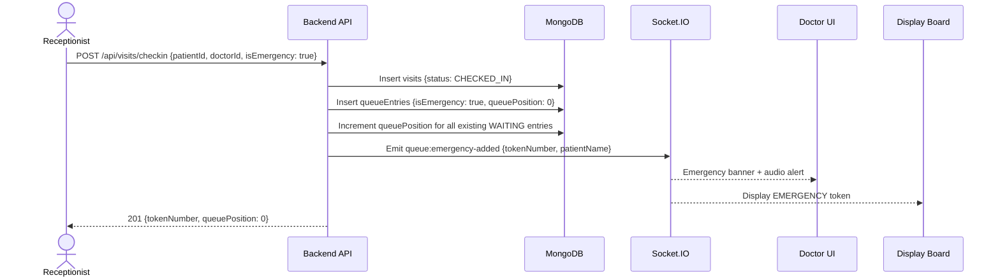

---

## WF-19: Analytics Report Generation

### Overview

| Attribute | Value |
|-----------|-------|
| **Purpose** | Admin generates aggregated reports for clinic performance, patient trends, and revenue |
| **Actors** | Admin (primary), System |
| **Trigger** | Admin opens **Analytics** dashboard and applies report filters |
| **Outcome** | Charts rendered; data exportable as CSV/PDF |

### Preconditions

- Admin is authenticated.
- Sufficient historical data exists in **visits**, **appointments**, **invoices**, **payments**.

### Step-by-Step Flow

| Step | Actor | Action | System Response |
|------|-------|--------|-----------------|
| 1 | Admin | Opens **Analytics** section | Dashboard with pre-loaded summary cards (today's stats) |
| 2 | Admin | Selects `reportType`: `PATIENT_VOLUME` / `REVENUE` / `APPOINTMENT_TRENDS` / `DOCTOR_PERFORMANCE` / `NO_SHOW_RATE` | — |
| 3 | Admin | Sets `dateFrom`, `dateTo`, optional `doctorId` / `departmentId` filters | — |
| 4 | Admin | Clicks **Generate** | API executes MongoDB aggregation pipeline on relevant collections |
| 5 | System | Returns aggregated data: time-series arrays, totals, averages | — |
| 6 | Admin | Views charts (bar, line, pie via Recharts) | Recharts renders in browser |
| 7 | Admin | Clicks **Export CSV** or **Export PDF** | System generates export file; download initiated |

### Postconditions

- No data mutation; analytics are read-only queries.
- Exported file available locally.

---

## WF-20: Audit Log Review

### Overview

| Attribute | Value |
|-----------|-------|
| **Purpose** | Admin reviews the immutable audit trail of sensitive system actions |
| **Actors** | Admin (read-only) |
| **Trigger** | Admin opens **Audit Logs** screen |
| **Outcome** | Filtered log entries displayed; no modification possible |

### Preconditions

- Admin is authenticated.
- **auditLogs** collection contains entries.

### Step-by-Step Flow

| Step | Actor | Action | System Response |
|------|-------|--------|-----------------|
| 1 | Admin | Opens **Audit Logs** | Table with recent entries; filters panel on left |
| 2 | Admin | Applies filters: `actorId`, `action` (e.g., `PATIENT_REGISTERED`, `PRESCRIPTION_SIGNED`), `dateFrom`, `dateTo`, `targetType` (`patient`, `appointment`, etc.) | — |
| 3 | Admin | Clicks **Apply** | API queries **auditLogs** with filters; returns paginated results |
| 4 | Admin | Reviews entries: `{timestamp, actor.name, actor.role, action, targetType, targetId, ipAddress, details}` | — |
| 5 | Admin | Clicks **Export** (optional) | CSV download of filtered entries |

### Alternate Flows

| Scenario | Handling |
|----------|----------|
| Admin attempts to delete log entries | UI provides no delete option; API returns 403 for any DELETE on auditLogs |
| Log query returns too many results | Pagination enforced (50 per page); date range capped at 90 days per query |

### Postconditions

- No data modified; audit logs are append-only.
- Admin has visibility into system activity.

---

## WF-21: Notification Sending

### Overview

| Attribute | Value |
|-----------|-------|
| **Purpose** | Automated, trigger-based delivery of email (and optional SMS) notifications to patients and staff |
| **Actors** | System (sender), Patient / Doctor / Receptionist (recipients) |
| **Trigger** | Various system events (see table below) |
| **Outcome** | Notification dispatched via email/SMS provider; logged in **notifications** collection |

### Notification Types & Triggers

| `notificationType` | Trigger Event | Recipient | Channel |
|--------------------|--------------|-----------|---------|
| `APPOINTMENT_CONFIRMED` | Appointment created (`status: CONFIRMED`) | Patient | Email |
| `APPOINTMENT_REMINDER` | 24 hours before `slotDate+slotTime` (cron job) | Patient | Email + SMS |
| `APPOINTMENT_CANCELLED_PATIENT` | Patient cancels (WF-15) | Doctor | Email |
| `APPOINTMENT_CANCELLED_STAFF` | Staff cancels (WF-16) | Patient | Email + SMS |
| `APPOINTMENT_CANCELLED_DOCTOR_LEAVE` | Doctor leave (WF-06) | Patient | Email + SMS |
| `CHECK_IN_CONFIRMED` | Check-in complete (WF-07) | Patient | SMS |
| `PRESCRIPTION_READY` | Prescription signed (WF-10) | Patient | Email |
| `FOLLOW_UP_REMINDER` | `followUpDate - reminderDaysBefore` (cron) | Patient | Email + SMS |
| `NO_SHOW_NOTIFICATION` | No-show marked (WF-17) | Patient | Email |
| `EMAIL_VERIFY` | Self-registration (WF-01) | Patient | Email |

### Step-by-Step Flow

| Step | Actor | Action | System Response |
|------|-------|--------|-----------------|
| 1 | System | Triggering event fires (e.g., appointment confirmed) | Notification service invoked with `{type, recipientId, templateData}` |
| 2 | System | Fetches recipient's `email` and `phone` from **users** | — |
| 3 | System | Renders template with `templateData` (Handlebars/Mustache template per `notificationType`) | — |
| 4 | System | Sends email via configured provider (SendGrid / Nodemailer) | — |
| 5 | System | If SMS configured and `channel` includes SMS → sends via SMS provider (Twilio / MSG91) | — |
| 6 | System | Creates **notifications** record: `{recipientId, notificationType, channel, status: "SENT" / "FAILED", sentAt, metadata}` | — |
| 7 | System | On delivery failure → retries up to 3 times with exponential backoff; final status `"FAILED"` if all retries exhausted | — |

### Postconditions

- **notifications** record with final `status: "SENT"` or `"FAILED"`.
- Recipient has received communication.

### Sequence Diagram

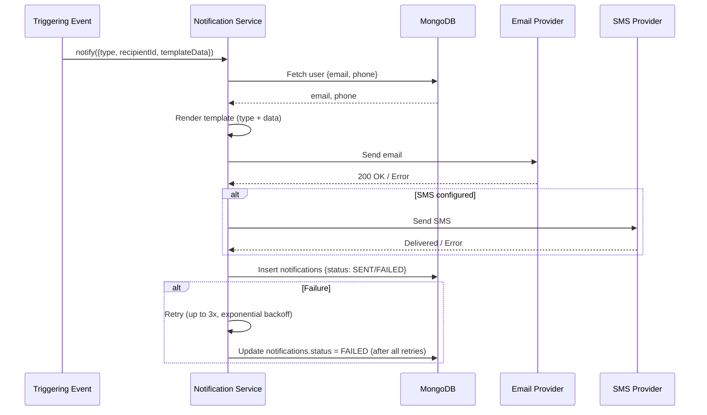

---

## WF-22: Clinic Settings Update

### Overview

| Attribute | Value |
|-----------|-------|
| **Purpose** | Admin configures clinic-wide settings: profile, working hours, departments, fee schedules, policies |
| **Actors** | Admin (primary), System |
| **Trigger** | Admin opens **Settings** in the admin dashboard |
| **Outcome** | **clinicSettings** document updated; changes take effect immediately or from next day depending on type |

### Preconditions

- Admin is authenticated with `role: "admin"`.
- **clinicSettings** document exists for the clinic (created at onboarding).

### Settings Categories & Effect Timing

| Category | Fields | Effect |
|----------|--------|--------|
| **Clinic Profile** | `clinicName`, `address`, `phone`, `email`, `logo`, `website` | Immediate |
| **Working Hours** | `workingDays[]`, `openTime`, `closeTime` | Next day (existing appointments protected) |
| **Departments** | `departments[]` (`{name, description}`) | Immediate |
| **Fee Schedule** | `feeSchedule[]` (`{visitType, doctorId, consultationFee, procedureFees[]}`) | Next new invoice |
| **Cancellation Policy** | `refundWindowHours`, `cancellationPolicyText` | Immediate (new cancellations) |
| **No-Show Policy** | `noShowGracePeriodMinutes`, `autoNoShow` | Immediate |
| **Notification Config** | `emailEnabled`, `smsEnabled`, `smsProvider`, `reminderHoursBefore` | Next notification trigger |
| **Tax Configuration** | `taxEnabled`, `taxRate`, `taxName` | Next new invoice |

### Step-by-Step Flow

| Step | Actor | Action | System Response |
|------|-------|--------|-----------------|
| 1 | Admin | Opens **Settings** dashboard | Current **clinicSettings** document loaded |
| 2 | Admin | Navigates to relevant settings tab | Tab content rendered with current values |
| 3 | Admin | Modifies one or more fields | Real-time form validation |
| 4 | Admin | Clicks **Save Changes** | API validates and merges changes into **clinicSettings** (upsert by `clinicId`) |
| 5 | System | Applies effect-timing logic: schedule-related changes flagged with `effectiveFrom: tomorrow` | — |
| 6 | System | Writes audit log: `action: "SETTINGS_UPDATED"`, `changedFields[]`, `previousValues`, `newValues` | — |
| 7 | System | Invalidates relevant server-side caches (slot generator, fee calculator) | — |
| 8 | Admin | Sees success toast; settings reflected in UI | — |

### Alternate Flows

| Scenario | Handling |
|----------|----------|
| Working hours narrowed (e.g., clinic now closes earlier) | System identifies existing future appointments outside new hours; flags for admin review |
| Fee schedule updated with existing unpaid invoices | Existing invoices unaffected; new invoices use updated fee |
| Admin saves invalid configuration (e.g., `openTime > closeTime`) | Validation error; changes not persisted |

### Postconditions

- **clinicSettings** document updated with new values.
- Audit log records all changed fields with before/after values.
- System behaviour adapts to new configuration per effect-timing rules.

### Flowchart

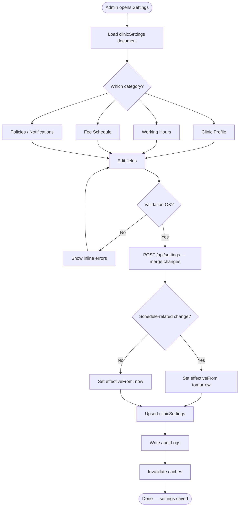

---

## Cross-Workflow State Transition Summary

### Appointment Status Transitions

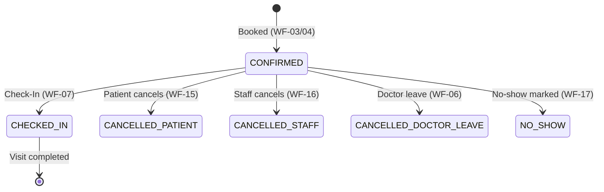

### Visit Status Transitions

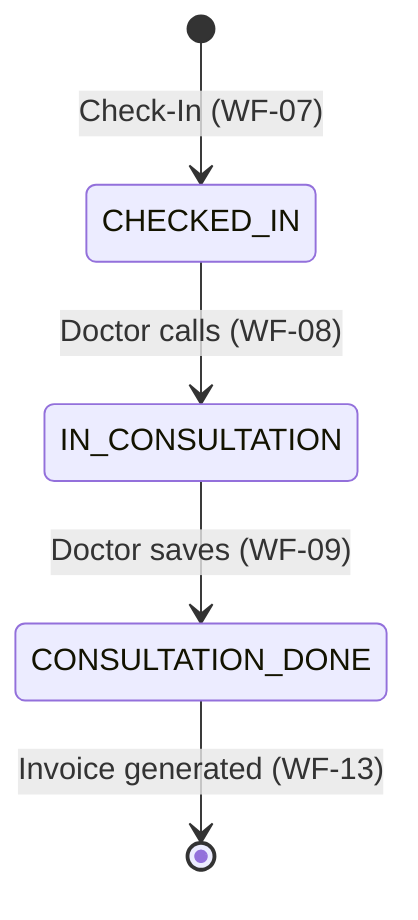

### Queue Entry Status Transitions

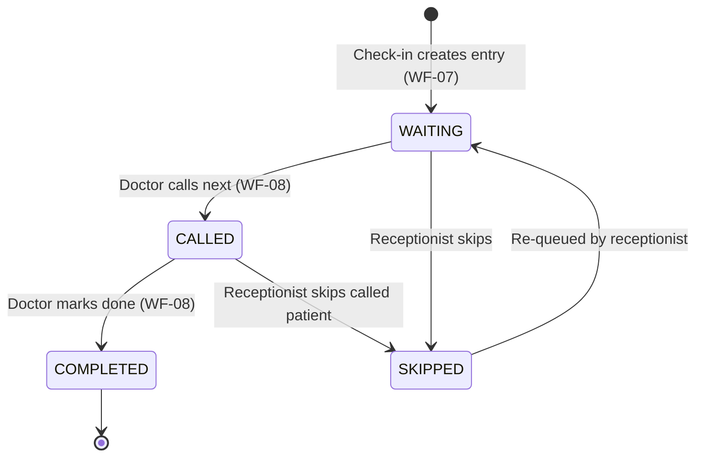

---

## Document Revision History

| Version | Date | Author | Changes |
|---------|------|--------|---------|
| 1.0 | 2026-11-11 | workflow-writer (AI) | Initial draft — all 22 workflows documented |

---

*End of Document — Smart OPD Workflow & Business Process Documentation*
