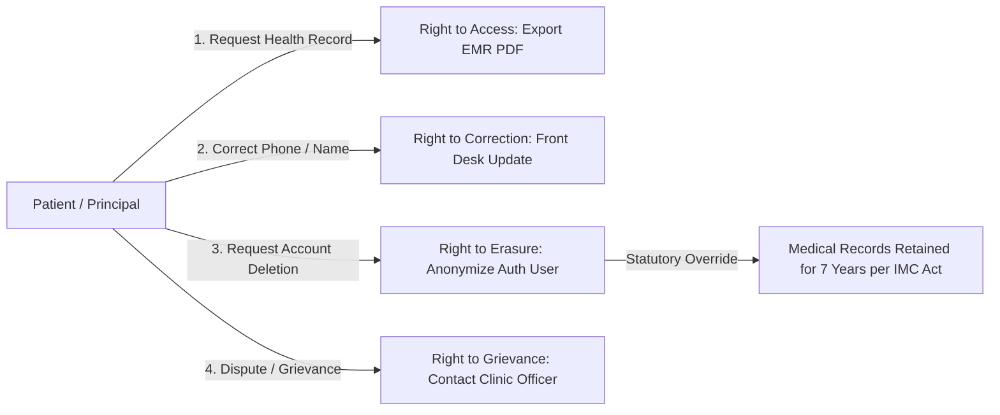
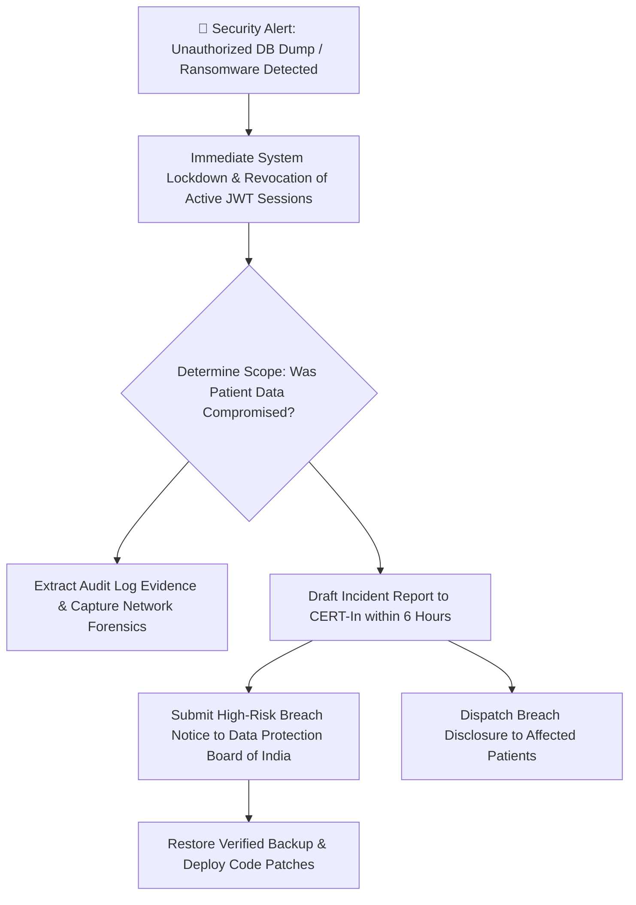

# Smart OPD – Healthcare Compliance & Digital Consent Architecture
## Single-Clinic Outpatient Department Management System

> **Document ID:** 08-Healthcare-Compliance-Consent.md  
> **Version:** 2.0.0 (Master Release)  
> **Status:** Stage A Architectural Baseline – Fully Detailed  
> **Date:** 2026-11-11  
> **Statutory Authorities Cited:** Ministry of Law and Justice · National Medical Commission (NMC) · Ministry of Health and Family Welfare (MoHFW) · CERT-In  
> **Jurisdiction:** Republic of India  

---

## 1. Statutory Regulatory Framework & Authoritative Citations

Smart OPD is architected in accordance with Indian healthcare statutes, medical ethics guidelines, and data protection legislation.

```
+-----------------------------------------------------------------------------------------------+
| STATUTORY COMPLIANCE CITATION MATRIX (REPUBLIC OF INDIA)                                      |
+---------------------+-----------------------------------+-------------------------------------+
| Legislation / Rule  | Official Citation & Date          | Direct System Mandates              |
+---------------------+-----------------------------------+-------------------------------------+
| **DPDP Act 2023**   | The Gazette of India, Extraordinary| Itemized notice & consent, purpose  |
|                     | Act No. 22 of 2023 (Aug 11, 2023) | limitation, right to health summary,|
|                     | Section 5, 6, 11, 12, 13          | grievance officer, penalties up to  |
|                     |                                   | ₹ 250 Crores for data breaches.     |
+---------------------+-----------------------------------+-------------------------------------+
| **Clinical**        | Act No. 23 of 2010, Ministry of   | Mandatory display of clinic reg. no.|
| **Establishments**  | Health & Family Welfare, Govt. of | on all medical records & bills;     |
| **Act, 2010**       | India (Enforced in state statutes)| standardized EMR data capture;      |
|                     |                                   | transparent pricing schedules.      |
+---------------------+-----------------------------------+-------------------------------------+
| **NMC Ethics**      | National Medical Commission       | Doctor full name, qualification,    |
| **Regulations**     | Notification No. R.13015/01/2021- | and council reg. number on all e-Rx;|
| **2023**            | NMC/Reg (Aug 2, 2023)             | generic drug naming alongside brands;|
|                     | Chapter 1 & 2                     | patient confidentiality protection. |
+---------------------+-----------------------------------+-------------------------------------+
| **Pharmacy Practice**| Gazette of India, Extraordinary, | Standards for electronic medical    |
| **Regulations 2015**| Pharmacy Council of India         | prescriptions; clear drug dosage,   |
|                     | Section 9.1 & 9.2                 | duration, route, and doctor sign.   |
+---------------------+-----------------------------------+-------------------------------------+
| **CERT-In Cyber**   | Cyber Security Directions under   | Mandatory 6-hour cybersecurity      |
| **Directions 2022** | Section 70B(6) of IT Act, 2000    | incident reporting; preservation of |
|                     | No. 20(3)/2022-CERT-In (Apr 2022) | server & audit logs for 180 days.   |
+---------------------+-----------------------------------+-------------------------------------+
```

---

## 2. Distinction: Mandatory Legal Rules vs Recommendations

To ensure legal rigor, Smart OPD strictly distinguishes between **Hard Statutory Obligations** and **Best-Practice Professional Recommendations**:

```
┌────────────────────────────────────────────────────────────────────────┐
│               LEGAL MANDATES VS BEST PRACTICE RECOMMENDATIONS          │
├──────────────────────────────────┬─────────────────────────────────────┤
│ ⚖️ MANDATORY LEGAL REQUIREMENTS  │ 💡 RECOMMENDATIONS FOR LEGAL COUNSEL│
│   (Enforced in Application Code) │    (Subject to Clinic Legal Review) │
├──────────────────────────────────┼─────────────────────────────────────┤
│ 1. Mandatory collection of notice│ 1. Telemedicine consent clause      │
│    and consent prior to storage. │    formulation (if enabled in v2).  │
│ 2. Display of Doctor MCI/SMC reg │ 2. Exact fee refund policy window   │
│    number on every prescription. │    for patient cancellations.       │
│ 3. Display of Clinic CEA reg.    │ 3. Specific indemnification wording │
│    number on all invoices & bills│    on prescription disclaimers.     │
│ 4. 6-Hour incident reporting to  │ 4. Formal appointment of a Data     │
│    CERT-In upon data compromise. │    Protection Officer (DPO).        │
│ 5. Minimum 3-year statutory      │ 5. Voluntary Ayushman Bharat (ABHA) │
│    retention of outpatient Rx.   │    ecosystem onboarding timeline.   │
└──────────────────────────────────┴─────────────────────────────────────┘
```

---

## 3. Notice & Consent Architecture (DPDP Act 2023, Section 5)

Under Section 5 of the DPDP Act 2023, consent must be **free, specific, informed, unconditional, and unambiguous with clear affirmative action**.

### 3.1 Digital Consent Notice Artifacts (Bilingual)

#### English Notice:
> *"I hereby provide my explicit consent to {{CLINIC_NAME}} to collect, store, and process my personal and medical data (including demographics, contact information, consultation notes, diagnostic reports, and prescriptions) strictly for the purpose of delivering outpatient healthcare services, generating digital prescriptions, tracking my medical appointments, and issuing billing receipts. I understand that my records will be retained in accordance with statutory medical regulations and that I may request a copy of my health summary at any time."*

#### Hindi Translation (सामग्री सहमति सूचना):
> *"मैं एतद्द्वारा {{CLINIC_NAME}} को ओपीडी स्वास्थ्य सेवाएं प्रदान करने, डिजिटल पर्चे तैयार करने, अपॉइंटमेंट प्रबंधित करने और बिलिंग रसीदें जारी करने के उद्देश्य से मेरे व्यक्तिगत और चिकित्सीय विवरण (नाम, संपर्क, परामर्श नोट्स और जांच रिपोर्ट) एकत्र और संसाधित करने की स्पष्ट सहमति प्रदान करता/करती हूँ। मैं समझता/समझती हूँ कि मेरे रिकॉर्ड वैधानिक चिकित्सा नियमों के अनुसार संग्रहीत किए जाएंगे।"*

### 3.2 Consent Data Model & Immutability
```typescript
interface IPatientConsent {
  consentGiven: boolean;           // true
  consentVersion: string;          // "v1.0-DPDP-2026"
  consentTimestamp: Date;          // ISO UTC Date
  consentLanguage: 'EN' | 'HI';    // Language chosen
  ipAddress: string;               // Client IP
  userAgent: string;               // Browser / Device identifier
}
```

---

## 4. Patient Rights Execution Framework (DPDP Act 2023)



1. **Right to Access Information (Section 11)**:
   - Patient can at any time click *"Export Health Summary"* in the patient portal (`/portal/history/export`) to stream an aggregated PDF of all past encounters, diagnoses, medications, and attached lab reports.
2. **Right to Correction & Erasure (Section 12)**:
   - Demographic errors (misspelled name, updated phone number) are corrected immediately.
   - **Clinical Integrity Exemption**: Medical diagnoses and prescriptions cannot be deleted upon patient request. Under Indian Medical Council rules, medical records must be preserved for statutory defense in potential malpractice claims. The system deactivates the login portal while retaining the historical clinical archive.
3. **Right of Grievance Redressal (Section 13)**:
   - The portal footer and all digital notices display the name and contact email of the clinic's designated Grievance Redressal Officer (`grievance@{{CLINIC_DOMAIN}}`).

---

## 5. Medical Record Retention & Archiving Schedule

```
┌────────────────────────────────────────────────────────────────────────┐
│                        DATA RETENTION SCHEDULE                         │
├─────────────────────────┬───────────────────┬──────────────────────────┤
│ Category of Record      │ Legal Basis       │ Retention Period Enforced│
├─────────────────────────┼───────────────────┼──────────────────────────┤
│ Outpatient Prescriptions│ Indian Medical    │ 7 Years Active Store     │
│ & Consultation Notes    │ Council (3y min,  │ (Immutable MongoDB)      │
│                         │ 7y recommended)   │                          │
├─────────────────────────┼───────────────────┼──────────────────────────┤
│ Medico-Legal Encounters │ Indian Evidence   │ Permanent Cold Archive   │
│ & Trauma Cases          │ Act / CrPC        │ (GCS / AWS S3 Glacier)   │
├─────────────────────────┼───────────────────┼──────────────────────────┤
│ Billing Invoices &      │ Section 44AA,     │ 8 Years Active Store     │
│ Payment Receipts        │ Income Tax Act    │                          │
├─────────────────────────┼───────────────────┼──────────────────────────┤
│ Diagnostic Lab Reports  │ Clinical Estab.   │ 7 Years Cloudinary Vault │
│ (Radiology & Blood)     │ Act Rules         │                          │
├─────────────────────────┼───────────────────┼──────────────────────────┤
│ System Access Logs &    │ CERT-In Directives│ 2 Years Active Store     │
│ Tamper-Evident Audits   │ (180 days min)    │ (Indexed MongoDB)        │
└─────────────────────────┴───────────────────┴──────────────────────────┘
```

---

## 6. Electronic Prescription (e-Rx) Regulatory Compliance

Under the National Medical Commission (NMC) 2023 regulations and Pharmacy Practice Rules, every prescription generated by Smart OPD strictly enforces the following schema:

```
+-----------------------------------------------------------------------------------------------+
| NMC-COMPLIANT ELECTRONIC PRESCRIPTION MANDATORY FIELDS                                       |
+---------------------+-------------------------------+-----------------------------------------+
| Category            | Specific Parameter            | Compliance Enforcement Mechanism        |
+---------------------+-------------------------------+-----------------------------------------+
| **Clinic Details**  | Legal Name, Physical Address  | Injected dynamically from ClinicSetting |
|                     | CEA Registration Number       | Pre-printed on header                   |
| **Doctor Details**  | Full Name, Qualifications     | Injected from Doctor Master             |
|                     | State/National Council Reg No | Rendered in bold beneath doctor name    |
| **Patient Details** | Full Name, Age, Gender, UHID  | Verified demographic data               |
| **Clinical**        | Date of Visit, Diagnosis      | Recorded in consultation workspace      |
| **Pharmacology**    | Generic Drug Name             | Displayed alongside brand name          |
|                     | Dosage, Frequency, Duration   | Structured table format                 |
|                     | Timing (Before/After food)    | Standardized instructions               |
| **Authentication**  | Digital Verification Stamp    | Cryptographic QR Code verifying JWT     |
|                     | Disclaimer Note               | "Valid for single dispensation only"    |
+---------------------+-------------------------------+-----------------------------------------+
```

---

## 7. CERT-In Mandatory Cybersecurity Incident Reporting (6-Hour SLA)

Under Section 70B(6) of the Information Technology Act, 2000 and CERT-In Directions (April 2022), cybersecurity incidents involving health databases must be reported to CERT-In (`incident@cert-in.org.in`) within **6 hours of detection**:



---

## 8. Professional Legal Disclaimer

> **Legal Review Boundary**: The compliance architectures, consent wording, and statutory mappings documented herein represent healthcare software engineering best practices designed to comply with Indian law. Formal certification of legal compliance requires final review and operational sign-off by the clinic's retained healthcare legal counsel.
