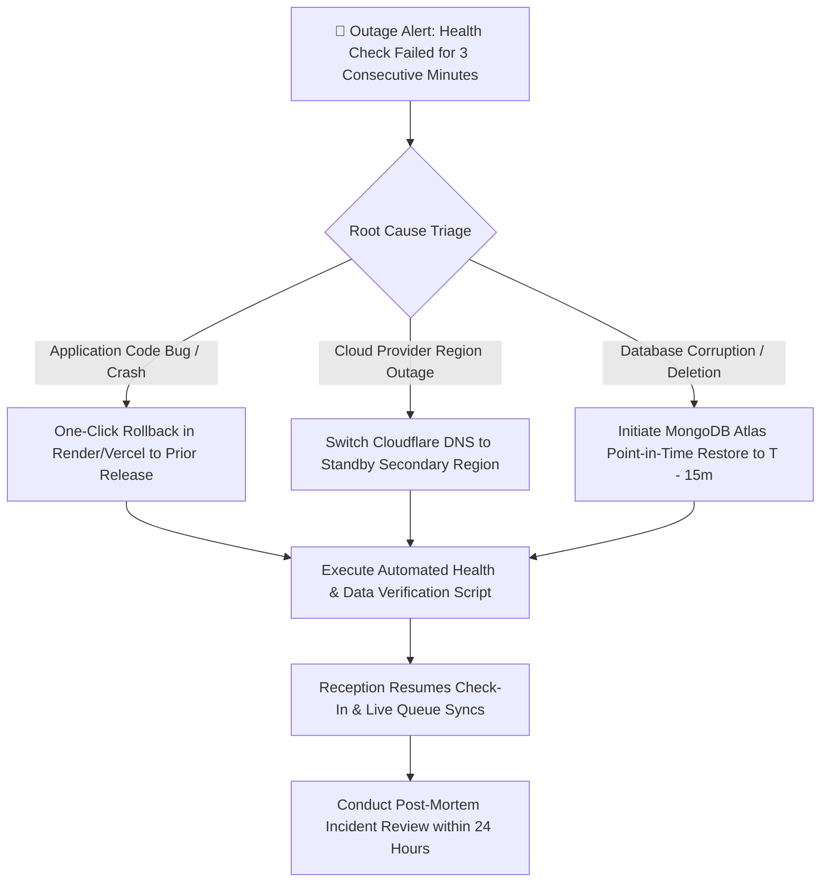

# Smart OPD – Reliability, Backup & Infrastructure Specification
## Single-Clinic Outpatient Department Management System

> **Document ID:** 10-Reliability-Backup-Infrastructure.md  
> **Version:** 2.0.0 (Master Release)  
> **Status:** Stage A Architectural Baseline – Fully Detailed  
> **Date:** 2026-11-11  
> **Operational Uptime Target:** 99.5% Availability during Clinic Hours (08:00 – 21:00 IST)  
> **Disaster Recovery Targets:** Recovery Time Objective (RTO) ≤ 2 Hours · Recovery Point Objective (RPO) ≤ 1 Hour  

---

## 1. Reliability Architecture & Service Level Objectives (SLO)

A medical clinic operates in real time; software downtime causes waiting lounge chaos, lost clinical encounter records, delayed triage, and financial reconciliation discrepancies.

```
+-----------------------------------------------------------------------------------------------+
| SERVICE LEVEL OBJECTIVES (SLO) & INDICATORS (SLI) MATRIX                                      |
+---------------------+-------------------+---------------------+-------------------------------+
| Metric Category     | Indicator (SLI)   | Target Objective    | Measurement Window            |
+---------------------+-------------------+---------------------+-------------------------------+
| Operating Uptime    | Health probe 200  | ≥ 99.5% Availability| Working Hours (08:00 - 21:00) |
| API Latency         | Server execution  | p95 < 300ms         | Monthly rolling aggregate     |
| Real-Time Latency   | Socket.IO token   | < 500ms broadcast   | Per consultation encounter    |
| Recovery Time (RTO) | Time to restore   | ≤ 2 Hours           | Full disaster restore         |
| Recovery Point (RPO)| Max data loss     | ≤ 1 Hour            | Maximum database delta        |
+---------------------+-------------------+---------------------+-------------------------------+
```

---

## 2. Three-Tier Database Backup Strategy (MongoDB Atlas)

```
┌────────────────────────────────────────────────────────────────────────┐
│                        3-TIER BACKUP ARCHITECTURE                      │
├─────────────────────┬───────────────────────┬──────────────────────────┤
│ Tier 1: Real-Time   │ Tier 2: Off-Site Cold │ Tier 3: Automated        │
│ Continuous Atlas    │ Logical Dumps         │ Restoration Drill        │
├─────────────────────┼───────────────────────┼──────────────────────────┤
│ • Oplog streaming   │ • Daily `mongodump`   │ • Monthly automated test │
│ • Continuous point- │ • GZIP + AES-256-CBC  │   spins up ephemeral DB  │
│   in-time recovery  │ • Pushed to AWS S3 /  │ • Restores dump & runs   │
│ • 30-day retention  │   GCS Cold Storage    │   data integrity queries │
└─────────────────────┴───────────────────────┴──────────────────────────┘
```

### 2.1 Tier 1: MongoDB Atlas Continuous Point-in-Time Recovery (PITR)
- **Mechanism**: Continuous oplog tailing combined with automated daily snapshots in MongoDB Atlas.
- **Granularity**: Enables restoring the database to any exact minute within the preceding 30 days. In the event of an accidental batch deletion or corrupted migration script, the database can be rolled back to `T - 5 minutes` with minimal clinical disruption.

### 2.2 Tier 2: Daily Off-Site Encrypted Logical Dumps
A scheduled automated cron job runs daily at **02:00 AM IST** (outside clinic operating hours):

```bash
#!/bin/bash
# Smart OPD Off-Site Encrypted Backup Script
set -e
TIMESTAMP=$(date +"%Y%m%d_%H%M%S")
BACKUP_DIR="/tmp/smart_opd_backup_${TIMESTAMP}"
ARCHIVE_NAME="smart_opd_${TIMESTAMP}.tar.gz.enc"

echo "[$(date)] Starting Smart OPD Database Backup..."

# 1. Export BSON dump via mongodump
mongodump --uri="$MONGODB_URI" --out="$BACKUP_DIR" --quiet

# 2. Archive and compress
tar -czf "/tmp/smart_opd_${TIMESTAMP}.tar.gz" -C "$BACKUP_DIR" .

# 3. Encrypt archive with AES-256-CBC using PBKDF2 & KMS-derived key
openssl enc -aes-256-cbc -salt -pbkdf2 \
  -in "/tmp/smart_opd_${TIMESTAMP}.tar.gz" \
  -out "/tmp/${ARCHIVE_NAME}" \
  -pass env:BACKUP_ENCRYPTION_KEY

# 4. Upload encrypted archive to private AWS S3 Glacier vault
aws s3 cp "/tmp/${ARCHIVE_NAME}" "s3://smart-opd-cold-backups/daily/${ARCHIVE_NAME}" \
  --sse aws:kms --sse-kms-key-id "$AWS_KMS_BACKUP_KEY_ID"

# 5. Purge ephemeral files from local disk
rm -rf "$BACKUP_DIR" "/tmp/smart_opd_${TIMESTAMP}.tar.gz" "/tmp/${ARCHIVE_NAME}"
echo "[$(date)] Backup Completed & Pushed to S3: ${ARCHIVE_NAME}"
```

### 2.3 Tier 3: Monthly Automated Restoration Integrity Drill
Backups that are never restored cannot be certified for disaster recovery. On the 1st of every month, an automated CI/CD pipeline executes:
1. Downloads the latest Tier 2 encrypted archive from AWS S3 Glacier.
2. Decrypts the archive using the off-site KMS key.
3. Spins up an ephemeral MongoDB Docker container (`mongo:7.0`).
4. Executes `mongorestore` and asserts collection counts (`users`, `patients`, `appointments`, `prescriptions`, `invoices`).
5. Emits a verification report to the Clinic Admin and technical lead.

---

## 3. Backup Access Controls & Data Protection

To prevent ransomware or unauthorized data exfiltration targeting backup archives:
1. **AWS S3 Bucket Policy (Zero Public Access)**:
   - Public read and write explicitly blocked at the S3 account level.
   - Bucket enforces `MFA Delete` (deleting a snapshot requires root credential hardware token).
   - Server-Side Encryption mandatory using customer-managed AWS KMS keys (`aws:kms`).
2. **Principle of Least Privilege (IAM)**:
   - The backup execution server holds an IAM role restricted strictly to `s3:PutObject` on the backup bucket; it possesses zero `s3:GetObject` or `s3:DeleteObject` permissions.
   - Restoration permissions require an independent `RoleBackupRestoreOperator` role governed by multi-factor authentication.
3. **Immutable Audit Trail**:
   - Every backup generation, S3 upload, and restoration attempt generates a cryptographic audit record in `auditLogs`.

---

## 4. High Availability, Clustering & Automatic Failover

### 4.1 MongoDB Atlas 3-Node Replica Set (PSS Architecture)
- Deployed as a 3-node replica set: Primary + 2 Secondaries distributed across distinct Availability Zones (AZs).
- **Automatic Election**: If the Primary node experiences hardware failure or network partition, the remaining Secondaries hold an election and promote a new Primary within **5 to 10 seconds**.
- **Driver Reconnect**: The Mongoose / Node.js driver automatically reconnects using `retryWrites=true&w=majority`.

### 4.2 Application Supervisor & Health Check Probe
- The Node.js Express server runs under PM2 or container supervisor with automated restart upon uncaught exceptions or memory threshold breaches (`--max-old-space-size=1024`).
- **Health Check Probe (`GET /api/v1/health`)**:
  ```typescript
  app.get('/api/v1/health', async (req: Request, res: Response) => {
    const dbStatus = mongoose.connection.readyState === 1 ? 'UP' : 'DOWN';
    const memory = process.memoryUsage();
    
    if (dbStatus === 'DOWN') {
      return res.status(503).json({
        status: 'UNHEALTHY',
        database: dbStatus,
        timestamp: new Date().toISOString()
      });
    }

    res.status(200).json({
      status: 'HEALTHY',
      uptimeSeconds: Math.floor(process.uptime()),
      database: dbStatus,
      memoryHeapMB: Math.round(memory.heapUsed / 1024 / 1024),
      nodeVersion: process.version
    });
  });
  ```

---

## 5. Observability, Alerting & Error Monitoring

1. **Sentry Error Tracking**:
   - Integrated into both React frontend and Express backend.
   - Automatically captures unhandled exceptions, render crashes, and 500-series API errors.
   - Source maps uploaded privately during CI/CD build to ensure human-readable stack traces without exposing source code publicly.
2. **Uptime Monitoring**:
   - External monitoring service (UptimeRobot / Better Uptime) pings `https://{{CLINIC_DOMAIN}}/api/v1/health` every 60 seconds from nodes in Mumbai, Singapore, and Frankfurt.
   - Three consecutive failed pings trigger high-priority alerts via SMS, WhatsApp, and email to on-call technical engineers and the clinic administrator.
3. **Structured Logging (Morgan + Winston)**:
   - Morgan HTTP logger operating in combined Apache format.
   - Winston logger streaming error events to rotating daily log files (`logs/error-%DATE%.log`) with 90-day automatic retention.

---

## 6. Disaster Recovery Runbook & Playbook



### Emergency Contacts & Escalation Tree
1. **Level 1 (Within 5 Minutes)**: Automated health monitor alerts On-Call Lead Engineer via SMS/Call.
2. **Level 2 (Within 15 Minutes)**: Technical Lead assesses root cause and initiates container rollback or Atlas point-in-time restore.
3. **Level 3 (Within 30 Minutes)**: Clinic Medical Director notified; front-desk operates in temporary offline triage mode until database reconnection.
