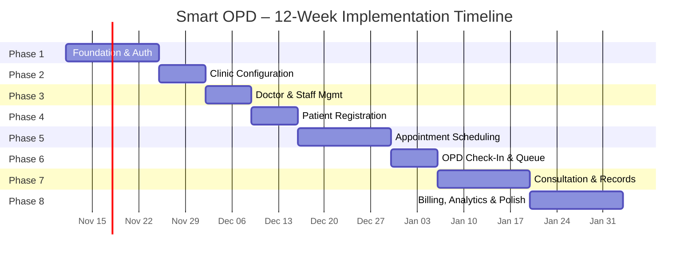

# Smart OPD – Implementation Roadmap

> **Document ID:** 10_IMPLEMENTATION_ROADMAP  
> **Version:** 1.0  
> **Last Updated:** 2026-11-11  
> **Status:** Active  
> **Stack:** MERN (MongoDB · Express · React · Node.js) + TypeScript + Socket.IO

---

## Table of Contents

1. [Technology Setup Checklist](#1-technology-setup-checklist)
2. [Timeline Overview (Gantt)](#2-timeline-overview-gantt)
3. [Phase 1 – Foundation & Auth](#3-phase-1--foundation--auth-week-1-2)
4. [Phase 2 – Clinic Configuration](#4-phase-2--clinic-configuration-week-2-3)
5. [Phase 3 – Doctor & Staff Management](#5-phase-3--doctor--staff-management-week-3-4)
6. [Phase 4 – Patient Registration & Medical Profile](#6-phase-4--patient-registration--medical-profile-week-4-5)
7. [Phase 5 – Appointment Scheduling](#7-phase-5--appointment-scheduling-week-5-7)
8. [Phase 6 – OPD Check-In, Token & Live Queue](#8-phase-6--opd-check-in-token--live-queue-week-7-8)
9. [Phase 7 – Consultation, Prescriptions & Medical Records](#9-phase-7--consultation-prescriptions--medical-records-week-8-10)
10. [Phase 8 – Billing, Analytics & Polish](#10-phase-8--billing-analytics--polish-week-10-12)
11. [Known Risks & Mitigation Strategies](#11-known-risks--mitigation-strategies)
12. [Phase Gate Criteria](#12-phase-gate-criteria)

---

## 1. Technology Setup Checklist

### Local Development Environment

- [ ] Node.js v20 LTS installed (`node -v`)
- [ ] pnpm v9+ installed globally (`npm install -g pnpm`)
- [ ] MongoDB Community Server 7.x installed (or Docker image `mongo:7`)
- [ ] MongoDB Compass (GUI) installed for schema inspection
- [ ] Git 2.x installed, SSH key added to GitHub
- [ ] VS Code with extensions: ESLint, Prettier, Tailwind CSS IntelliSense, MongoDB for VS Code
- [ ] Docker Desktop installed (for local MongoDB + Redis containers)

### Cloud Accounts & Services

- [ ] **MongoDB Atlas** – free M0 cluster created, connection string stored in `.env`
- [ ] **Cloudinary** – account created, API key + secret + cloud name captured
- [ ] **Resend / SendGrid / Nodemailer SMTP** – transactional email provider configured, API key stored
- [ ] **GitHub** – repository created with branch protection on `main`
- [ ] **Vercel** (frontend) or **Render/Railway** (full-stack) – account created, project linked

### Project Toolchain

- [ ] Monorepo structure initialised: `client/` (React+Vite) and `server/` (Express+TS)
- [ ] `package.json` workspace scripts (`dev`, `build`, `lint`, `test`) configured at root
- [ ] TypeScript `tsconfig.json` present in both `client/` and `server/`
- [ ] ESLint + Prettier config shared across workspace
- [ ] Husky pre-commit hooks installed (lint + format on staged files)
- [ ] Jest (server unit tests) + Vitest (client unit tests) + Playwright (E2E) configured
- [ ] GitHub Actions CI pipeline created (lint → test → build on every PR)

---

## 2. Timeline Overview (Gantt)

> [!NOTE]
> Dates above are relative to a Day-0 project kickoff. Adjust `2026-11-11` to your actual start date.  
> A 2-developer team can run phases 1-2 in parallel (backend/frontend split) and compress the schedule by ~25%.

---

## 3. Phase 1 – Foundation & Auth (Week 1-2)

### Goal & Business Value
Establish the entire project skeleton and a secure, role-aware authentication system. Every subsequent phase builds on these foundations. Without a working, battle-tested auth layer, all future work is blocked.

### Backend Tasks

| # | Task | Endpoint(s) |
|---|------|------------|
| 1.B.1 | Initialise Express + TypeScript server | – |
| 1.B.2 | MongoDB connection via Mongoose, connection retry logic | – |
| 1.B.3 | Environment config (`dotenv`, `zod` schema validation) | – |
| 1.B.4 | Global error handler middleware | – |
| 1.B.5 | Request logger (Morgan + Winston) | – |
| 1.B.6 | **User model** (email, passwordHash, role, isActive, refreshTokens[ ]) | – |
| 1.B.7 | Register endpoint | `POST /api/auth/register` |
| 1.B.8 | Login endpoint, JWT access + refresh tokens | `POST /api/auth/login` |
| 1.B.9 | Refresh token endpoint | `POST /api/auth/refresh` |
| 1.B.10 | Logout (invalidate refresh token) | `POST /api/auth/logout` |
| 1.B.11 | Forgot password (send reset email) | `POST /api/auth/forgot-password` |
| 1.B.12 | Reset password | `POST /api/auth/reset-password` |
| 1.B.13 | Auth middleware (verify JWT, attach `req.user`) | – |
| 1.B.14 | RBAC middleware (`requireRole(...roles)`) | – |
| 1.B.15 | Health check endpoint | `GET /api/health` |

**Models to create:** `User`

### Frontend Tasks

| # | Task |
|---|------|
| 1.F.1 | Vite + React + TypeScript project bootstrapped |
| 1.F.2 | Tailwind CSS configured, `tailwind.config.ts` |
| 1.F.3 | shadcn/ui initialised, base components added (`Button`, `Input`, `Card`, `Toast`) |
| 1.F.4 | React Router v6 set up, root layout |
| 1.F.5 | Auth context (`AuthContext`, `useAuth` hook), token storage, auto-refresh logic |
| 1.F.6 | Axios interceptors (attach bearer token, handle 401 → refresh) |
| 1.F.7 | Login page (email + password form, Zod validation, error display) |
| 1.F.8 | Forgot/reset password pages |
| 1.F.9 | Protected route wrapper component |
| 1.F.10 | Role-based redirect on login (admin → `/admin`, doctor → `/doctor`, etc.) |
| 1.F.11 | Logout button in a minimal nav shell |
| 1.F.12 | 404 and global error boundary pages |

### Integration Points
- Frontend axios base URL → `server` Express API
- JWT secret shared via `.env` (never committed)
- Phase 2+ all depend on `req.user.role` from this phase's middleware

### Test Cases

| ID | Test | Expected |
|----|------|----------|
| T1.1 | Register admin user | 201 + user record in DB |
| T1.2 | Login with valid credentials | 200 + `accessToken` + `refreshToken` cookie |
| T1.3 | Login with wrong password | 401 Unauthorized |
| T1.4 | Access protected route with valid token | 200 |
| T1.5 | Access protected route without token | 401 |
| T1.6 | Doctor attempts admin-only route | 403 Forbidden |
| T1.7 | Refresh token returns new access token | 200 |
| T1.8 | Logout invalidates refresh token | next refresh returns 401 |
| T1.9 | Forgot password sends email | email received, reset link works |
| T1.10 | Frontend login redirects by role | admin → `/admin/dashboard` |

### Acceptance Criteria
- [ ] All 4 role types can register and log in
- [ ] Role-based redirect works for all roles
- [ ] Invalid credentials return appropriate errors
- [ ] Token refresh works silently in the background
- [ ] Protected routes are inaccessible without a valid token
- [ ] No `.env` values committed to git

### Estimated Effort
| Resource | Days |
|----------|------|
| Solo developer | 10 days |
| 2-dev team (backend + frontend split) | 6 days |

### Dependencies
- None (first phase)

### Risks & Mitigation
| Risk | Mitigation |
|------|-----------|
| Refresh token rotation edge cases (concurrent requests) | Implement token family invalidation; use `httpOnly` cookie for refresh token |
| JWT secret leak | Use strong 256-bit secret; rotate via env var update + redeploy |
| bcrypt performance on login | Use work factor 12; profile on target hardware |

---

## 4. Phase 2 – Clinic Configuration (Week 2-3)

### Goal & Business Value
Allow the clinic admin to fully configure the system before any clinical workflow begins. Without clinic settings (working hours, departments, fees), downstream features (slot generation, billing) cannot function correctly.

### Backend Tasks

| # | Task | Endpoint(s) |
|---|------|------------|
| 2.B.1 | **ClinicSettings model** (name, logo URL, address, contact, workingHours[], departments[], consultationFee, currency, timezone) | – |
| 2.B.2 | Get clinic settings | `GET /api/clinic/settings` |
| 2.B.3 | Upsert clinic settings (admin only) | `PUT /api/clinic/settings` |
| 2.B.4 | Upload clinic logo → Cloudinary | `POST /api/clinic/logo` |
| 2.B.5 | List departments | `GET /api/clinic/departments` |

**Models to create:** `ClinicSettings`

### Frontend Tasks

| # | Task |
|---|------|
| 2.F.1 | Admin layout with sidebar navigation |
| 2.F.2 | Clinic profile form (react-hook-form + zod, all fields) |
| 2.F.3 | Logo upload widget (preview before save) |
| 2.F.4 | Working hours editor (per-day on/off + open/close times) |
| 2.F.5 | Departments manager (add / remove / reorder) |
| 2.F.6 | Toast notifications on save success/error |

### Integration Points
- `workingHours` from ClinicSettings feeds the slot generation algorithm in Phase 3/5
- `departments` list used as a dropdown in Doctor management (Phase 3)
- Logo URL displayed in PDF headers (Phase 7, 8)

### Test Cases

| ID | Test | Expected |
|----|------|----------|
| T2.1 | Admin saves clinic settings | 200, data persisted |
| T2.2 | Non-admin cannot modify settings | 403 |
| T2.3 | Logo upload returns Cloudinary URL | 200 + URL stored |
| T2.4 | Working hours are retrievable | `GET` returns saved hours |

### Acceptance Criteria
- [ ] Admin can set all clinic fields and they persist on page reload
- [ ] Logo upload works and renders correctly
- [ ] Working hours configuration saves and is retrievable via API

### Estimated Effort
| Resource | Days |
|----------|------|
| Solo developer | 4 days |
| 2-dev team | 2.5 days |

### Dependencies
- Phase 1 complete (auth + RBAC middleware)

### Risks & Mitigation
| Risk | Mitigation |
|------|-----------|
| Cloudinary upload failures | Wrap in try/catch, return user-friendly error; use multer file size limits |

---

## 5. Phase 3 – Doctor & Staff Management (Week 3-4)

### Goal & Business Value
Build the clinic's directory of medical professionals and define when they are available. This is the prerequisite for all appointment and queue features. Poor schedule data = broken slot generation.

### Backend Tasks

| # | Task | Endpoint(s) |
|---|------|------------|
| 3.B.1 | **Doctor model** (linked to User, specialisation, qualification, bio, photo) | – |
| 3.B.2 | Doctor CRUD | `GET/POST /api/doctors`, `GET/PUT/DELETE /api/doctors/:id` |
| 3.B.3 | **DoctorSchedule model** (doctorId, dayOfWeek, startTime, endTime, slotDuration, maxPatients) | – |
| 3.B.4 | Schedule CRUD | `GET/PUT /api/doctors/:id/schedule` |
| 3.B.5 | **DoctorLeave model** (doctorId, startDate, endDate, reason, type) | – |
| 3.B.6 | Leave CRUD | `GET/POST /api/doctors/:id/leaves`, `DELETE /api/doctors/:id/leaves/:leaveId` |
| 3.B.7 | Availability query API (returns open slots for a date) | `GET /api/doctors/:id/availability?date=YYYY-MM-DD` |
| 3.B.8 | Slot generation algorithm (pure function, unit-testable) | internal service |
| 3.B.9 | Staff (Receptionist) user creation by Admin | `POST /api/staff` |

**Models to create:** `Doctor`, `DoctorSchedule`, `DoctorLeave`

### Frontend Tasks

| # | Task |
|---|------|
| 3.F.1 | Doctor list page (table with search/filter by department) |
| 3.F.2 | Add/edit doctor form (profile fields + department + fee) |
| 3.F.3 | Doctor photo upload |
| 3.F.4 | Schedule configuration UI (weekly grid, per-day settings) |
| 3.F.5 | Leave management UI (calendar view + add leave form) |
| 3.F.6 | Staff list + invite/create staff form |

### Integration Points
- Slot generation output consumed by Phase 5 (appointment booking)
- Doctor leave dates block slots in Phase 5
- Doctor profile displayed in consultation workspace (Phase 7)

### Test Cases

| ID | Test | Expected |
|----|------|----------|
| T3.1 | Create doctor, verify linked user created | 201, doctor + user in DB |
| T3.2 | Set 9–17 schedule Mon–Fri, 15-min slots | availability returns 32 slots |
| T3.3 | Add leave for a date, check availability | zero slots on that date |
| T3.4 | Slot generation respects clinic working hours | slots don't exceed clinic hours |
| T3.5 | Delete doctor marks inactive, doesn't cascade-delete records | 200, isActive: false |

### Acceptance Criteria
- [ ] Admin can CRUD doctors and their schedules
- [ ] Availability API returns correct slots, respecting leaves and working hours
- [ ] Slot generation is a pure function covered by unit tests
- [ ] Staff accounts can be created by Admin

### Estimated Effort
| Resource | Days |
|----------|------|
| Solo developer | 7 days |
| 2-dev team | 4 days |

### Dependencies
- Phase 1 (auth), Phase 2 (clinic settings / working hours)

### Risks & Mitigation
| Risk | Mitigation |
|------|-----------|
| Complex slot generation edge cases (DST, midnight spans) | Use `date-fns-tz` for all time math; write >20 unit tests |
| Doctor deletion with existing appointments | Soft-delete only; block deletion if future appointments exist |

---

## 6. Phase 4 – Patient Registration & Medical Profile (Week 4-5)

### Goal & Business Value
Register patients in the system and begin building their longitudinal medical record. Accurate patient identification prevents duplicate records and medical errors.

### Backend Tasks

| # | Task | Endpoint(s) |
|---|------|------------|
| 4.B.1 | **Patient model** (name, DOB, gender, contact, address, bloodGroup, allergies, emergencyContact, MRN auto-generated) | – |
| 4.B.2 | Patient CRUD | `GET/POST /api/patients`, `GET/PUT /api/patients/:id` |
| 4.B.3 | Patient search (name, phone, MRN) | `GET /api/patients/search?q=` |
| 4.B.4 | Medical history timeline API | `GET /api/patients/:id/timeline` |
| 4.B.5 | Patient self-registration (public endpoint, creates user+patient) | `POST /api/auth/patient-register` |
| 4.B.6 | Patient profile self-update | `PUT /api/patients/:id/profile` |
| 4.B.7 | MRN generator service (sequential, clinic-prefixed) | internal |

**Models to create:** `Patient`

### Frontend Tasks

| # | Task |
|---|------|
| 4.F.1 | Receptionist dashboard shell with side nav |
| 4.F.2 | Patient search bar (live, debounced) |
| 4.F.3 | Patient registration form (all demographic fields) |
| 4.F.4 | Patient profile view + edit |
| 4.F.5 | Medical history timeline component (chronological visits, prescriptions) |
| 4.F.6 | Patient portal: self-registration page |
| 4.F.7 | Patient portal: dashboard stub (appointments, prescriptions) |

### Integration Points
- Patient record referenced by Appointment (Phase 5), Visit (Phase 6), Prescription (Phase 7), Invoice (Phase 8)
- MRN printed on tokens (Phase 6) and prescription PDFs (Phase 7)
- Timeline aggregates data from visits, prescriptions, reports (Phases 6, 7)

### Test Cases

| ID | Test | Expected |
|----|------|----------|
| T4.1 | Register patient with all required fields | 201 + auto-generated MRN |
| T4.2 | Search patient by partial name | returns matching records |
| T4.3 | Duplicate phone number registration | 400 conflict or merge prompt |
| T4.4 | Patient self-registers via portal | user + patient records created |
| T4.5 | Receptionist edits patient address | change persisted |

### Acceptance Criteria
- [ ] Every patient gets a unique MRN
- [ ] Receptionist can search patients by name, phone, MRN
- [ ] Patients can self-register and view their profile via the portal
- [ ] Medical history timeline renders (empty state for new patients)

### Estimated Effort
| Resource | Days |
|----------|------|
| Solo developer | 7 days |
| 2-dev team | 4 days |

### Dependencies
- Phase 1 (auth), Phase 3 (complete, though doctors not strictly needed)

### Risks & Mitigation
| Risk | Mitigation |
|------|-----------|
| Duplicate patient records | Implement fuzzy-match warning on registration (name + DOB + phone) |
| MRN collision under concurrent inserts | Use MongoDB `$inc` on a counter document for atomic MRN generation |

---

## 7. Phase 5 – Appointment Scheduling (Week 5-7)

### Goal & Business Value
The core transactional workflow of the clinic. A robust scheduling engine prevents double-booking, manages cancellations gracefully, and keeps all stakeholders informed. This is the highest-complexity phase.

### Backend Tasks

| # | Task | Endpoint(s) |
|---|------|------------|
| 5.B.1 | **Appointment model** (patientId, doctorId, date, slot, type, status, notes, bookingSource) | – |
| 5.B.2 | Book appointment (conflict check, slot reservation) | `POST /api/appointments` |
| 5.B.3 | List appointments (filterable by doctor/patient/date/status) | `GET /api/appointments` |
| 5.B.4 | Get single appointment | `GET /api/appointments/:id` |
| 5.B.5 | Cancel appointment + reason | `PATCH /api/appointments/:id/cancel` |
| 5.B.6 | Reschedule appointment | `PATCH /api/appointments/:id/reschedule` |
| 5.B.7 | Walk-in appointment creation | `POST /api/appointments/walk-in` |
| 5.B.8 | Slot conflict prevention (atomic check-and-book) | internal (MongoDB transaction) |
| 5.B.9 | Email notification on booking | triggered by booking service |
| 5.B.10 | Email notification on cancellation/reschedule | triggered by booking service |
| 5.B.11 | Patient's upcoming appointments | `GET /api/patients/:id/appointments` |

**Models to create:** `Appointment`

### Frontend Tasks

| # | Task |
|---|------|
| 5.F.1 | Appointment booking wizard (select doctor → date → slot → confirm) |
| 5.F.2 | Interactive slot picker (shows available/booked slots) |
| 5.F.3 | Appointment calendar view (day/week views, colour-coded by status) |
| 5.F.4 | Receptionist appointment list with quick-action buttons |
| 5.F.5 | Cancel/reschedule modal with confirmation |
| 5.F.6 | Doctor's daily appointment list |
| 5.F.7 | Patient portal: book appointment + upcoming appointments view |
| 5.F.8 | Admin: global appointment overview |

### Integration Points
- Slots come from Phase 3 `DoctorSchedule` + leave data
- Patient ID comes from Phase 4 search
- Booked appointments feed Phase 6 check-in
- Appointment status referenced in Phase 7 consultation record

### Test Cases

| ID | Test | Expected |
|----|------|----------|
| T5.1 | Book appointment for available slot | 201, slot marked booked |
| T5.2 | Book same slot concurrently (race condition test) | only one succeeds, other gets 409 |
| T5.3 | Cancel appointment, slot freed | slot available again |
| T5.4 | Reschedule to occupied slot | 409 conflict |
| T5.5 | Booking email received | email delivered with correct details |
| T5.6 | Doctor on leave, slots unavailable | booking returns no available slots |
| T5.7 | Patient views their upcoming appointments | correct list |

### Acceptance Criteria
- [ ] Slot conflict prevention works under concurrent load (race condition tested)
- [ ] Booking, cancellation, and reschedule emails are sent
- [ ] All 4 roles can view appointments (filtered by their scope)
- [ ] Walk-in appointments can be created by receptionist
- [ ] Calendar view is functional

### Estimated Effort
| Resource | Days |
|----------|------|
| Solo developer | 12 days |
| 2-dev team | 7 days |

### Dependencies
- Phases 1–4 all complete

### Risks & Mitigation
| Risk | Mitigation |
|------|-----------|
| Double-booking under concurrent requests | Wrap booking in MongoDB transaction; use optimistic concurrency |
| Email delivery failures | Queue emails (use BullMQ or simple retry); log all email send attempts |
| Calendar complexity (timezone rendering) | Standardise all datetimes as UTC in DB; convert to clinic timezone in frontend |

---

## 8. Phase 6 – OPD Check-In, Token & Live Queue (Week 7-8)

### Goal & Business Value
Transforms a booked appointment into a physical clinic visit. The live queue system is the most visible daily-use feature for receptionists and doctors. Real-time accuracy is non-negotiable.

### Backend Tasks

| # | Task | Endpoint(s) |
|---|------|------------|
| 6.B.1 | **Visit model** (appointmentId, patientId, doctorId, tokenNumber, status, checkinTime, startTime, endTime, notes) | – |
| 6.B.2 | **QueueEntry model** (visitId, doctorId, position, priority, status) | – |
| 6.B.3 | Check-in API (creates Visit + QueueEntry, generates token) | `POST /api/visits/check-in` |
| 6.B.4 | Walk-in token creation (no prior appointment) | `POST /api/visits/walk-in` |
| 6.B.5 | Queue state API | `GET /api/queue/:doctorId` |
| 6.B.6 | Queue actions: call-next | `POST /api/queue/:doctorId/call-next` |
| 6.B.7 | Queue actions: skip patient | `PATCH /api/queue/entries/:id/skip` |
| 6.B.8 | Queue actions: mark priority | `PATCH /api/queue/entries/:id/priority` |
| 6.B.9 | Queue actions: complete visit | `PATCH /api/visits/:id/complete` |
| 6.B.10 | Socket.IO server setup (rooms per doctorId, JWT auth for WS) | – |
| 6.B.11 | Broadcast queue events on every queue mutation | internal |

**Models to create:** `Visit`, `QueueEntry`

### Frontend Tasks

| # | Task |
|---|------|
| 6.F.1 | Real-time queue dashboard (receptionist): live token list, check-in button |
| 6.F.2 | Real-time doctor queue panel: "Now Serving" + queue list |
| 6.F.3 | Socket.IO client setup, reconnect logic |
| 6.F.4 | Token receipt display/print (patient-facing) |
| 6.F.5 | Priority patient indicator (visual badge) |
| 6.F.6 | Queue controls: call-next, skip, mark-priority (doctor + receptionist) |
| 6.F.7 | Queue status badge in doctor's appointment list |

### Integration Points
- Appointment record status updated to `checked-in` on check-in
- Visit record links to Consultation workspace (Phase 7)
- Socket.IO events broadcast to both receptionist and doctor dashboards simultaneously

### Test Cases

| ID | Test | Expected |
|----|------|----------|
| T6.1 | Check-in appointment → token generated | token number sequential per doctor per day |
| T6.2 | Walk-in check-in generates token | 201, no prior appointment required |
| T6.3 | Doctor calls next → queue updates on receptionist screen | real-time update < 500ms |
| T6.4 | Skip patient → moves to end of queue | position updated |
| T6.5 | Priority patient → moves to top of queue | position 1 |
| T6.6 | Complete visit → patient removed from queue | queue length decremented |
| T6.7 | Socket.IO reconnects after disconnect | state re-synced |

### Acceptance Criteria
- [ ] Check-in creates visit + token atomically
- [ ] Real-time queue updates propagate to all connected clients in < 1 second
- [ ] Walk-in token generation works without prior appointment
- [ ] All queue actions (call-next, skip, priority, complete) work correctly
- [ ] Socket.IO authenticated (JWT checked on handshake)

### Estimated Effort
| Resource | Days |
|----------|------|
| Solo developer | 7 days |
| 2-dev team | 4 days |

### Dependencies
- Phases 1–5 (especially Phase 5 appointment records)

### Risks & Mitigation
| Risk | Mitigation |
|------|-----------|
| Socket.IO scale (many concurrent clients) | Use Redis adapter for multi-instance deployments |
| Queue state desync after server restart | Re-hydrate queue from DB on server start-up |
| Token number collisions | Use atomic `$inc` counter per `{doctorId, date}` key |

---

## 9. Phase 7 – Consultation, Prescriptions & Medical Records (Week 8-10)

### Goal & Business Value
The clinical core of the product. Doctors document their assessment, write prescriptions, upload reports, and schedule follow-ups. This data forms the patient's longitudinal medical record.

### Backend Tasks

| # | Task | Endpoint(s) |
|---|------|------------|
| 7.B.1 | Consultation fields added to Visit model (chiefComplaint, diagnosis, notes, treatmentPlan) | – |
| 7.B.2 | Update visit with consultation data | `PUT /api/visits/:id/consultation` |
| 7.B.3 | **Prescription model** (visitId, patientId, doctorId, medicines[], instructions, validUntil) | – |
| 7.B.4 | Prescription CRUD | `GET/POST /api/prescriptions`, `GET /api/prescriptions/:id` |
| 7.B.5 | Prescription PDF generation (PDFKit) | `GET /api/prescriptions/:id/pdf` |
| 7.B.6 | **MedicalReport model** (patientId, visitId, reportType, cloudinaryUrl, uploadedBy) | – |
| 7.B.7 | Report upload → Cloudinary | `POST /api/reports/upload` |
| 7.B.8 | Report list for patient | `GET /api/patients/:id/reports` |
| 7.B.9 | Signed URL for secure report access | `GET /api/reports/:id/url` |
| 7.B.10 | **FollowUp model** (patientId, doctorId, dueDate, notes, status) | – |
| 7.B.11 | Follow-up CRUD | `GET/POST /api/followups`, `PATCH /api/followups/:id` |
| 7.B.12 | Follow-up reminder email (scheduled job) | cron job |
| 7.B.13 | Medical history timeline aggregation | `GET /api/patients/:id/timeline` |

**Models to create:** `Prescription`, `MedicalReport`, `FollowUp`

### Frontend Tasks

| # | Task |
|---|------|
| 7.F.1 | Doctor consultation workspace (triggered from queue "call next") |
| 7.F.2 | Chief complaint + diagnosis + notes rich text area |
| 7.F.3 | Prescription builder (add/remove medicines, dosage, frequency, duration) |
| 7.F.4 | "Generate PDF" button, PDF preview modal |
| 7.F.5 | Medical report upload dropzone (drag-and-drop, file type validation) |
| 7.F.6 | Report list with secure download links |
| 7.F.7 | Follow-up scheduling widget (date picker + notes) |
| 7.F.8 | Medical history timeline component (renders across all visits) |
| 7.F.9 | Patient portal: view prescriptions + download PDFs |
| 7.F.10 | Patient portal: view/download reports |

### Integration Points
- Consultation workspace opens from Phase 6 queue "call next" action
- PDFs include clinic logo/name from Phase 2 ClinicSettings
- Follow-up reminders trigger the notification service (Phase 8)
- Timeline data visible to receptionist (Phase 4), doctor, and patient portal

### Test Cases

| ID | Test | Expected |
|----|------|----------|
| T7.1 | Doctor saves consultation notes | data persisted in Visit |
| T7.2 | Prescription created with medicines | 201, all fields stored |
| T7.3 | PDF endpoint returns valid PDF | content-type: application/pdf |
| T7.4 | Report uploaded to Cloudinary | Cloudinary URL stored in DB |
| T7.5 | Unsigned report URL inaccessible without auth | 403 |
| T7.6 | Follow-up scheduled for patient | record created, reminder email queued |
| T7.7 | Timeline returns all visit + prescription + report history | correct chronological order |

### Acceptance Criteria
- [ ] Doctor can complete a full consultation (notes → prescription → PDF) without leaving workspace
- [ ] Prescription PDFs render with clinic header, patient info, medicines
- [ ] Reports are uploaded to Cloudinary and accessible only to authorised users
- [ ] Follow-up scheduling triggers reminder emails
- [ ] Medical history timeline shows complete patient history

### Estimated Effort
| Resource | Days |
|----------|------|
| Solo developer | 12 days |
| 2-dev team | 7 days |

### Dependencies
- Phases 1–6 complete

### Risks & Mitigation
| Risk | Mitigation |
|------|-----------|
| PDFKit pagination / layout complexity | Build PDF template incrementally; test with long prescription lists |
| Cloudinary upload size limits | Enforce 10 MB file size limit on multer; display error on exceed |
| Sensitive report URL exposure | Use short-lived signed URLs or proxy through backend auth |

---

## 10. Phase 8 – Billing, Analytics & Polish (Week 10-12)

### Goal & Business Value
Completes the financial workflow, provides management visibility into clinic performance, and hardens the application for production. This is the phase that transforms a working prototype into a deployable product.

### Backend Tasks

| # | Task | Endpoint(s) |
|---|------|------------|
| 8.B.1 | **Invoice model** (visitId, patientId, lineItems[], total, status, dueDate) | – |
| 8.B.2 | Invoice CRUD | `GET/POST /api/invoices`, `GET/PUT /api/invoices/:id` |
| 8.B.3 | Invoice PDF generation | `GET /api/invoices/:id/pdf` |
| 8.B.4 | **Payment model** (invoiceId, amount, method, transactionRef, recordedBy) | – |
| 8.B.5 | Record payment | `POST /api/payments` |
| 8.B.6 | Analytics: daily/weekly/monthly appointment counts | `GET /api/analytics/appointments` |
| 8.B.7 | Analytics: revenue summary | `GET /api/analytics/revenue` |
| 8.B.8 | Analytics: doctor utilisation | `GET /api/analytics/doctors` |
| 8.B.9 | Analytics: patient demographics | `GET /api/analytics/patients` |
| 8.B.10 | **AuditLog model** (userId, action, entity, entityId, oldValue, newValue, ip) | – |
| 8.B.11 | Audit log middleware (auto-capture sensitive actions) | middleware |
| 8.B.12 | **Notification model** + notification service (email + in-app) | – |
| 8.B.13 | Rate limiting (express-rate-limit, per route) | middleware |
| 8.B.14 | Helmet.js security headers | middleware |
| 8.B.15 | CSP headers configured | middleware |
| 8.B.16 | Input sanitisation (mongo-sanitize, xss-clean) | middleware |
| 8.B.17 | Playwright E2E test suite | tests/ |
| 8.B.18 | Production deployment scripts (Dockerfile, docker-compose, CI deploy action) | – |

**Models to create:** `Invoice`, `Payment`, `AuditLog`, `Notification`

### Frontend Tasks

| # | Task |
|---|------|
| 8.F.1 | Billing screen: generate invoice from visit |
| 8.F.2 | Invoice line-item editor |
| 8.F.3 | Record payment modal (method, amount, reference) |
| 8.F.4 | Invoice PDF download |
| 8.F.5 | Analytics dashboard (Recharts): appointment trends, revenue, top doctors |
| 8.F.6 | Admin: audit log viewer (paginated, filterable) |
| 8.F.7 | In-app notification bell + dropdown |
| 8.F.8 | Responsive layout audit and fixes (mobile, tablet) |
| 8.F.9 | Loading skeletons and empty states throughout |
| 8.F.10 | Accessibility audit (keyboard nav, ARIA labels, contrast) |

### Integration Points
- Invoice generated from Visit + ClinicSettings (fee) + Prescription items
- Audit log captures actions across all previous phases' endpoints
- Analytics aggregate data from Appointments, Visits, Invoices, Patients

### Test Cases

| ID | Test | Expected |
|----|------|----------|
| T8.1 | Generate invoice for completed visit | 201, correct total |
| T8.2 | Record payment, invoice status → paid | invoice.status = "paid" |
| T8.3 | Invoice PDF renders all line items | valid PDF, correct total |
| T8.4 | Analytics appointment count matches DB | counts match |
| T8.5 | Audit log captures doctor record edit | log entry created |
| T8.6 | Rate limit triggers on excess requests | 429 Too Many Requests |
| T8.7 | Playwright E2E: full booking + consultation flow | all steps pass |
| T8.8 | Mobile layout: all pages usable on 375px viewport | no horizontal scroll, readable |

### Acceptance Criteria
- [ ] Invoices can be generated and paid within the system
- [ ] All 4 analytics charts render with real data
- [ ] Audit log captures all sensitive mutations
- [ ] Helmet + rate limiting + CSP active in production build
- [ ] Playwright E2E suite passes (critical user flows)
- [ ] Application renders correctly on mobile and tablet
- [ ] Production deployment succeeds from CI pipeline

### Estimated Effort
| Resource | Days |
|----------|------|
| Solo developer | 14 days |
| 2-dev team | 8 days |

### Dependencies
- Phases 1–7 complete

### Risks & Mitigation
| Risk | Mitigation |
|------|-----------|
| Analytics query performance on large datasets | Add MongoDB indexes on date fields; use aggregation pipelines |
| E2E test flakiness | Use Playwright's retry and waitForSelector; run on CI with stable seed data |
| CSP blocking third-party resources (Cloudinary, fonts) | Whitelist required domains in CSP directives |
| Production deployment complexity | Use Docker Compose for reproducible environments |

---

## 11. Known Risks & Mitigation Strategies

| # | Risk | Probability | Impact | Mitigation |
|---|------|------------|--------|-----------|
| R1 | Scope creep from clinic owner mid-development | High | High | Freeze requirements after Phase 2; use change log |
| R2 | Real-time queue fails under clinic peak load | Medium | High | Load test with k6 before go-live; use Redis adapter |
| R3 | Patient data breach / unauthorised access | Low | Critical | RBAC, JWT, HTTPS enforced; audit logs; pen test before launch |
| R4 | Third-party service outage (Cloudinary, email) | Medium | Medium | Graceful degradation; local fallback for critical paths |
| R5 | Developer velocity loss due to TypeScript complexity | Medium | Medium | Invest in types early; shared `@types` package in monorepo |
| R6 | PDF generation incompatibility across browsers | Low | Low | Test PDFKit output on multiple viewers; use standard fonts |
| R7 | MongoDB Atlas free tier limitations | Medium | Medium | Monitor collection size; upgrade tier before beta launch |
| R8 | Timezone errors in appointment/slot display | Medium | High | Use UTC everywhere in backend; `date-fns-tz` in frontend |

---

## 12. Phase Gate Criteria

Before closing a phase and starting the next, **all** of the following must be true:

| Gate | Criterion |
|------|-----------|
| **Code** | All planned endpoints return expected responses per test cases |
| **Tests** | Phase unit tests pass; no skipped tests without documented reason |
| **Review** | At minimum, one code review completed (self-review for solo developer) |
| **Docs** | API endpoints documented in Postman/Swagger collection |
| **Demo** | Phase deliverable demoed end-to-end in a staging environment |
| **No Critical Bugs** | Zero P0/P1 bugs open |
| **Merged** | Feature branch merged to `main`; CI pipeline green |

---

*End of Implementation Roadmap*
