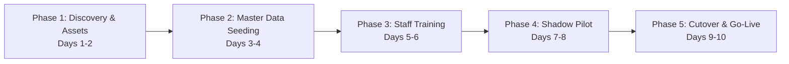

# Smart OPD – Business Model & Clinic Onboarding Plan
## Single-Clinic Outpatient Department Management System

> **Document ID:** 12-Business-Model-Onboarding.md  
> **Version:** 2.0.0 (Master Release)  
> **Status:** Stage A Architectural Baseline – Fully Detailed  
> **Date:** 2026-11-11  
> **Target Audience:** Clinic Practice Owner · Healthcare Business Consultants · Implementation Leads  
> **Commercial Scope:** Dedicated Single-Clinic Deployment Architecture  

---

## 1. Single-Clinic Commercial Strategy & Value Proposition

Smart OPD is architected as an independent, dedicated clinical software product for **one physical clinic practice or polyclinic**. Unlike marketplace aggregators that extract 15–25% booking commissions or recurring per-doctor fees, Smart OPD provides predictable operational expenditure with complete data sovereignty.

### 1.1 Commercial Packaging Options

```
┌────────────────────────────────────────────────────────────────────────┐
│                        COMMERCIAL LICENSING MODELS                     │
├──────────────────────────────────┬─────────────────────────────────────┤
│ Model A: Dedicated Managed Cloud │ Model B: Perpetual License + AMC    │
│ (Recommended for Independent OPD)│ (Preferred by Large Polyclinics)    │
├──────────────────────────────────┼─────────────────────────────────────┤
│ • Flat Monthly Maintenance Fee   │ • One-time upfront software license │
│   (₹ 2,999 – ₹ 4,999 / month)    │   (₹ 45,000 – ₹ 75,000)             │
│ • Includes managed Atlas backup, │ • 18% Annual Maintenance Contract   │
│   cloud hosting, and monitoring  │   (AMC) for security & updates      │
│ • Unlimited doctors, staff, and  │ • Clinic hosts on own cloud or      │
│   patient appointments           │   local server; direct TCO control  │
│ • Zero commission per patient    │ • Zero booking commissions          │
└──────────────────────────────────┴─────────────────────────────────────┘
```

---

## 2. Total Cost of Ownership (TCO) – Monthly Cloud Run-Rate

The entire full-stack architecture is engineered to run on highly cost-efficient modern cloud infrastructure:

```
+-----------------------------------------------------------------------------------------------+
| ESTIMATED MONTHLY CLOUD INFRASTRUCTURE RUN-RATE (AVERAGE OPD CLINIC: 40–80 PTS/DAY)          |
+---------------------+-------------------------------+--------------------+--------------------+
| Component           | Service Provider & Tier       | Allocation Specs   | Est. Cost (INR/mo) |
+---------------------+-------------------------------+--------------------+--------------------+
| Backend API Server  | Render.com (Web Service)      | 512MB RAM / 1 vCPU | ₹ 600 - ₹ 800      |
| Frontend Web Client | Vercel Edge Network (CDN)     | Static SPA / SSL   | ₹ 0 (Hobby/Free)   |
| Database (Mongo)    | MongoDB Atlas (M0 to M2)      | 2GB - 5GB Storage  | ₹ 0 - ₹ 800        |
| Diagnostic Media    | Cloudinary (Free Tier)        | 25GB Bandwidth     | ₹ 0 (Free)         |
| Transactional SMS   | MSG91 / Twilio (DLT Service)  | ~3,000 SMS / month | ₹ 450 - ₹ 600      |
| Transactional Email | SendGrid / Nodemailer SMTP    | ~1,500 Emails / mo | ₹ 0 (Free Tier)    |
| Custom Domain & SSL | Cloudflare DNS + Registrar    | Annual amortized   | ₹ 100              |
+---------------------+-------------------------------+--------------------+--------------------+
| TOTAL ESTIMATED CLOUD INFRASTRUCTURE COST PER MONTH:               | ₹ 1,150 - ₹ 2,300  |
+-----------------------------------------------------------------------------------------------+
```

---

## 3. Clinic Return on Investment (ROI) Financial Model

For a standard Indian private outpatient clinic handling an average of **45 patients per day** (6 days a week = ~1,170 consultations monthly):

1. **Appointment No-Show Reduction**:
   - Industry benchmark no-show rate for Indian private clinics without automated reminders is **22%** (~257 missed visits monthly).
   - Automated 24h SMS/Email reminders and live queue tracking reduce no-shows to **7%** (~82 missed visits).
   - **Net Recovered Consultations**: 175 consultations per month.
   - At a conservative ₹ 500 consultation fee: **₹ 87,500 recovered clinic revenue every month**.
2. **Paper Stationery & Register Elimination**:
   - Paper prescription pads, physical token tokens, registration files, and paper receipt rolls cost ~₹ 4,500/month.
   - Digital e-prescriptions and printable vector receipts eliminate **100% of stationery waste**.
3. **Front-Desk Time Optimization**:
   - Receptionists spend 2–3 hours less per day answering repetitive phone calls regarding doctor availability and waiting times.
4. **Payback Period**: At an initial implementation cost of ₹ 50,000, the platform **pays for itself in less than 3 weeks** through recovered no-show revenue alone.

---

## 4. Comprehensive 5-Phase Clinic Onboarding Plan

The structured rollout spans **10 operational days** to ensure smooth transition from manual registers without halting clinic care:



### Phase 1: Discovery & Master Asset Collection (Days 1–2)
- Execute the discovery protocol (Doc 15) with the Clinic Medical Director.
- Collect clinic branding: High-res PNG logo, physical address, CEA registration certificate, and doctor medical council registration credentials.
- Finalize initial departments, consulting rooms, fee schedules, doctor shift hours, and holiday calendar.
- Determine the clinic's preferred default allocation mode: **Mode A (Auto-Allocation)** vs **Mode B (Patient Choice)**.

### Phase 2: System Provisioning & Master Data Seeding (Days 3–4)
- Deploy dedicated MongoDB Atlas cluster, Render backend, and Vercel edge frontend.
- Configure custom clinic domain (`opd.clinicname.com`) and SSL certificates.
- Execute automated database seeding scripts:
  - Populate `ClinicSetting` master document.
  - Create Admin, Doctor, and Receptionist accounts with temporary secure passwords.
  - Seed WHO/Indian generic drug formulary autocomplete database (~2,500 common medications).
  - Configure SMS DLT Principal Entity ID, headers, and approved templates on MSG91.

### Phase 3: Role-Specific Staff Training Playbooks (Days 5–6)
- **Attending Doctor Training (1.5 Hours)**:
  - Split-screen workspace orientation (EMR history left, prescription right).
  - Fast drug autocomplete, dosage dropdowns, and clinical advice shortcuts.
  - 1-click vector PDF prescription generation and print routing.
  - Queue management: "Call Next ▶", "Skip Token", and "Emergency ⚠️" bump.
- **Receptionist & Cashier Training (2.0 Hours)**:
  - High-speed patient search (`Alt + C` or `⌘K`) and 10-second check-in.
  - Generating and printing physical OPD token slips.
  - Smart doctor auto-allocation console and recording override reason codes.
  - Cashier POS billing: adding procedures, recording UPI QR payments, and printing itemized money receipts.

### Phase 4: Shadow Pilot / Parallel Run (Days 7–8)
- Run Smart OPD in parallel with the clinic's existing paper register for 2 consecutive clinic shifts.
- Receptionists input walk-ins and check-ins into both paper register and Smart OPD.
- Connect the Waiting Room TV to `/display/waiting-room`; test audio chimes and visual token calls.
- Reconcile evening cashier collection totals against the physical cash drawer.

### Phase 5: Official Cutover & Hypercare Go-Live (Days 9–10)
- Retire paper token pads; turn on live waiting room display permanently.
- Send broadcast SMS to existing patient database announcing the new self-service booking portal.
- On-site or dedicated remote hypercare support for the first 3 live operational days.

---

## 5. Legacy Patient Data Migration Strategy

For clinics transitioning from Excel registers or previous legacy software:

```typescript
// Legacy CSV Ingestion Pipeline
interface ILegacyPatientCSV {
  FullName: string;
  Mobile: string;
  Gender: string;
  Age?: string;
  Address?: string;
  BloodGroup?: string;
  Allergies?: string;
}

export async function migrateLegacyPatients(records: ILegacyPatientCSV[], clinicId: string) {
  const sanitized = records.map((row, index) => {
    // 1. Clean and normalize mobile number (strip +91, spaces, dashes)
    const phone = row.Mobile.replace(/\D/g, '').slice(-10);
    
    // 2. Format sequential legacy UHID: OPD-LEG-XXXXX
    const uhid = `OPD-LEG-${String(index + 1).padStart(5, '0')}`;
    
    return {
      clinicId,
      uhid,
      fullName: row.FullName.trim(),
      phone,
      gender: ['MALE', 'FEMALE', 'OTHER'].includes(row.Gender?.toUpperCase()) 
        ? row.Gender.toUpperCase() 
        : 'OTHER',
      age: parseInt(row.Age || '0', 10) || undefined,
      bloodGroup: row.BloodGroup || undefined,
      allergies: row.Allergies ? row.Allergies.split(',').map(s => s.trim()) : [],
      consentGiven: true,
      consentDate: new Date()
    };
  });

  // 3. Bulk write ignoring duplicates on phone
  await Patient.insertMany(sanitized, { ordered: false });
}
```

---

## 6. Practical Recommendations, Risks & Acceptance Criteria

### 6.1 Recommendations
1. **Never Enforce Mandatory Advance Online Payments in Phase 1**: Over 70% of Indian OPD patients prefer paying cash or UPI at the clinic counter upon arrival. Keep online booking free with pay-at-clinic settlement initially.
2. **Train Super-Users**: Designate one senior receptionist as the primary clinic champion to resolve junior staff queries during peak morning rush.

### 6.2 Key Risks & Mitigations
- **Risk 1: Peak Hour Internet Outage**: A broadband disconnection halts check-in.
  - *Mitigation*: Ensure receptionist desktop is tethered to a secondary 4G/5G mobile hotspot backup; frontend preserves unsaved form state in `sessionStorage`.
- **Risk 2: Patient Token Skipping Friction**: Patient stepped out of waiting room when token was chimed.
  - *Mitigation*: The doctor clicks "Skip Token", allowing the queue to proceed. When the patient returns, the receptionist recalls the token to `CALLED` with 1 click.

### 6.3 Acceptance Criteria
- [x] Clear commercial pricing models tailored for single-clinic deployment.
- [x] Itemized Monthly Total Cost of Ownership (TCO) breakdown under ₹ 2,500/month.
- [x] Verifiable ROI calculation based on Indian private clinic benchmarks.
- [x] Structured 5-phase onboarding schedule spanning 10 operational days.
- [x] Automated legacy patient data migration pipeline.
