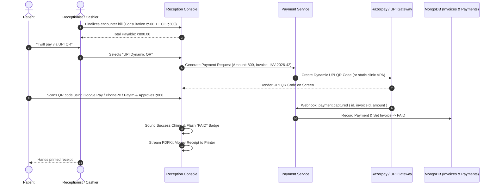

# Smart OPD – Notification & Integration Strategy
## Single-Clinic Outpatient Department Management System

> **Document ID:** 13-Notification-Integration-Strategy.md  
> **Version:** 2.0.0 (Master Release)  
> **Status:** Stage A Architectural Baseline – Fully Detailed  
> **Date:** 2026-11-11  
> **Channels Supported:** Transactional SMS (TRAI DLT Compliant) · HTML Email · In-App WebSocket Alerts · WhatsApp Webhooks · Payment Integrations (UPI QR / Razorpay)  
> **Primary Providers:** MSG91 / Twilio (SMS) · SendGrid / Nodemailer (Email) · Socket.IO v4 (In-App) · NPCI UPI (Payments)  

---

## 1. Multi-Channel Notification Architecture

The notification engine ensures patients and clinical staff receive real-time updates across multiple touchpoints without blocking user HTTP threads:

```
                      ┌──────────────────────────────────────────────┐
                      │              Clinical Action                 │
                      │  (Booking, Check-In, Token Call, Rx Ready)   │
                      └──────────────────────┬───────────────────────┘
                                             │
                                             ▼
                      ┌──────────────────────────────────────────────┐
                      │          Event Dispatcher Service            │
                      │          (EventEmitter / Pub-Sub)            │
                      └──────────────┬───────────────────────────────┘
                                     │
           ┌─────────────────────────┼─────────────────────────┐
           ▼                         ▼                         ▼
┌────────────────────┐    ┌────────────────────┐    ┌────────────────────┐
│   In-App Engine    │    │    Email Engine    │    │     SMS Engine     │
│ (Socket.IO + Mongo)│    │ (SendGrid / SMTP)  │    │ (MSG91 DLT/Twilio) │
└──────────┬─────────┘    └──────────┬─────────┘    └──────────┬─────────┘
           │                         │                         │
           ▼                         ▼                         ▼
┌────────────────────┐    ┌────────────────────┐    ┌────────────────────┐
│ Staff/Pt Dashboard │    │ Patient/Doc Inbox  │    │ Mobile Phone (GSM) │
└────────────────────┘    └────────────────────┘    └────────────────────┘
```

---

## 2. Indian Telecom Regulatory Authority (TRAI) DLT Compliance

Under Indian telecommunications law, all commercial bulk SMS messages must be registered on a Telecom Distributed Ledger Technology (DLT) platform (e.g., Vilpower, Jio DLT, Airtel DLT).

### 2.1 Mandatory DLT Registration Metadata
- **Principal Entity (PE) ID**: Unique registration ID of {{CLINIC_NAME}} (provided upon entity KYC).
- **Sender Header (6 Characters)**: e.g., `SMROPD`, `CLNCOP`.
- **Message Classification**: Service Implicit (Transactional) — exempt from National Do Not Disturb (DND) filtering.

### 2.2 Approved DLT SMS Templates & Merge Fields

#### Template 1: Appointment Confirmation (`APPT_CONFIRMED`)
- **DLT Template ID**: `1107168923450012`
```
Dear {#var#}, your appointment with Dr. {#var#} at {#var#} is confirmed for {#var#} at {#var#}. Ref: #{#var#}. Please arrive 15 mins early for OPD token check-in. - {#var#}
```

#### Template 2: OPD Token Issued at Check-In (`CHECKIN_TOKEN_ISSUED`)
- **DLT Template ID**: `1107168923450013`
```
Welcome to {#var#}. Your OPD Token is #{#var#} for Dr. {#var#}. Est. wait: ~{#var#} mins. View live queue on your phone: {#var#} - {#var#}
```

#### Template 3: Urgent Token Call Alert (`QUEUE_NEXT_CALLED`)
- **DLT Template ID**: `1107168923450014`
```
ALERT: Dr. {#var#} is ready to see you now in Room #{#var#}. Token #{#var#}. Please proceed immediately to the consultation room. - {#var#}
```

#### Template 4: Follow-up Reminder (`FOLLOWUP_REMINDER`)
- **DLT Template ID**: `1107168923450015`
```
Dear {#var#}, reminder for your recommended follow-up visit with Dr. {#var#} at {#var#} due on {#var#}. Book online at {#var#} - {#var#}
```

#### Template 5: Doctor Leave Cancellation (`DOCTOR_LEAVE_NOTICE`)
- **DLT Template ID**: `1107168923450016`
```
URGENT: Dr. {#var#} is unavailable on {#var#}. Your appointment #{#var#} at {#var#} requires rescheduling. Reschedule with priority here: {#var#} - {#var#}
```

---

## 3. Email Notification Specifications

- **Design System**: Medical deep navy (`#1e2d4a`), clinical blue (`#3b6fce`), slate backgrounds (`#f8fafc`).
- **Standard Header**: Clinic Logo, Name, Address, and Emergency Contact Hotline.
- **Delivery Standard**: Asynchronous background queuing via Node.js worker; zero blocking of user HTTP threads.

### 3.1 Digital Prescription Email Delivery
When a doctor finalizes a prescription:
1. Backend generates official vector PDF via PDFKit.
2. Email engine composes message with direct secure download link (`https://{{CLINIC_DOMAIN}}/portal/prescriptions/:id`).
3. Dispatches email within **10 seconds** of doctor clicking "Finish Encounter".

---

## 4. Payment Integrations Architecture (UPI QR & POS)

In Indian outpatient clinics, cashier workflows must support fast payment settlement:



---

## 5. In-App Notification Store & WebSockets

### 5.1 Schema Definition (`notifications` collection)
```typescript
export interface INotification extends Document {
  clinicId: mongoose.Types.ObjectId;
  recipientUserId: mongoose.Types.ObjectId;
  type: 'APPOINTMENT' | 'QUEUE' | 'PRESCRIPTION' | 'BILLING' | 'SYSTEM';
  title: string;
  message: string;
  actionUrl?: string;
  isRead: boolean;
  createdAt: Date;
}
```

### 5.2 Real-Time Emission Pattern
```typescript
io.to(`user:${recipientUserId}`).emit('notification:new', {
  id: notification._id,
  type: notification.type,
  title: notification.title,
  message: notification.message,
  actionUrl: notification.actionUrl,
  createdAt: notification.createdAt
});
```

---

## 6. Rate Limiting, Retries & Fallback Strategy

1. **Anti-Spam Throttling**: A patient can trigger at most 1 SMS OTP or booking confirmation per 2 minutes.
2. **Exponential Backoff**: If an SMS gateway returns a transient HTTP 5xx error, the dispatcher retries at 1 minute, 5 minutes, and 15 minutes.
3. **Delivery Logging**: Every dispatch attempt is logged to the database with gateway message ID and delivery status (`SENT`, `DELIVERED`, `FAILED`).

---

## 7. Practical Recommendations, Risks & Acceptance Criteria

### 7.1 Recommendations
1. **Prioritize Static UPI QR for Small Clinics**: If the clinic lacks a payment aggregator account, deploy a static verified UPI VPA (`clinic@okaxis`) QR card at reception, where receptionists manually input the 12-digit UTR transaction reference upon verifying the alert on their phone.
2. **Register All 5 DLT Templates Upfront**: DLT approval takes 2–4 business days; submit templates during Stage A to prevent go-live delays.

### 7.2 Key Risks & Mitigations
- **Risk 1: SMS Delivery Latency**: Telecom network congestion delays SMS delivery during morning peak hours.
  - *Mitigation*: The waiting room TV display and patient web portal provide real-time visual token cues; SMS is a supplementary reminder rather than a single point of failure.
- **Risk 2: DLT Variable Mismatch**: A template variable containing unexpected characters gets rejected by telecom gateways.
  - *Mitigation*: Strictly sanitize all template variables before passing to SMS gateway (strip special characters, truncate names to 30 chars).

### 7.3 Acceptance Criteria
- [x] Complete DLT SMS templates adhering to 160-character TRAI standards.
- [x] Dual-channel delivery: SMS + HTML Email + Socket.IO in-app.
- [x] Cashier payment architecture supporting Cash, Static UPI QR, and Dynamic Gateway.
- [x] Exponential backoff retry mechanism with delivery logging.
