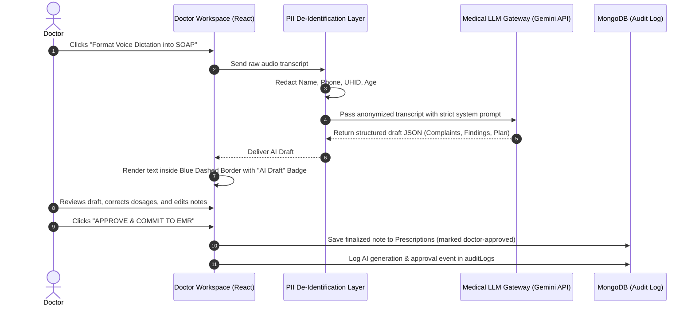

# Smart OPD – Clinical AI Governance & Validation Framework
## Single-Clinic Outpatient Department Management System

> **Document ID:** 15-AI-Governance-Validation.md  
> **Version:** 2.0.0 (Master Release)  
> **Status:** Stage A Architectural Baseline – Fully Detailed  
> **Date:** 2026-11-11  
> **Clinical Safety Principle:** Strictly Non-Autonomous Advisory · Mandatory Human-in-the-Loop (HITL)  
> **Compliance Alignment:** WHO Guidance on AI for Health · Indian DPDP Act 2023 · NMC Medical Ethics Regulations  

---

## 1. Cardinal Ethical Principles & Clinical Safety

AI capabilities within Smart OPD are engineered strictly as an **administrative assistant and cognitive co-pilot** for the registered medical practitioner.

```
┌────────────────────────────────────────────────────────────────────────┐
│                        CARDINAL CLINICAL AI RULES                      │
├────────────────────────────────────────────────────────────────────────┤
│ 1. ZERO AUTONOMOUS DIAGNOSIS: The AI shall never independently diagnose│
│    a disease, assign an ICD-10 code, or declare a clinical outcome.    │
│ 2. ZERO AUTONOMOUS PRESCRIBING: The AI shall never independently issue,│
│    modify, or sign a medical prescription or drug dosage.              │
│ 3. MANDATORY HUMAN-IN-THE-LOOP: Every AI-generated draft must be       │
│    reviewed, edited, and approved by a licensed doctor before entering │
│    the official medical record.                                        │
│ 4. STRICT PII REDACTION: No patient identifying information (Name,     │
│    Phone, UHID, Address) shall ever be passed to an external LLM API.  │
└────────────────────────────────────────────────────────────────────────┘
```

---

## 2. Permitted AI Use Cases & Prohibited Actions

```
+-----------------------------------------------------------------------------------------------+
| PERMITTED VS PROHIBITED AI CAPABILITIES MATRIX                                                |
+---------------------+-------------------------------+-----------------------------------------+
| Category            | Permitted Capability          | Prohibited Action                       |
+---------------------+-------------------------------+-----------------------------------------+
| Patient Intake      | Structuring raw patient-typed | Predicting disease risk or triaging     |
|                     | complaints into clinical tags.| away urgent emergency cases.            |
| Doctor Workspace    | Transcribing doctor audio into| Autonomously selecting prescription     |
|                     | structured SOAP notes.        | drugs, dosages, or administration route.|
| Medical History     | Summarizing 5 past visits into| Inferring unrecorded diagnoses or       |
|                     | a concise 3-bullet briefing.  | altering historical laboratory values.  |
| Patient Education   | Translating doctor advice into| Formulating independent medical         |
|                     | plain-language Hindi summary. | treatment advice without doctor source. |
+---------------------+-------------------------------+-----------------------------------------+
```

---

## 3. Human-in-the-Loop (HITL) Workflow & UI Safeguards

When a doctor invokes an optional AI assistance feature (e.g., "Summarize Patient EMR" or "Format Dictation"):



### 3.1 Visual UI Safeguards in Doctor Console
- **Distinct Visual Style**: Any field populated by AI is rendered with a distinct **light-blue background and dashed border** (`border-blue-400 bg-blue-50/50`).
- **Explicit Approve Button**: The form disables final sign-off until the doctor explicitly clicks **"Accept & Insert"** or manually edits the text box.
- **Diff Tracking**: The system tracks whether the doctor accepted the draft verbatim or made modifications.

---

## 4. Privacy, De-Identification & DPDP Alignment

To guarantee total patient privacy under the Indian DPDP Act 2023:
1. **De-Identification Proxy**: Before any payload is transmitted to the AI provider, the backend passes the payload through a regex-based de-identification sanitizer:
   ```typescript
   export function anonymizeClinicalPayload(payload: any): any {
     const sanitized = { ...payload };
     delete sanitized.patientName;
     delete sanitized.phone;
     delete sanitized.email;
     delete sanitized.address;
     delete sanitized.uhid;
     // Replace with ephemeral token
     sanitized.patientToken = 'PATIENT_ANON_TOKEN';
     return sanitized;
   }
   ```
2. **Zero Model Training Retention**: API enterprise agreements with cloud LLM providers (e.g., Google Cloud Vertex AI / Enterprise Gemini) strictly enforce that prompt and completion data are never logged, inspected, or utilized for foundational model retraining.

---

## 5. Medico-Legal Accountability & Audit Trails

Every AI interaction produces an immutable entry in `auditLogs`:
```json
{
  "action": "AI_SOAP_SUMMARY_GENERATED",
  "actorUserId": "6731ecb01234567890doc001",
  "actorRole": "DOCTOR",
  "targetResourceId": "6731ecb0aaaaaaaaaaaa0001",
  "details": {
    "feature": "DICTATION_TO_SOAP",
    "promptTokens": 142,
    "completionTokens": 88,
    "doctorEditedBeforeSave": true,
    "doctorAcceptedAt": "2026-11-12T10:24:15Z"
  },
  "timestamp": "2026-11-12T10:24:15Z"
}
```

The treating physician remains **100% legally and clinically responsible** for all medical advice, prescriptions, and diagnoses recorded in Smart OPD.

---

## 6. Practical Recommendations, Risks & Acceptance Criteria

### 6.1 Recommendations
1. **Keep AI Opt-In**: Doctors who prefer manual typing or direct templates should be able to disable AI features entirely in their user preferences.
2. **Constrain Prompts to Valid Clinical Dictionaries**: Ground LLM symptom formatting strictly against standard ICD-10 and WHO terminologies to eliminate hallucinations.

### 6.2 Key Risks & Mitigations
- **Risk 1: LLM Hallucination of Drug Dosages**: An AI note formatting tool suggests a hazardous medication dosage.
  - *Mitigation*: The AI formatting tool is strictly prohibited from populating the active prescription medication table; the doctor must manually select drugs from the verified clinic formulary.
- **Risk 2: Network Latency on External AI Calls**: Slow cloud LLM response blocks doctor workflow.
  - *Mitigation*: Set a strict 4-second timeout on AI inference calls; if exceeded, fail silently and allow the doctor to proceed with direct manual typing.

### 6.3 Acceptance Criteria
- [x] Strict prohibition against autonomous diagnosis and autonomous prescribing.
- [x] Mandatory Human-in-the-Loop (HITL) doctor review and approval for every AI output.
- [x] Client-side visual distinction (dashed border & badge) for AI-generated text.
- [x] Complete PII de-identification proxy stripping all patient identifiers.
- [x] Immutable audit logging capturing AI generation, doctor edits, and final approval timestamp.
